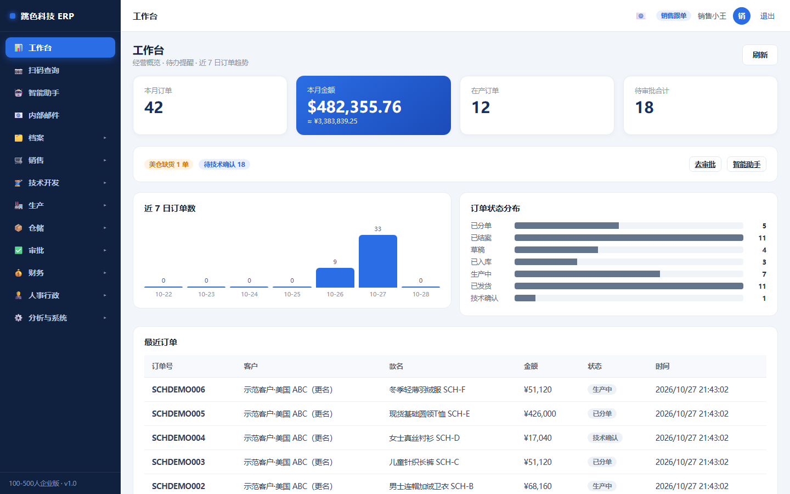
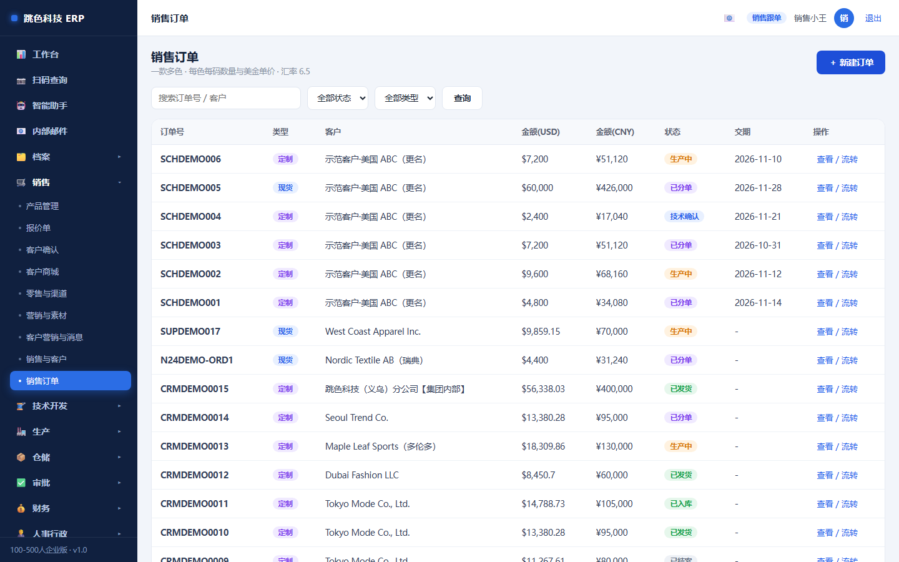
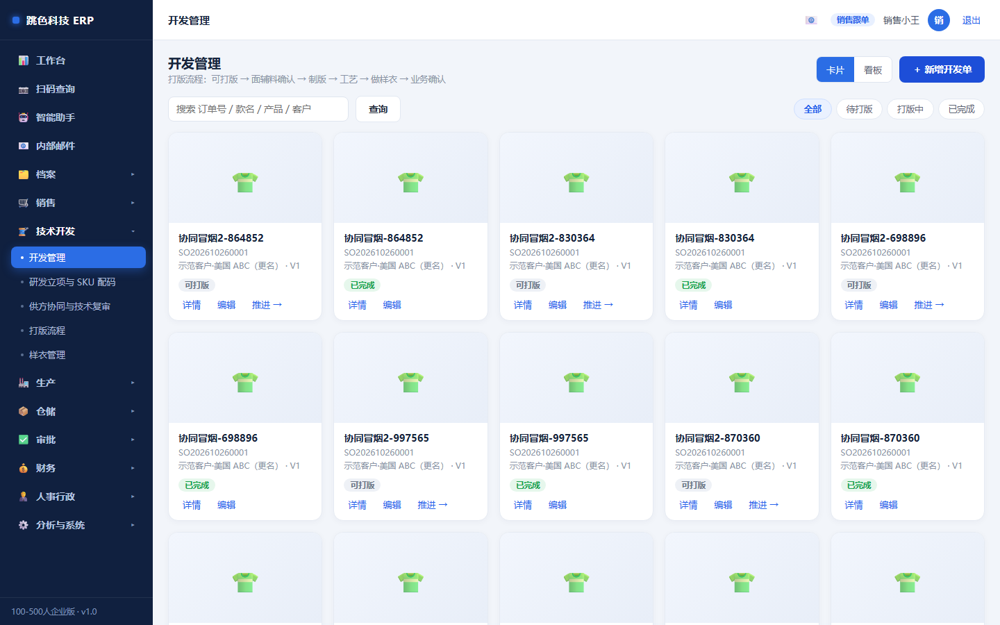
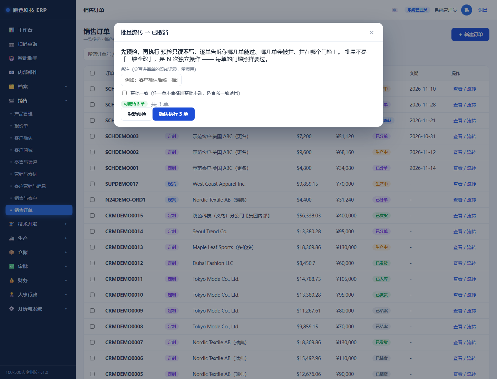
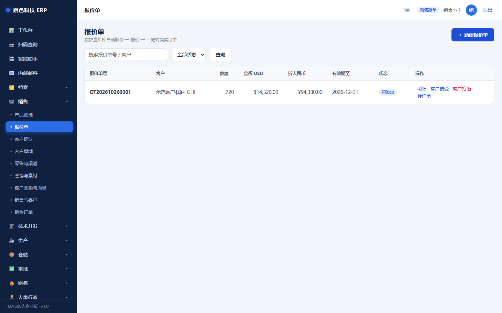
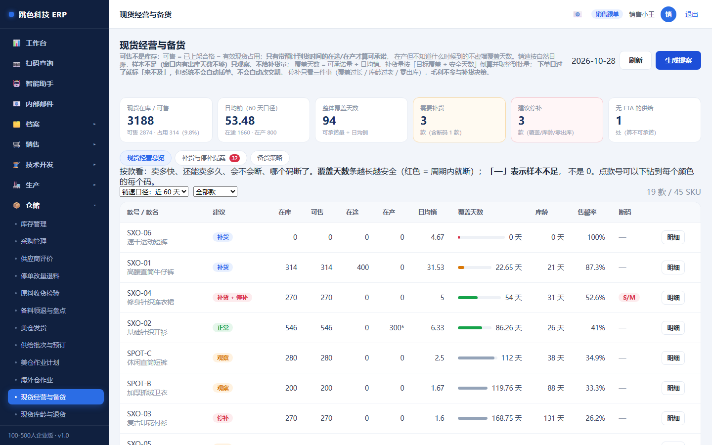
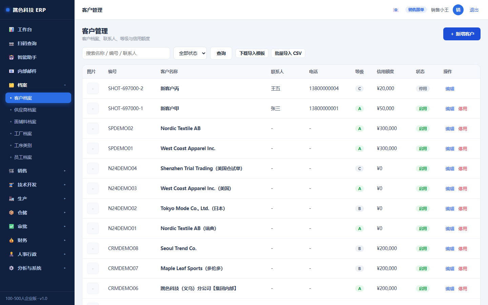

# 01 · 销售跟单培训手册

> 适用岗位：销售 / 跟单员
> 系统权限：`sales`
> 你在系统里的职责：**接单、报价、客户维护、发起开发单、现货补货提案、跟到交期**

---

## 一、你的界面

登录后你看到的是这样（左侧只有你用得上的菜单，看不到的说明不归你管）：

**每天上班第一件事**：看工作台顶部的三个数

| 指标 | 含义 | 什么时候要管 |
|---|---|---|
| 本月金额 | 本月接单总额（美元 + 折人民币） | 看目标进度 |
| 在产订单 | 已经进车间的单 | 判断交期压力 |
| 待审批合计 | 卡在评审/技术/财务的单 | **有数就要催**，这是你的单在等人 |

下面的「近 7 日订单数」和「订单状态分布」用来看节奏：如果「草稿」堆得多，说明单子建了没往下推。

---

## 二、一天的节奏

| 时间 | 做什么 | 在哪 |
|---|---|---|
| 上班 | 看工作台：待确认、逾期交期 | 工作台 |
| 上午 | 处理客户询价 → 出报价单 | 报价单 |
| 上午 | 把已确认的报价转成订单 | 报价单 → 转订单 |
| 下午 | 催卡住的单（评审 / 技术 / 财务） | 销售订单（按状态筛） |
| 随时 | 客户资料有变就改客户档案 | 客户管理 |
| 每周 | 看现货款是否需要补货 | 现货经营 |

---

## 三、接单六步（每步都有门槛）

### 第 1 步：建订单

点「＋ 新建订单」，填这些：

| 字段 | 注意 |
|---|---|
| 订单类型 | **定制**要打样，走开发单；**现货**直接生产。选错会卡在后面 |
| 客户 | 客户档案里的信用额度会在这里校验 |
| 款名 / 客户订单号 / 店铺名称 | 客户订单号用来跟客户对账，别空缺 |
| 跟单员 | 默认是你，可以改 |
| 交期 | **这是后面的承诺交期基线**，不确定就先填大概，评审时再定 |
| 交货方式 / 贸易条款 / 包装要求 | 会打到装箱单和发货单上 |
| 汇率 | 默认取系统设置里的汇率，下单时**快照**进订单（以后汇率变了不影响这单） |

然后加「款」：款号 → SKU → 颜色 → 尺码 → 单价（美元）。
有尺码模板的可以一键「套用尺码模板」，不用一个个敲。

> 建好是 **草稿** 状态，草稿可以随便改。

### 第 2 步：接单评审（进技术确认的前提）

⚠️ **这是第一个硬门槛**。不做评审，点「技术确认」会被拒，提示：

> 接单评审未完成：还没有接单评审记录。请到「生产 → 接单评审与交期」确认前端裁床、后端缝制、物料齐套三项并给出承诺交期后再做技术确认

要到「生产 → 接单评审与交期」把三项都确认：

| 三项 | 谁来确认 | 确认什么 |
|---|---|---|
| 前端裁床 | 生产 | 裁床档期够不够，能不能在交期前裁完 |
| 后端缝制 | 生产 | 车缝产能够不够 |
| 物料齐套 | 仓库/采购 | 面料辅料能不能按时到 |

三项全过 + 给出承诺交期 → 评审状态变「已通过」。

### 第 3 步：开发单确认（定制单必须，现货单也要）

技术部要在这张开发单里填：面辅料（从材料库勾选）、工艺明细、客户要求、尺码规格。

**定制单还要走完打版流程**（面辅料确认 → 制版 → 工艺明细 → 车板 → 业务确认 → 工价核价），流程没走完不能技术确认。

> 「业务确认」这一环是**你做**的：样衣做出来、客户看过、你确认可以，才能往下走。

### 第 4 步：技术确认 → 财务审核

你点「技术确认」后，订单状态从 **草稿** 变成 **技术确认**，然后交给财务核成本。

> 财务审核通过前，**分单按钮只有财务能点**。你只能催。

### 第 5 步：财务通过 → 分单 → 生产

财务审核通过后，订单变成「已分单」，自动进车间。这时候会**自动生成 13 道工序**（备料 / 排版算料 / 裁剪 / 车缝 / 锁眼钉扣 / 整烫 / 水洗 / 印花 / 绣花 / 检验 / 包装 / 成品入库 / 出库发运）。

### 第 6 步：跟交期（你的日常工作）

订单进了车间以后，你要盯的是：

- 工作台的「在产订单」
- 「生产 → 生产管理」里这单的工序进度
- 如果看到**逾期**（计划完成日已过还没完成），先问生产主管卡在哪，再决定要不要跟客户打招呼

⚠️ **不要自己改交期糊过去**。改交期要走「客户确认」里的变更流程，留下客户同意的记录。

### 一次处理很多单：批量流转

月底财务审完一批单要一起分单，或者客户确认后要统一推进 —— 不用一张张点进去。

1. 列表左边勾选（**表头那个框是全选本页，不是全库**）
2. 下方出现「已选 N 单」，选目标状态 → 点「批量流转」
3. 弹窗里先点「**开始预检**」—— 预检只读不写，逐单告诉你：
   - 绿色「可流转 N 单」：这些点了才会动
   - 红色「被拦 M 单」：每单都写清拦在哪个门槛上（「接单评审未完成」「开发单尚未确认」「还有未收金额 X 元」…）
4. 看清楚再点「**确认执行 N 单**」

**三条要知道的**：

- **批量不等于放宽条件**。每一单的门槛照样要过（接单评审、开发单、打版流程、成本审核、应收未清不许结案），
  批量只是把「点 30 次」变成「点 3 次」，不会让不合格的单混过去。
- **被拦的单不会被动**，也不会被静默跳过 —— 它们列在表里，照着原因去补。
- 每次批量有一个**批次号**（形如 `BAT20261028-104233`），写进每单的流转记录。
  事后有人问「这几单怎么一起变了」，按批次号能查出来是谁、什么时候、动了哪几单。

> **什么时候勾「整批一致」**：当这批单必须同进同退时（一整套要一起投产、一起结案）。
> 只要有一单不合格，整批都不动，而且会把所有不合格的原因一次列全 —— 不用来回试。

---

## 四、报价单怎么用

报价单是**给客户看的价钱**，和订单是两张单。流程：

1. 新建报价单 → 填客户、款、数量、单价、外发标记
2. 报价单里能填成本参考（`FOB`、`外发`、`洗水`、`裁剪` 四个标记决定成本口径）
3. 客户接受后点「转订单」→ 自动带出订单草稿，不用重敲

> 为什么要分开：客户经常改数量改价，报价单可以多版并存；订单是承诺，建了就要往下走。

---

## 五、现货补货提案

现货款卖得动要补、卖不动要停，系统按销售速度算建议，但**批准不等于自动下单**：

- 系统给建议补货量 = 日均销 ×（目标覆盖天数 + 安全天数）− 可承诺量
- **样本不足**（窗口内出库天数不够）只给「观察」，不给数量 —— 别硬补
- 你点「批准」只记批准数量，**不会自动生成采购单或生产单**，要另走下单

---

## 六、客户管理

- **信用额度**：下单时会校验，超了要财务批
- **客户归属**：改归属会影响客户对应的销售
- **删客户要谨慎**：有订单的客户删不掉（系统会拦），这是保护

> 客户商城的子账号在「客户商城」里授权，不在这一页。授权有 6 个权限点，其中「看财务数据」默认关闭，不要随便开。

---

## 七、客户要验货报告怎么办

客户（或第三方验货行）来要验货报告时，不要自己去拼 Word、截图、拼照片 —— 系统里直接出：

1. 打开那张订单 → 右上「**验货报告**」
2. 先看**实时预览**：照片齐不齐、结论是不是最新那张验货单
3. 点「**生成报告**」拿到编号（`JH` + 日期 + 序号）
4. 点「**打印 / 另存为 PDF**」，在打印对话框里选「另存为 PDF」→ 发给客户

| 注意 | 说明 |
|---|---|
| 报告是**快照** | 生成后就定住了。之后工厂再补照片、再报工，客户手里那份不会变 |
| 可以出多版 | 客户要「补拍后的新版本」就再生成一次，版本递增，旧的仍可查 |
| **不能替客户下结论** | 结论只来自验货单。这单还没验货，报告上就写「未验货」，不会写成合格 |

> 报告上有签字栏。客户签回后拍照存到订单附件里，出事时这是最硬的一份东西。

---

## 八、为什么有些按钮点不了（对照表）

| 你想做的 | 提示 / 现象 | 真正原因 | 怎么解决 |
|---|---|---|---|
| 点「技术确认」 | 接单评审未完成 | 三项评审没做完或没过 | 去「接单评审与交期」补齐 |
| 点「技术确认」 | 开发单尚未确认 | 技术包没确认 | 找技术部 |
| 点「技术确认」 | 打版流程尚未完成，剩余：xxx | 定制单打版没走完 | 找技术部，或看「业务确认」是不是你没做 |
| 点「分单」 | 403 无权限 | 分单只有财务能点 | 催财务，别借号 |
| 点「结案」 | 还有未收金额 xxx 元 | 客户钱没收到 | 找财务催款；确需先结案要写原因 |
| 看不到「导出 Excel」 | 按钮没出现 | 你的导出权限被按岗位收回了 | 找主管申请，或让有权限的人导 |

---

## 九、常见问题

**Q：客户改数量了，改订单还是新建？**
还没进车间的改订单；已进车间的不能改量，走「停单改量退料」流程（找仓库/采购）。

**Q：订单能退回去改吗？**
能，但只能往回退一步，并且要看下游有没有产生副作用：
- 已入库的退回生产 → 系统会先把这单的入库冲销掉（货已经发走就退不了）
- 已发货/已结案 → **不能退**，走退货流程

**Q：为什么我改了汇率，老订单金额没变？**
汇率是下单时的快照，改了只影响新单。老订单要保持当时的账，不然对不上客户和财务。

**Q：客户问「我的单到哪了」怎么答？**
打开订单详情，看状态 + 工序进度。状态对应：

| 状态 | 客户能听懂的说明 |
|---|---|
| 草稿 | 单子建了，还在确认细节 |
| 技术确认 | 在做技术资料（面辅料/工艺） |
| 财务审核 | 在核成本、核价 |
| 已分单 | 已安排生产 |
| 生产中 | 车间在做（可以报工序进度） |
| 已入库 | 做完了，在仓库 |
| 已发货 | 已发出（发货单上有运单号） |
| 已结案 | 单子结束 |

**Q：我把单建错了能删吗？**
草稿可以删。已经往下走的不能删，只能「取消」（要有原因），让记录留着。
