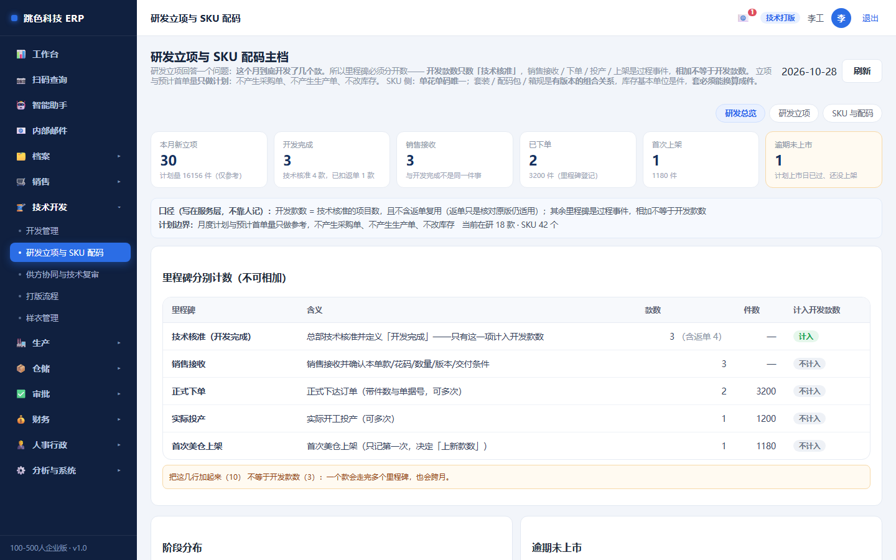
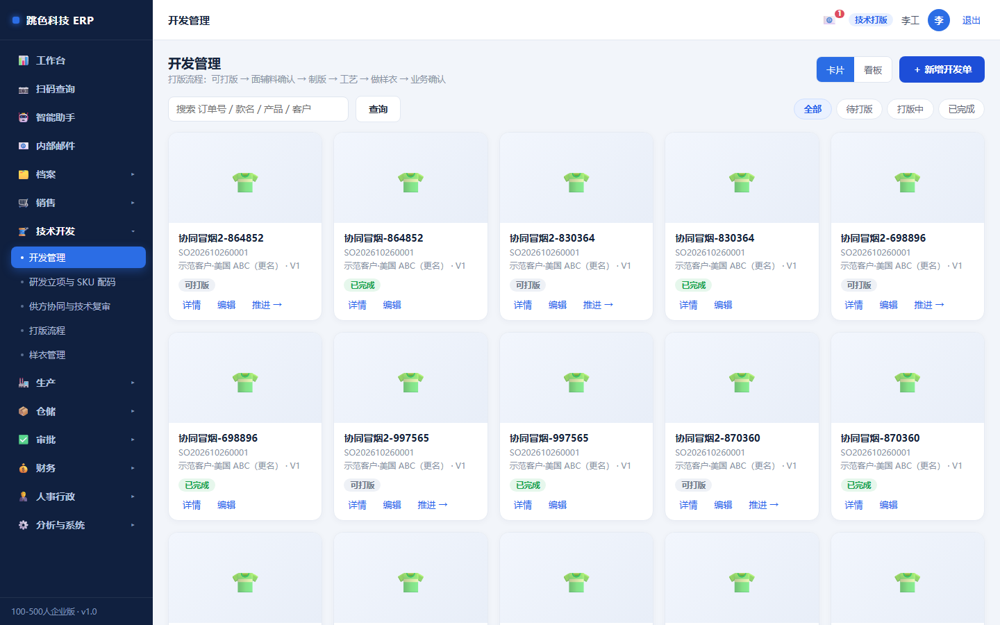
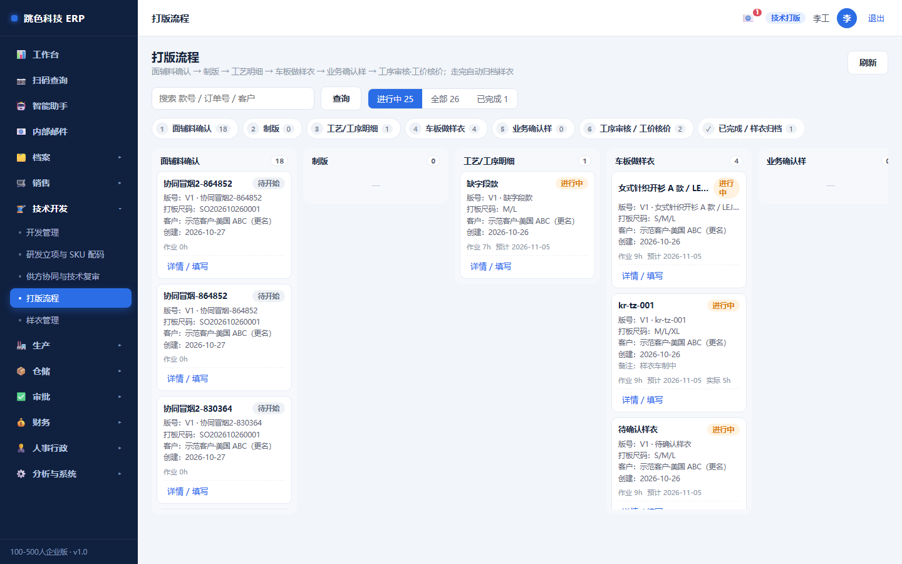
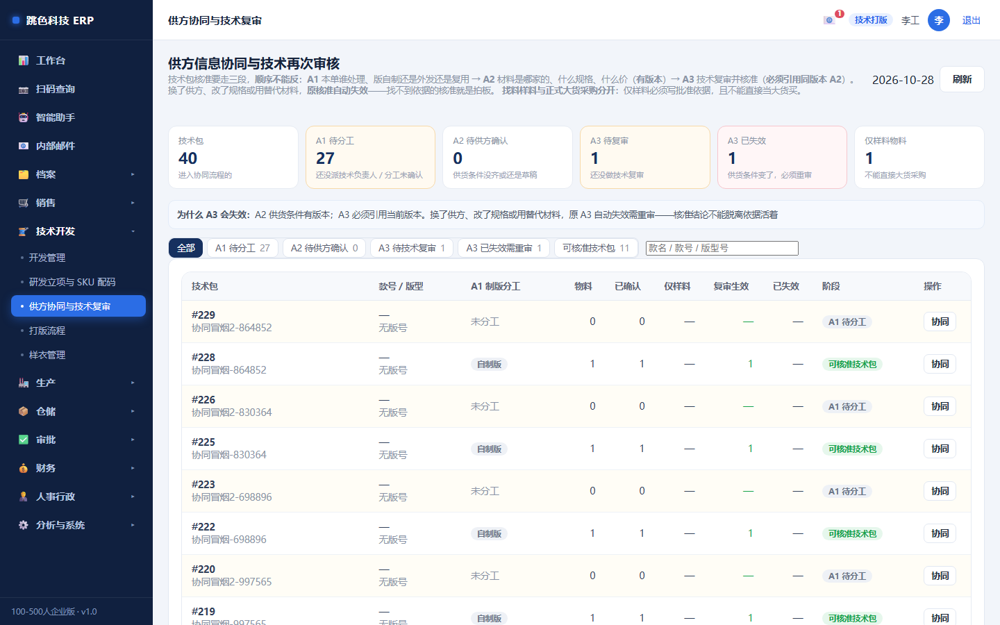
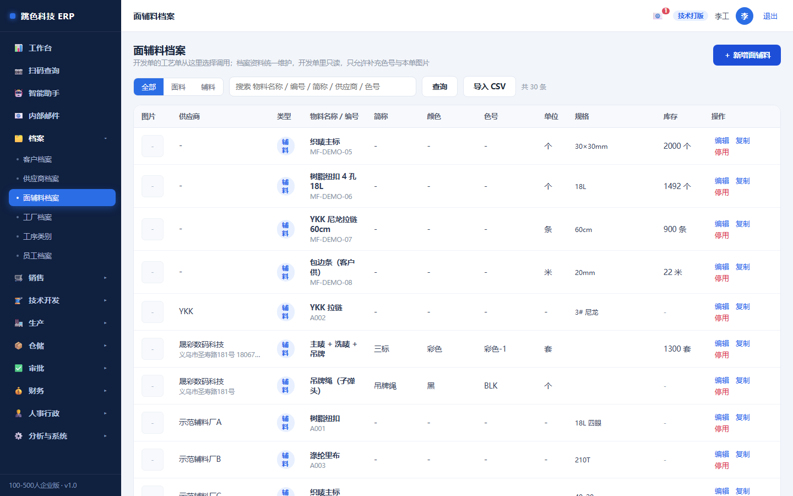

# 02 · 技术打版培训手册

> 适用岗位：技术 / 打版 / 工艺
> 系统权限：`tech`
> 你在系统里的职责：**开发单（技术包）、工艺与面辅料、打版流程、供方技术复审、研发立项**

---

## 一、你的界面



技术部是**订单能不能进车间的第一道门**：技术确认不通过，销售的单子动不了；技术包没核准，批量生产就是靠猜。

---

## 二、一天的节奏

| 时间 | 做什么 | 在哪 |
|---|---|---|
| 上班 | 看哪些开发单待确认、哪些打版阶段停着 | 工作台 / 开发管理 |
| 上午 | 补技术包：面辅料、工艺、客户要求、尺码规格 | 开发管理 |
| 上午 | 供方确认还没回来的，催供方（A2） | 供方协同与复审 |
| 下午 | 打版流程推进：制版 → 工艺 → 车板 | 打版流程看板 |
| 随时 | 新材料建档（面料/辅料） | 面辅料档案 |
| 每周 | 研发立项里程碑登记 | 研发立项 |

---

## 三、技术包（开发管理）



一张开发单 = 一款的技术资料。必须填全这四块，否则确认不了：

| 内容 | 从哪来 | 注意 |
|---|---|---|
| **面辅料** | 从「面辅料档案」勾选 | 勾选的是主数据，改了主数据会影响所有用它的单 |
| **工艺明细** | 手工填 | 倍率 / FOB / 外发 / 洗水 / 裁剪 四个标记决定成本怎么算 |
| **客户要求** | 客户给 | 客户特殊要求写清楚，车间按这个做 |
| **尺码规格** | 尺码模板或手填 | 决定裁床与配码 |

**定制单**还必须走完打版流程六步：

```
面辅料确认 → 制版 → 工艺明细 → 车板 → 业务确认 → 工价核价
```

任何一步没 done，销售点「技术确认」会被拒，提示里会列出剩余哪几步。

> **「业务确认」是销售点的**，不是你。样衣做好、客户看过、销售确认，才能进工价核价。

### 打版流程看板



看板按阶段列卡片，停留时间长的（超过预期）会标出来 —— 这是找瓶颈用的。

---

## 四、供方协同与复审（A1 → A2 → A3）



这张单能不能投产，取决于材料**有没有经过确认**。流程分三段，**顺序不能反**：

| 段 | 做什么 | 硬规则 |
|---|---|---|
| **A1 分工** | 本单谁处理、版自制/外发/复用 | **复用原版必须指向已核准的技术包**（复用一份没核准的版 = 跳过技术审核） |
| **A2 供方确认** | 材料哪家的、什么规格、什么价 | **A1 没确认不许做 A2**；**同物料只能有一版生效**；**没单价不许确认** |
| **A3 技术复审** | 引用当前版 A2，给结论 | **必须引用当前版本的 A2**；引用已作废版本直接拒 |

### 最容易出错的一条

**A2 一改，原来的 A3 就自动失效。**

只要供货条件变了（换供方 / 改规格 / 用替代材料），系统会给 A2 出新版本、把旧版作废，
同时把引用旧版的 A3 标成「失效」，并且**失效期间不许核准技术包**。

这是故意的：核准结论不能脱离依据活着。原来的材料换成另一家的了，凭什么还用原来的核准结论？

> 遇到「技术包核准不了，提示有失效的复审」，去 A3 重新做一次复审，别去找管理员。

---

## 五、面辅料档案



- 材料分**面料 / 辅料**两类，编码要唯一
- 库存数量在这里能看到，但**不要在这一页直接改库存** —— 库存只能通过收货、领料、退料、盘点来动
- 存档用的色卡、样布照片可以挂在这里

---

## 六、研发立项（里程碑各算各的）


研发立项回答一个具体问题：**这个月到底开发了几个款**。

所以里程碑是**五个独立事件，各自计数，绝不相加**：

| 里程碑 | 什么时候登记 | 谁登记 |
|---|---|---|
| 技术核准 | 技术资料完成、样衣编号有了 | 技术 |
| 销售接收 | 销售确认要这个款 | 销售 |
| 正式下单 | 客户下单了 | 销售 |
| 实际投产 | 车间开工 | 生产 |
| 首次上架 | 第一次在美仓上架 | 运营 |

**顺序不能反**：前一个没发生，后一个登记不了。

两条关键口径：
- **开发款数只数「技术核准」的项目数，而且不含返单** —— 返单只是核对原版仍适用，算进去每月开发款数就被撑大了
- **技术核准必须有样衣编号** —— 没样衣就核准，等于核准了一张图纸

---

## 七、为什么有些按钮点不了

| 现象 | 原因 | 解决 |
|---|---|---|
| 销售说确认不了，提示「打版流程未完成」 | 六步里还有没做完的 | 看提示列出的剩余阶段 |
| A2 存不了，提示「没单价不许确认」 | 价格没填 | 问供方要价；确实没价就先保存草稿 |
| A2 想改，提示「同物料只能一版生效」 | 已有生效版本 | 改会**自动出新版**并把旧版作废，不是覆盖 |
| 技术包核准被拒，提示「有失效的复审」 | A2 变了导致 A3 失效 | 重新做 A3 |
| 复用原版被拒 | 指向的技术包没核准 | 换一个已核准的，或自制 |
| 里程碑登记不了 | 前一个里程碑没发生 | 按顺序来 |

---

## 八、常见问题

**Q：客户临时要换面料，怎么走？**
在 A2 里改（或用替代材料），系统自动出新版本、旧版作废，然后**必须重做 A3 复审**。原来的核准自动失效。

**Q：为什么技术包改不了？**
已经确认的可能被锁定。确认后要改，走「变更」并留原因，不要新建一张技术包（会丢掉原版的追溯关系）。

**Q：样衣做了三版，怎么记？**
打版流程的「车板」阶段会有样衣记录，每版都留着。客户确认的是哪一版，要在业务确认里写清楚。

**Q：面料编码和名称哪个是主键？**
有编码只认编码，编码查不到就是新材料（不会按同名合并）。所以**建材料前先搜一下有没有同名的**，避免建重复。
