# 03 · 生产车间培训手册

> 适用岗位：生产主管 / 车间主任 / 班组长
> 系统权限：`production`
> 你在系统里的职责：**排程、工序报工、首件确认、裁片外发、返工报废与结单、设备与产能**

---

## 一、你的界面

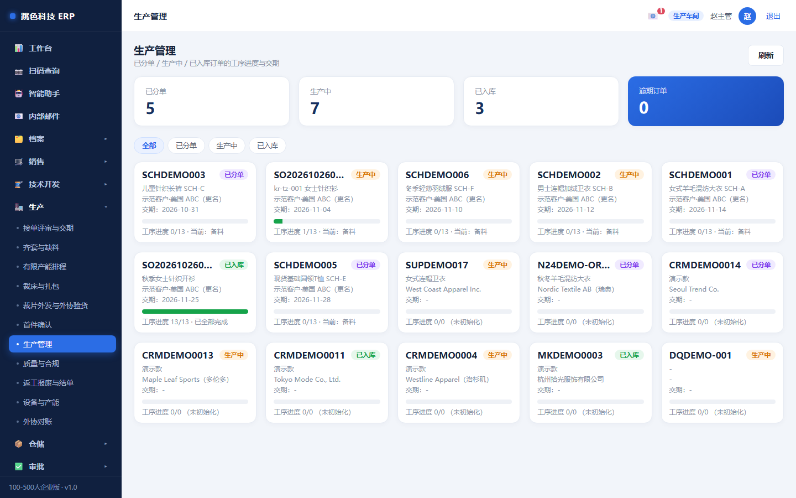

车间在系统里的每一笔动作都会变成钱和产能：
**报工数进成本、设备停机扣产能、返工报废进损失**。所以这里的规矩最硬。

---

## 二、一天的节奏

| 时间 | 做什么 | 在哪 |
|---|---|---|
| 上班前 | 看当天排程，确认工作中心与工时 | 有限产能排程 |
| 上班 | 看各单工序进度、昨日不良 | 生产管理 |
| 开工前 | 首件做出来、测量、请技术/质检放行 | 首件确认 |
| 全天 | 每道工序完工就报工（合格 / 不良） | 生产管理 → 报工 |
| 有故障 | 马上报设备停机 | 设备与产能 |
| 外发有回货 | 按扎验收，短数写原因 | 裁片外发 |
| 单子做完 | 返工复验、报废登记、结单 | 返工报废与结单 |

---

## 三、排程（发布前必须处理完硬冲突）

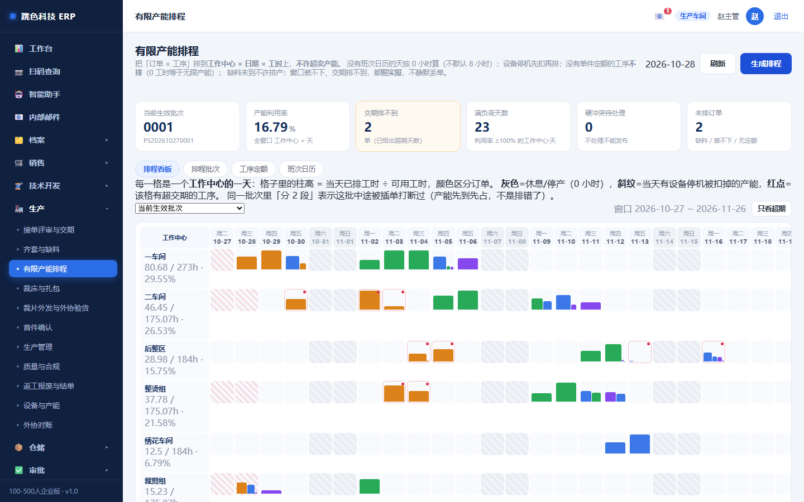

排程把「订单 × 工序」排到「工作中心 × 日期 × 工时」，**不许超卖产能**。

### 五条不排的规矩（不会偷偷帮你排）

| 情况 | 系统怎么做 | 为什么 |
|---|---|---|
| 那天没有班次日历 | 按 **0 小时** 算，排不进去 | 缺行就是不可用，绝不默认 8 小时 |
| 设备停机 | **先扣产能再排**，扣到 0 不出负值 | 停机了还排产，等于排了个假的 |
| 工序没有单件工时 | **不排** | 0 工时等于无限产能，排出来是假的 |
| 缺料净缺口 > 0 | **不排**，开工日不早于预计到货日 | 排了也开不了工 |
| 窗口内装不下整单 | **整单不排**，并报缺多少工时 | 不静默丢单，也不假装按期 |

### 发布前

冲突分**硬冲突**和**软冲突**：

- **硬冲突必须逐条写处理意见**，处理完才能发布
- **软冲突**（比如略超交期）可以发布，但要留说明

发布后：
- 排程变成「已发布」给车间，**已发布只读**
- 人工调整（起止时间 / 工作中心 / 工时 / 锁定）**必须写原因**
- 要改就发新版本，旧版留着

> 排程的甘特图是**按天分段**画的。一批活被插单打断成几段是正常的，看到一根横跨两周的条才是错的。

---

## 四、报工（数据要准，因为它进成本）


每道工序完工后，在订单详情的工序行点「报工」，填：

| 字段 | 注意 |
|---|---|
| 合格数 | 能做下一步的数量 |
| 不良数 | 要写原因，不良会进质量统计 |
| 工时 | 实际花了多少小时，影响成本摊 |
| 报工日期 | 默认今天 |

**累计**：工序行会显示「合格累计 / 不良累计」，一眼看出这道工序做完多少。

⚠️ **别攒到周末一次报**。报工影响两件事：
1. 成本按工时摊，一次报和分次报结果不一样
2. 排程要用实际进度去修正后面工序

---

## 五、拍照留证（手机拍，别等回办公室）

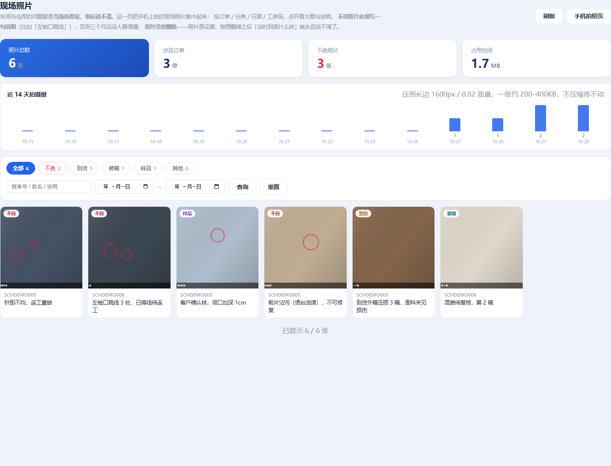

布面跳线、针距不均、烫台沾污——**电话里说三遍不如一张照片**。手机打开 `/m/photo`：

1. 扫工单码（或输入单号）—— 照片必须挂在一张单上，否则三个月后没人知道这是哪一单
2. 选分类：**不良** / 到货 / 装箱 / 样品 / 其他
3. 选工序（不良照片一定要选，能说清是哪道工序出的问题）
4. 点「拍一张」—— 直接调起后置摄像头，不用去文件管理器翻
5. 写一句说明，然后上传

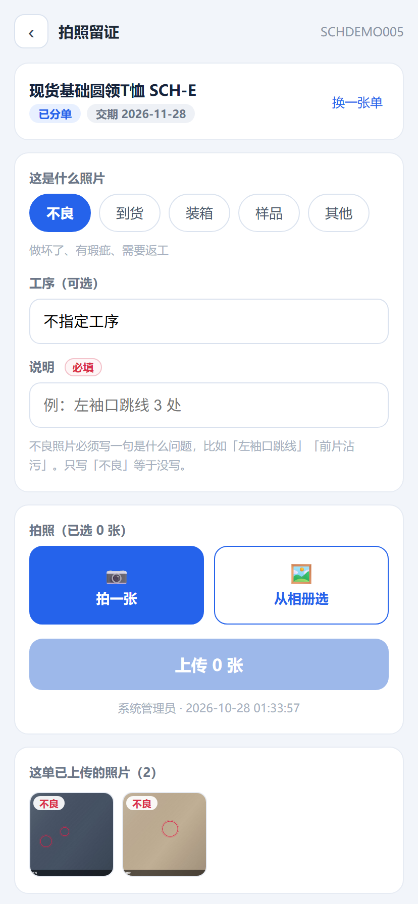

也可以直接在报工抽屉里拍：点工序 → 「📷 拍不良照片」→ 提交时报工和照片一起存。

| 规矩 | 为什么 |
|---|---|
| **不良照片必须写说明**（≥2 字） | 「不良」两个字等于没写。要写「左袖口跳线 3 处」 |
| 一张照片只能挂一张单 | 挂错单的照片比没有照片更糟 |
| 照片不能真删，只能标记删除 | 照片是证据，删了就说不清「当时什么样」 |

> 手机上照片会自动压缩到 200–400KB 再传（不压缩会传不上去）。拍完能看到「这张多大」，拍糊了当场重拍。

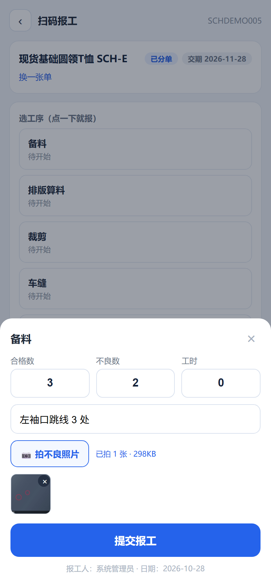

---

## 六、首件确认（没放行，批量报工过不去）

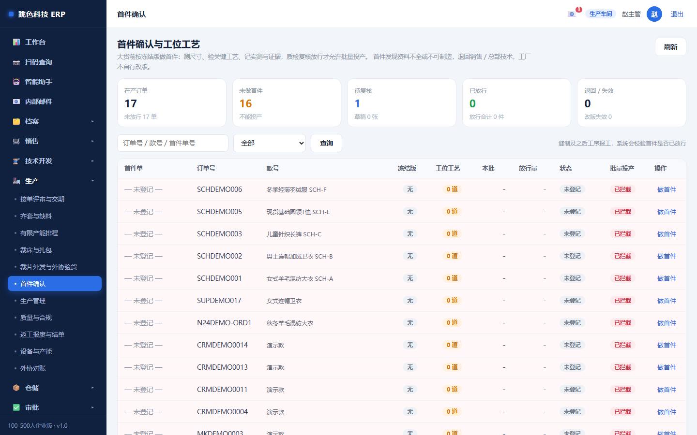

新单、换款、换料、换班，都要先做首件。

流程：

```
车间做首件 → 测量并填尺寸 → 技术/质检判定 → 放行
```

- **首件没放行，这道工序的批量报工被拦**（系统会提示首件未放行）
- 首件是**冻结版本**：放行时的工艺与版型被记下来，后面改工艺要重新首件
- 放行人和制作人分开（谁做的不该自己判合格）

---

## 七、裁片外发（按扎发、按扎回）

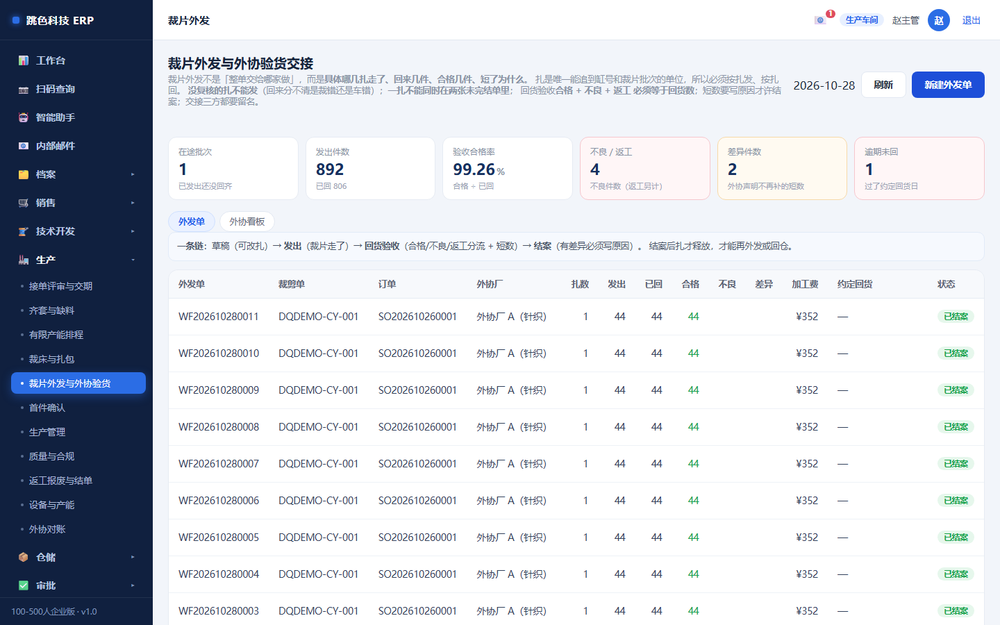

外协不是「整单交给哪家做」，而是「**具体哪几扎**出去了、回来几件、合格几件、短了为什么」。

**扎**是唯一能追到缸号和裁片批次的单位，所以：

| 规则 | 说明 |
|---|---|
| **没复核的扎不能发** | 回来分不清是裁错还是车错 |
| **发出件数 = 扎包件数合计** | 不能手改 |
| **一扎同时只能在一张未完结的外发单里** | 草稿也占扎 |
| **外发不能超过「合格裁片 − 已发」** | 裁剪单没录合格数就不许外发 |
| **回货不能多于未回** | — |
| **合格 + 不良 + 返工 = 本次回货** | 对不上不给存 |
| **短数必须写原因并落到具体扎** | 否则单据显示未回 0、某扎还挂着未回 2，谁也说不清 |

已结案不能改、已回货不能取消。结案后扎才释放。

---

## 八、打印扎标（裁完立刻贴）

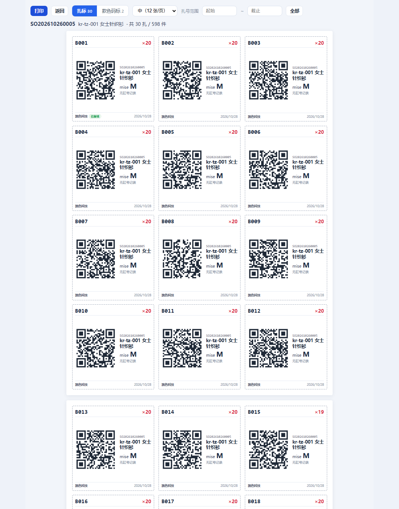

裁床把扎分好之后，进「销售订单 → 打开这单 → **打印标签**」，默认就是**扎标**模式。

| 做什么 | 怎么做 |
|---|---|
| 选张数 | 大 6 张/页（看得清）、中 12 张/页（常用）、小 24 张/页 |
| 补打某几扎 | 填「扎号范围」，比如 `B008` ~ `B014`，机器卡纸时只补这一段 |
| 打印 | 点「打印」，A4 纸；标签用虚线框，沿框裁 |

每张扎标上有：**扎号（大字）+ 件数 + 二维码 + 订单号 + 款号 + 颜色/尺码 + 缸号床次 + 复核状态**。

> ⚠️ 扎标打印出来**必须贴在对应的那一扎上**。贴错一张，整批追溯就乱了 ——
> 所以扫码核对这一步不能省（见下）。

### 工人扫扎标干活

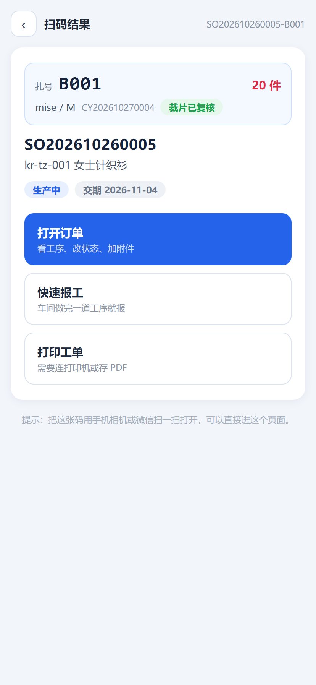

手机扫扎标上的二维码 → 直接看到「**这是哪一扎**」（扎号、件数、颜色尺码、哪张裁剪单、裁片有没有复核）
→ 点「快速报工」，报工会**记到这一扎上**。

| 你会看到 | 意思 |
|---|---|
| 扎号 + 件数 | 核对实物是不是这一扎 |
| 「裁片已复核」/「待复核」 | 待复核的扎按规矩不能往下发 |
| **红色提示「扎号在这单里找不到」** | 标签印错单了，或扎号被改过 —— **别贴，先找裁床核对** |

> 报工记了扎号之后，出了问题能查到「哪一扎、谁做的」；没记扎号的报工只能查到「这道工序做过」。

---

## 九、按扎看进度（哪一扎卡在哪）

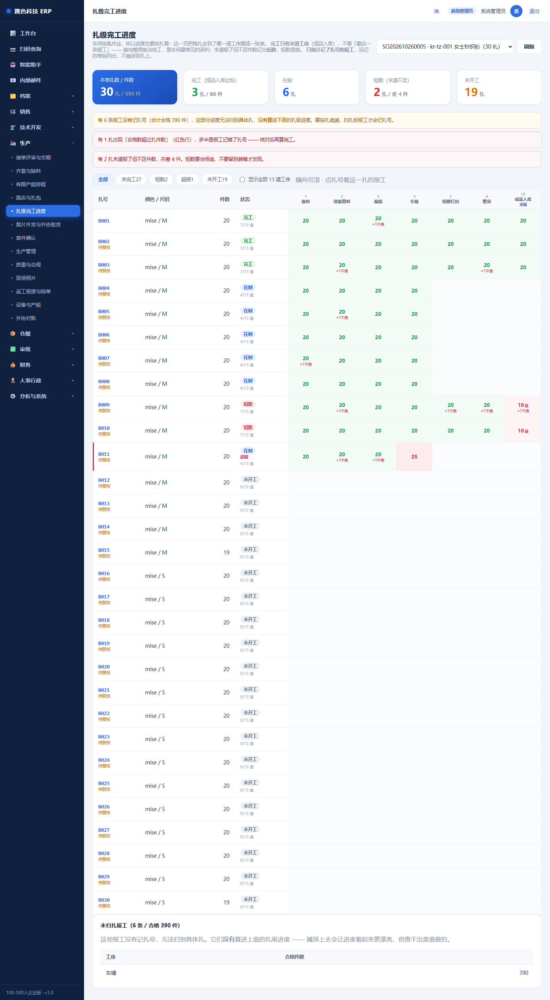

「生产 → **扎级完工进度**」，选一张单，就能看到每扎走到了哪一道：**行是扎，列是工序，
格子里是这一扎在这道工序报了多少件**。

| 状态 | 意思 | 你该做什么 |
|---|---|---|
| **完工** | 末道（成品入库）件数够了 | 可以入库 |
| **短数** | 末道报了但不够件数 | **马上查**，短数是钱 |
| **在制** | 已经开始做，末道还没报 | 看它卡在哪一道 |
| **未开工** | 一条报工都没有 | 没发下去，或者发了没报 |

### 三个必须知道的口径

1. **完工看「末道工序」，不是「最后一条报工」。** 做完整烫就当完工是最常见的误判 ——
   整烫之后还有水洗、印花、检验、包装。
2. **表头的数字是工序序号。** 默认只显示「有报工的工序 + 末道」，所以「6 整烫」后面
   直接跟「12 成品入库」是正常的 —— 中间 7~11 道没报工，被藏起来了。
   看状态列的「7/13 道」就知道这条走了几道。
3. **只统计记了扎号的报工。** 电脑上直接报工不记扎，这些会单列在页面底部
   「未归扎报工」里，**不会摊到扎上**。想按扎追溯，就用手机扫扎标报工。

> 点扎号看这一扎的明细：哪几道报了、每道合格多少、不良多少、哪天报的、够不够件数。
> 超报（合格数比扎件数还多）会标红 —— 一般是报工记错了扎号，回去核对再算完工。

---

## 十、返工、报废与结单

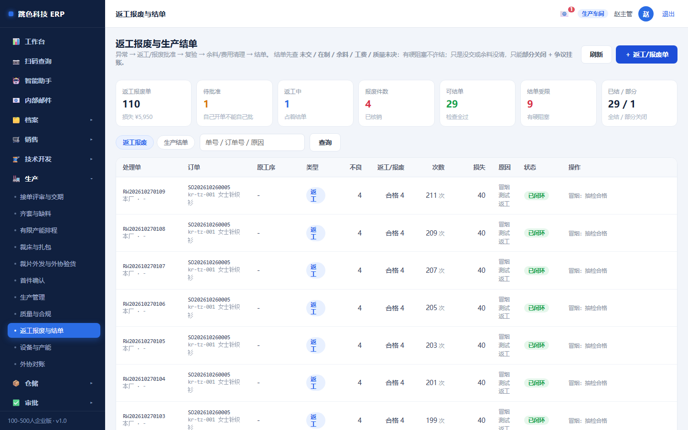

| 动作 | 硬规则 |
|---|---|
| **返工** | 返工完**必须复验**，不复验不算完成 |
| **报废** | **必须填损失数量与原因**，损失进成本（`rework` 层） |
| **批准** | **批准人 ≠ 制单人**（自己批自己的报废，等于没批） |
| **结单** | 过**五项检查**：工序全完成、报工齐、返工有复验、报废有批准、外发有回货 |
| **部分关闭** | 有欠数时可以部分关闭，但欠数要**挂账**，不能悄悄消失 |

---

## 十一、设备与产能

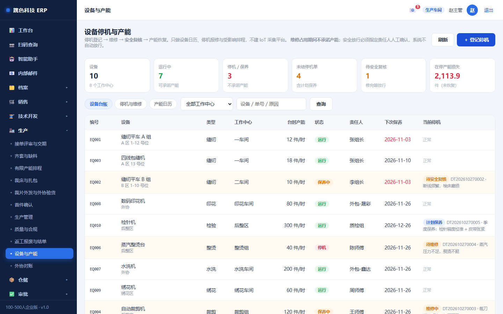

- 设备台账：每台设备在哪个工作中心、什么状态
- **停机报修**：填开始时间、原因；修好填结束
- 停机期间**产能自动扣减**，排程不会把活排到停机的设备上
- 安全相关的维修要**人工复核才放行**（系统不猜）

---

## 十二、出验货报告（发给客户的那份文件）

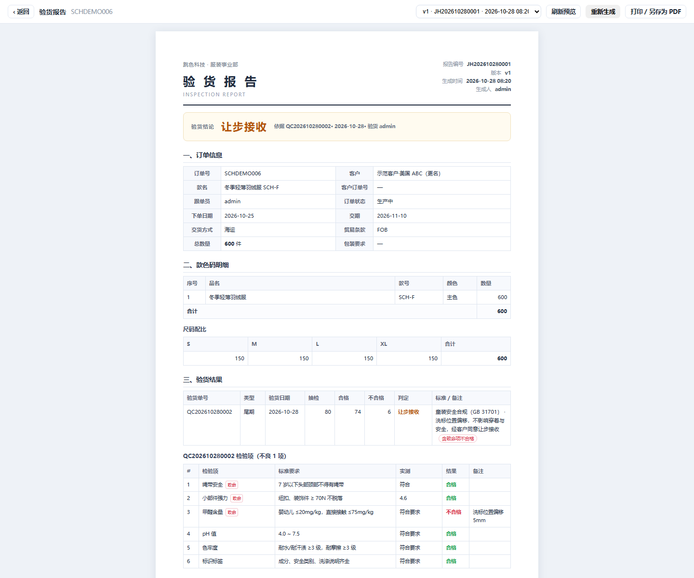

客户要的不是「你自己说合格」，是一份**能签字的文件**。路径：订单详情 → **验货报告**，或
「质量与合规 → 检验单 → 验货报告」。

页面先给你**实时预览**（没有编号），确认三件事再点「生成报告」：

1. 照片齐了没有（不良照片在最前面）
2. 结论是不是最新那张验货单的（看结论条下方「依据 QC…」）
3. 质量异常有没有还没关的（页面会黄条提醒）

| 你要知道的 | 为什么 |
|---|---|
| **生成后不能再改** | 报告是快照。之后又报了工、又补了照片，**这份报告不会变** —— 客户手里和你系统里的永远一致 |
| 可以多次生成 | 每次都出新编号，版本递增，旧的不覆盖。客户说「收到的是旧版」，按编号能翻出来 |
| 没有验货单就写「未验货」 | 系统不会替你下结论。没验货的记录，报告就写「不作为出货依据」 |
| 出 PDF 靠浏览器打印 | 点「打印 / 另存为 PDF」，在打印对话框里选「另存为 PDF」 |

> 报告里带签字栏（验货人 / 验货日期 / 客户确认）。打印出来签字盖章，拍照存档，比电子文件更稳。

---

## 十二·补 看效率与质量（生产交付报表）

入口：左侧「生产」→「生产交付与质量」。

这一页回答三个问题：**准不准时、慢在哪、返工是不是越来越多。**

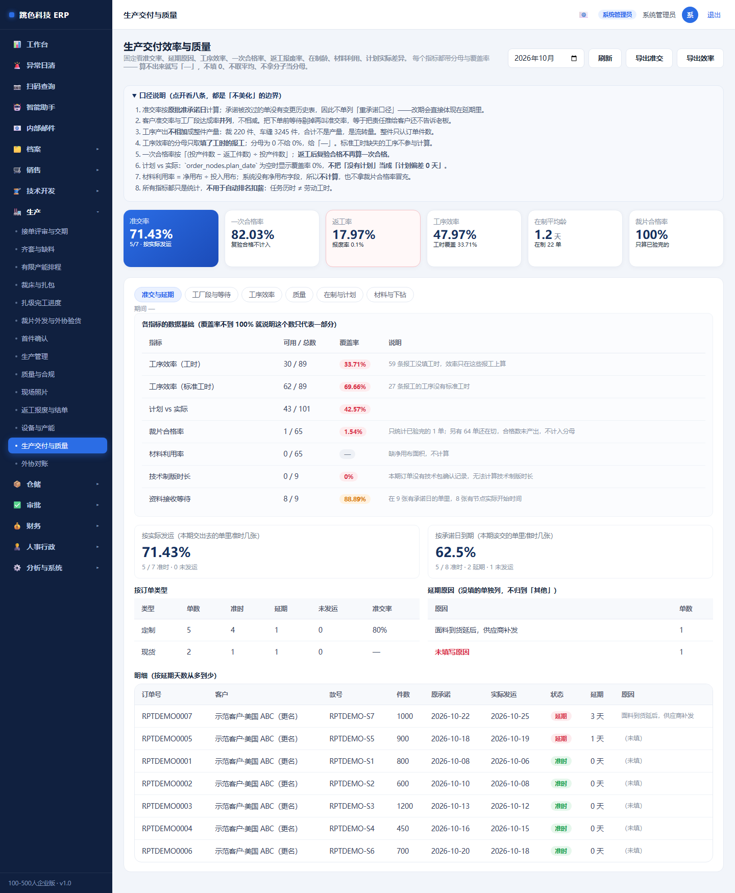

### 八个数看什么

| 指标 | 看什么 | 什么时候要警惕 |
|---|---|---|
| **准交率** | 实际发运 ≤ 原承诺的比例 | 低于 85% 要查是哪一段拖的 |
| **一次合格率** | 没返工就合格的比例 | 连续两月下降 = 工艺或来料有问题 |
| **返工率 / 报废率** | 返工件数、报废件数占投产件数 | 单道工序返工集中 = 那道工序该管 |
| **工序效率** | 标准工时 ÷ 实际工时 | 长期低于 70% 要么标准定宽了、要么人不够 |
| **在制平均龄** | 在制订单平均压了多少天 | 超过 15 天说明单子在做但不往前走 |
| **裁片合格率** | 已验完的裁床单里合格的比例 | 低于 95% 查排料与裁剪操作 |

### 三个必须知道的口径（不然会误读）

**1. 看到「—」不是 0，是「算不出来」**
比如工序效率显示「—」，说明这些报工**没填工时**。
系统不会拿 0 当分母算出 0%（那会让你以为效率极差），也不会猜一个数。

**2. 准交率有两个数，都要看**
- **按实际发运**：本月交出去的单里，准时几张 —— 看执行
- **按承诺日到期**：本月该交的单里，准时几张 —— 看有没有「该交没交」

两个差得越多，说明「拖着的单」越多。

**3. 工厂段达成 ≠ 客户准交率**
工厂段是「从裁床算料到出厂发运」这段，只算工厂能控制的部分。
客户准交率里还含下单前的等待与客户变更。
**两个数并排放，不相减** —— 不会因为「那段时间是客户造成的」就把工厂准交率算得更漂亮。

### 一项「不提供」的指标

**材料利用率**不计算，显示「—」。
原因：真正的利用率 = 净用布 ÷ 投入用布，系统只记了排料长度和余料，没有净用布面积。
宁可显示「没这个数」，也不拿裁片合格率冒充。

### 覆盖率为 0 怎么办

如果「计划 vs 实际」显示 `0 / 101`，意思是**这一批完成的工序一条都没填计划完成日**。
正确动作是去「有限产能排程」生成计划日，而不是等报表自己变好。

### 这页不用来罚人

报表只统计。**任务历时不等于劳动工时**，系统不会据此自动排名、扣绩效或扣工资。
真要考核，得由人拿着这份数据去谈。

---

## 十三、为什么有些按钮点不了

| 现象 | 原因 | 解决 |
|---|---|---|
| 报工被拒，提示「首件未放行」 | 这单这道工序没做首件或没放行 | 先做首件，请技术/质检放行 |
| 报工被拒，提示「不合格数超出」 | 不良数填多了 | 核对实物；确实报废走报废流程 |
| 排程发布不了 | 有硬冲突没写处理意见 | 逐条点开写意见 |
| 排程不排这单 | 无班次日历 / 无定额 / 缺料 / 装不下 | 看提示，补日历或补定额 |
| 外发保存不了 | 扎没复核 / 扎已在别的单里 | 先复核；或找那张单结案 |
| 结单被拒 | 五项检查没过 | 看提示缺哪项 |

---

## 十四、常见问题

**Q：客户加急，能不能插单？**
能，在排程里人工调整并**写原因**（加急插单要留痕，后面才能解释为什么别的单延了）。

**Q：报错了怎么改？**
工序报工可以删了重报（会留日志）。已经进成本的，要财务一起看。

**Q：设备临时坏了，已经排的活怎么办？**
先报停机，再重排。重排会自动避开停机时段；已发布的原排程会被新版本取代，旧版可查。

**Q：为什么我改不了工艺？**
工艺是技术部的。现场按工艺做，发现工艺有问题找技术改，不要在报工备注里写「实际做法不同」——那等于没改。
