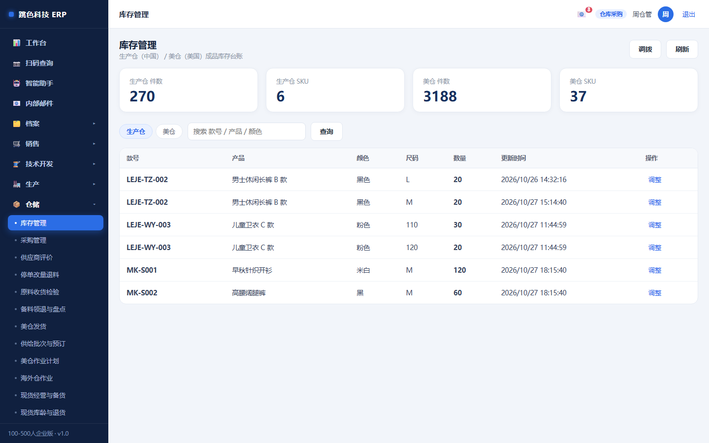
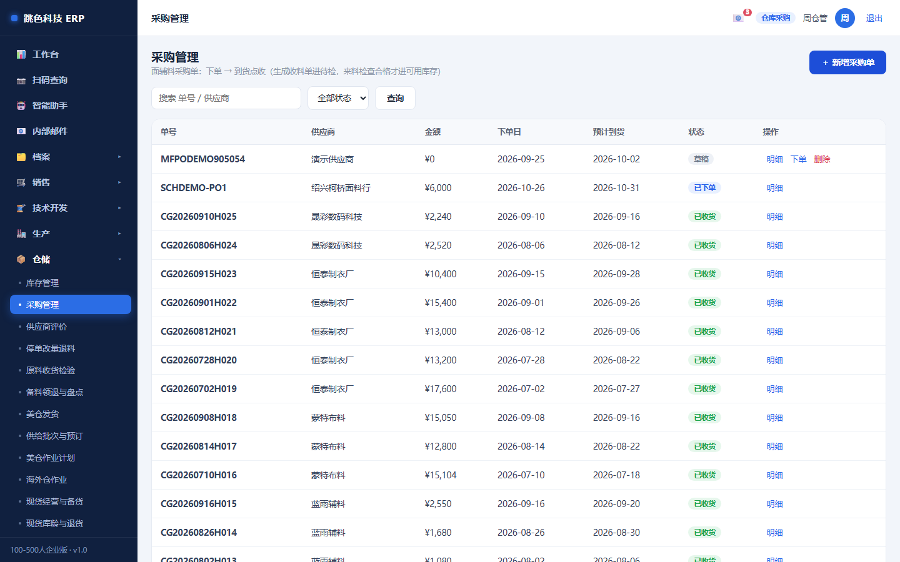
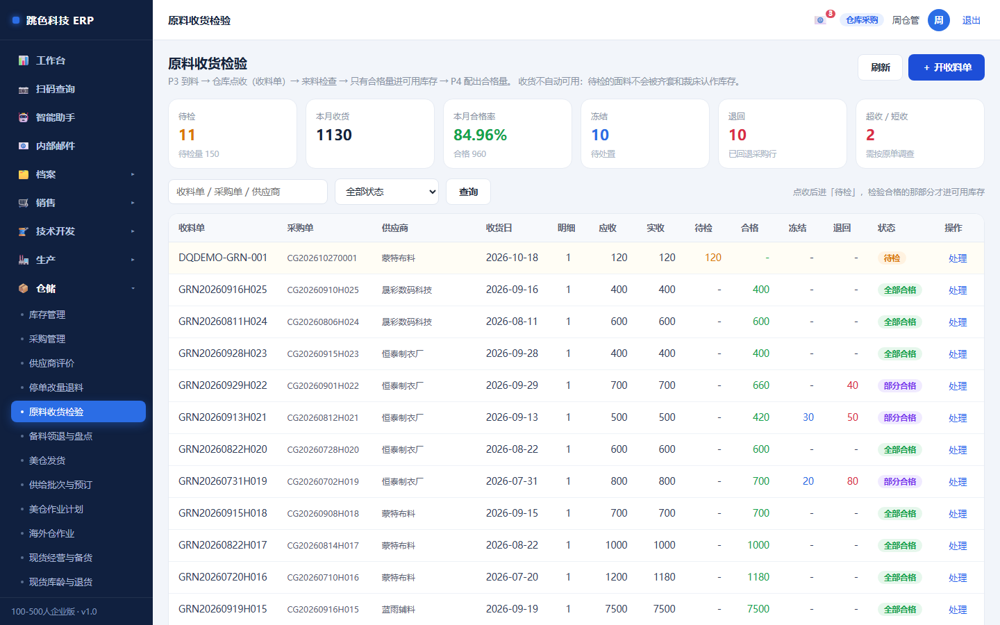
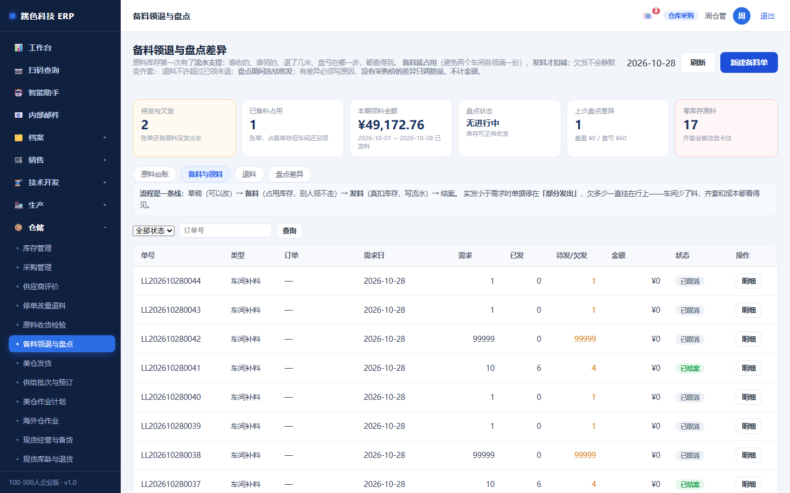
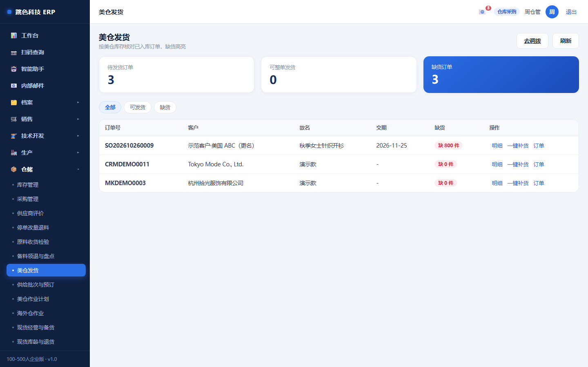
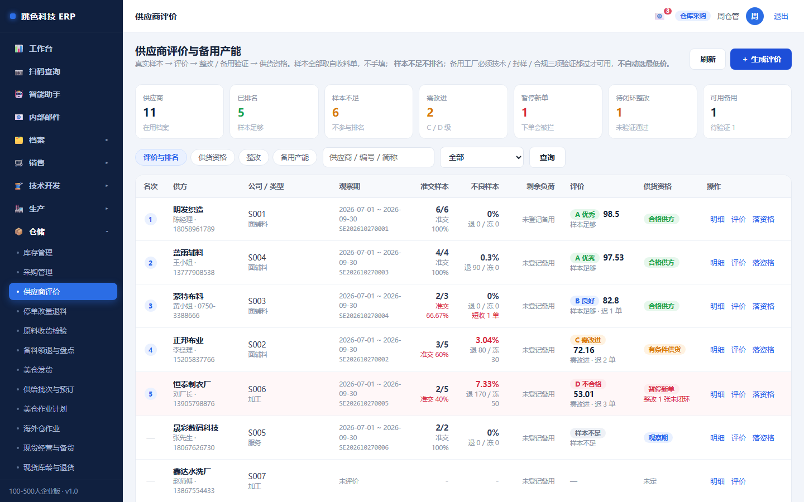

# 04 · 仓库采购培训手册

> 适用岗位：仓管 / 采购 / 美仓运营
> 系统权限：`warehouse`
> 你在系统里的职责：**采购、原料收货检验、备料领退与盘点、库存、美仓发货、供应商评价**

---

## 一、你的界面



仓库管的是**数量**。系统里所有数量都有来路和去向：
**收货要有采购单、领料要有备料单、调整要有原因、盘点要有表**。

---

## 二、一天的节奏

| 时间 | 做什么 | 在哪 |
|---|---|---|
| 上班 | 看到货计划（哪些采购单今天到） | 采购管理 |
| 到货 | 点收 → 请检 → 检验合格 → 才进可用库存 | 原料收货检验 |
| 上午 | 按车间需求备料（占用） | 备料领退与盘点 |
| 全天 | 车间来领料 → 发料（扣库存） | 备料领退与盘点 |
| 下午 | 成品入库、美仓发货核对 | 库存 / 美仓发货 |
| 月末 | 盘点：录数 → 差异写原因 → 落账 | 备料领退与盘点 |
| 每月 | 供方评价看整改 | 供应商评价 |

---

## 三、采购：草稿 → 下单 → 收货



| 状态 | 能做什么 |
|---|---|
| 草稿 | 随便改 |
| 已下单 | 等货；可以催；**不能改数量**（要改走「停单改量退料」） |
| 已收货 | 到货累加 |

**关键：采购收货不会自动让材料变成可用。**

---

## 四、原料收货检验（最容易漏的一步）



```
到货点收（数量）
   ↓
请检（送检）
   ↓
检验判定：合格 / 不合格 / 让步接收
   ↓
合格 → 进可用库存（materials.stock_qty）
不合格 → 不进库存，走退货
```

⚠️ **只点收不检验，材料不算库存**。这是为了防「来料不良悄悄上线」。

| 判定 | 后果 |
|---|---|
| 合格 | 数量进可用库存 |
| 不合格 | 不进库存，要退供应商 |
| 让步接收 | 进库存但标记，后面用的时候能看到 |

---

## 五、备料领退与盘点



### 三个概念必须先分清

| 概念 | 含义 |
|---|---|
| **账面** | 仓库里实际有多少 |
| **占用** | 已备料但还没发出去的（答应给某张单了） |
| **可用** | 账面 − 占用 |

### 流程

```
建备料单 → 备料（占用，不扣库存）
        → 发料（扣库存，占用释放）
        → 退料（车间用不完退回来，加回库存）
```

四条硬规则：

1. **备料即占用、发料才扣减** —— 两个车间不会各领满一份
2. **实发 ≤ 未发量** —— 少发会转「部分发出」，欠发一直挂在行上，不会静默变齐套
3. **可退 = 已发 − 已退** —— 退料必须挂在一张已发料的单上（否则退回来的东西来路不明）
4. **盘点中冻结原料收发** —— 领料、退料、收货过账全拦，只有草稿不冻结

### 盘点

| 规则 | 说明 |
|---|---|
| **未盘 ≠ 0** | 没录数就是「没盘」，不会当 0 算盘亏 |
| **没盘完不许提交** | — |
| **有差异必须写原因** | 盘盈也要写 |
| **没有采购价的差异只调数量** | 金额留空显示「未计价」，不拿 0 冒充「没损失」 |
| **同一时间只允许一张未完成盘点** | 两套账面数会打架 |
| **已调账不能改、不能取消** | — |

---

## 六、库存管理


- **两个仓分开**：`生产仓（cn）` 和 `美仓（us）`，不要混
- **按 款/色/码** 三件套看，断码单列
- **调整必须写原因**：盘盈盘亏、报损、样衣领用都算调整
- **库存不足会拦发货**，不会出现负库存

### 缺货了怎么办

看「齐套与缺料」（生产模块）里的净缺口，再决定：
- 采购补料 → 采购管理新建
- 从别的单挪 → 备料单调整
- 停止接单 → 找销售

---

## 七、美仓发货



美国仓的订单按**美仓库存**核对：

| 情况 | 显示 |
|---|---|
| 全部有货 | 齐套，可整单发货 |
| 部分缺 | 标出缺哪个码缺几件 |
| 全缺 | 不可发货 |

- 发货**扣美仓库存**，并写库存流水
- 发货后订单变「已发货」，**自动开应收**（财务那边会看到）
- 库存不足会拦，**不允许负库存发货**

---

## 八、供应商评价



评价不是拍脑袋打分，是**按批次自动汇总**：

| 规则 | 说明 |
|---|---|
| 样本不足不排名 | 只交过一两次货的供方不参与排名，避免偶然 |
| 样本来源 | 收货准时率、来料合格率、退货率 |
| 整改 | 不合格的要开整改单，跟踪到关闭 |
| **资格门禁** | 评价不合格的供方，**采购下单时会被拦** |
| 备用产能 | 要成为备用供方，需三项验证都过 |

---

## 九、停单改量退料

订单要减量、或者采购要取消，走这个流程：

| 动作 | 规则 |
|---|---|
| **减量** | 只动「未交」部分，已交的不能减 |
| **停单** | 需要供方确认（对方也认了这个变更） |
| **退料** | 实物退回 + 贷项（财务冲账）**两个回执都要有**，只退实物不冲账，账就永远不平 |

---

## 十、为什么有些按钮点不了

| 现象 | 原因 | 解决 |
|---|---|---|
| 材料数量没变 | 只点收了没检验 | 走请检 + 检验判定 |
| 发料被拒，提示「可用不足」 | 账面 − 占用不够 | 看是不是别的单占用了；先退料或补料 |
| 发料被拒，提示「可用只有 xxx」但账面够 | 本单自己的占用没排除 | 这是系统 bug 的表现，截图找管理员 |
| 盘点提交不了 | 有没盘的物料 | 逐个录数（没有就录 0） |
| 盘点调整不了 | 已经落账 | 已调账不能改，走下一次盘点 |
| 发货被拒 | 美仓库存不足 | 先补货或改发货数量 |
| 采购下单被拒 | 供方资格不合格 | 看供应商评价，先做整改 |

---

## 十一、常见问题

**Q：盘点差了很多，能直接改库存吗？**
能，但必须走盘点并写原因。直接改库存等于把差异藏起来，下次盘点还会差。

**Q：车间说领了 100，系统显示 120，怎么办？**
看发料单的实际记录。差 20 可能是少发（部分发出）或退料没录。先查单据，不要直接调库存。

**Q：美仓和国内仓之间怎么调货？**
走「库存调拨」，会产生两条流水（调出、调入），两边数量同时变。

**Q：样衣领用要不要走备料？**
要。样衣用了料就是消耗，不录的话月底盘亏找不到原因。
