# 05 · 财务会计培训手册

> 适用岗位：会计 / 出纳 / 财务主管
> 系统权限：`finance`
> 你在系统里的职责：**成本审核、往来账、总账与报表、税票银行、预算、定价与费用池、集团合并**

---

## 一、你的界面

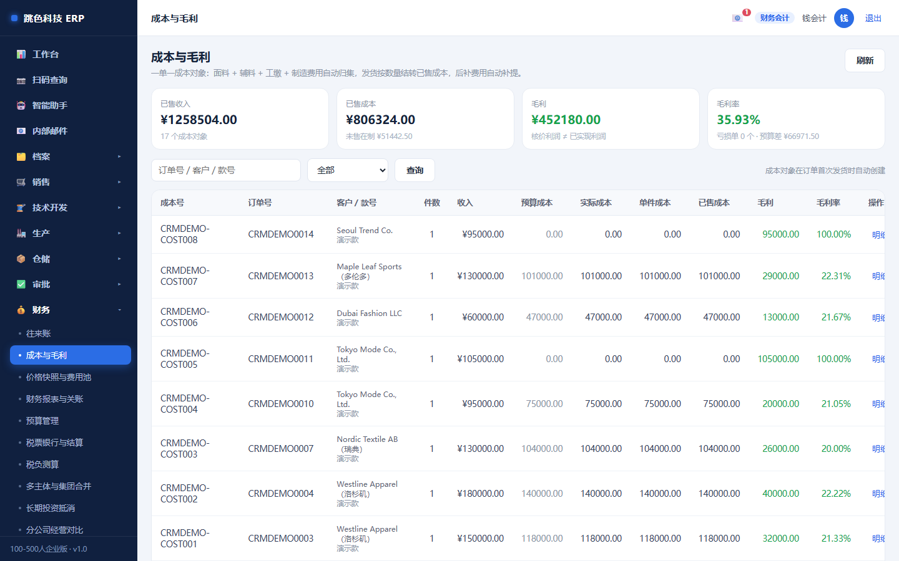

财务在系统里有**两个位置最关键**：
**成本审核**（不通过订单不能分单）和**关账**（关了就锁期间）。

---

## 二、一天的节奏

| 时间 | 做什么 | 在哪 |
|---|---|---|
| 上班 | 看待审成本单 | 成本与毛利 |
| 上午 | 审成本：材料、工缴、费用，核到毛利合理 | 成本与毛利 |
| 随时 | 收付款登记、核销 | 往来账 |
| 下午 | 税票登记、银行流水匹配 | 税票银行与结算 |
| 每周 | 看预算执行（已用 = 已发生 + 已占用） | 预算管理 |
| 月末 | 生成凭证 → 试算 → 报表 → 八项检查 → 关账 | 财务报表与关账 |
| 每季 | 集团合并（有子公司时） | 多主体与集团合并 |

---

## 三、成本审核（订单分单的闸门）


成本单不是一个数，是**七层叠出来的**：

```
材料 + 辅料 + 工缴 + 制造费用（分摊）+ 其他 + 返工损失 = 实际成本
出厂价 = 成本 × (1 + 利润率)
```

| 层 | 从哪来 | 注意 |
|---|---|---|
| 材料 / 辅料 | 开发单里勾选的面辅料 × 单件用量 × (1+损耗) | 用量是技术填的，改用量等于改成本 |
| 工缴 | 工序工时 × 工价 | 报工数据会影响实际工缴 |
| **制造费用** | **费用池按动因分摊** | 只有制造费用进产品成本，管理/销售费用不进 |
| 返工损失 | 返工报废模块 | 报废批过的损失会进这一层 |

### 审核要看三件事

1. **用量对不对**：单件用量 × 总件数是否合理（差得离谱通常是单位错或损耗填错）
2. **分摊对不对**：费用池的池额 = 明细合计，分摊合计必须正好等于池额
3. **毛利对不对**：售价低于成本**可以发**，但要写说明并会长期标红

审核通过后订单才能「分单」进车间。

### 成本漂移（容易被忽略）

价格本是**发布时快照**成本的。发布之后如果成本变了（比如刚分摊完费用池），
系统会提示**成本漂移**（≥5%），意思是你现在用的成本是旧的了。

> 看到漂移就去发一版新价格，别一直用过期成本算毛利。

---

## 四、往来账（应收应付）

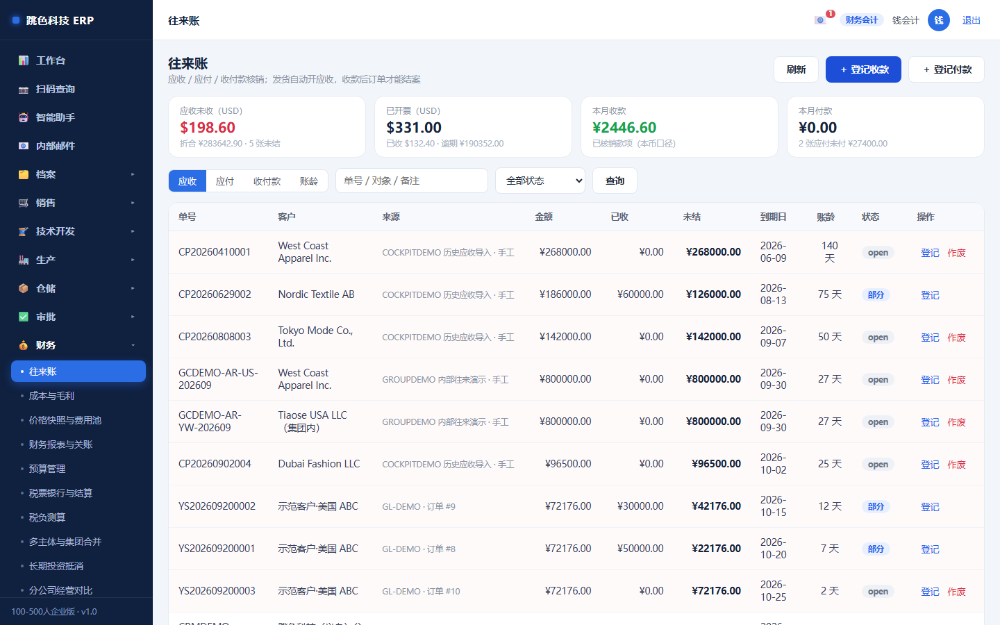

| 概念 | 说明 |
|---|---|
| **应收** | 发货时**自动开**（幂等，重复发货不会重复开票） |
| **应付** | 采购收货后按供方对账 |
| **核销** | 收/付款登记到具体发票上 |

外币处理：
- 开票时按**开票日汇率**折算本币记账（`amount_orig × rate = amount`）
- 之后汇率变了，**不改已开票的金额** —— 汇兑差异另算，不改原始凭证

**结案的闸门**：订单还有未收金额时不能结案。确需先结案要写原因（`force`）。

### 客户不付款时：出对账单

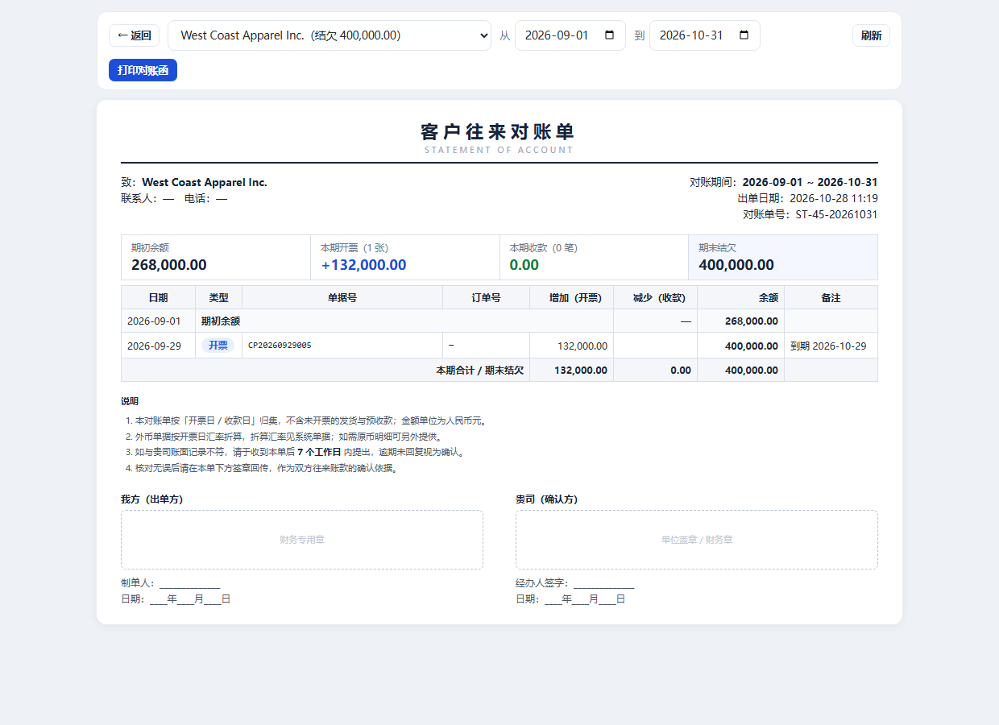

客户财务没对上账，就会一直「等核对完再付」。你催得再勤，他一句「你们的账跟我们的对不上」
就把球踢回来 —— 这时候要的不是电话，是一张**对账函**。

**怎么出**：财务 → 应收 → 某一行的「对账单」按钮（或直接打开 `/statement/客户id`），
选客户和期间，点「打印对账函」（可另存 PDF）。

**单子上有什么**：期初余额 → 本期开票（几张）→ 本期收款（几笔）→ 期末结欠，
下面逐笔流水带滚动余额，客户能一行行对；最后是双方盖章栏。

**三个要留意的地方**

1. **「未核销收款」**：钱到了但还没分到具体发票上，单子上会单列一句。
   客户问「我付的 6 万去哪了」，就指这一项 —— 它不影响结欠金额，但不是消失的钱。
2. **顶部红条「这张单现在不能发出去」**：说明「流水算出来的期末」和「未收发票 − 未核销」
   对不上，账本身有问题（有人绕过核销直接改了已收金额）。**先查清再发**，
   发出去被客户发现对不上，比不发更麻烦。
3. **只认「开票日/收款日」**：期间内的发生额才进这张单，到期日跟对账无关（那是账龄的事）。

> 系统有个自检脚本能一次性列出「已收金额与核销记录不符」的发票：
> `cd backend && node scripts/check-ar-consistency.js`（只看）/ 加 `--fix` 按核销回写。

### 这家客户还能不能再赊：信用与账期

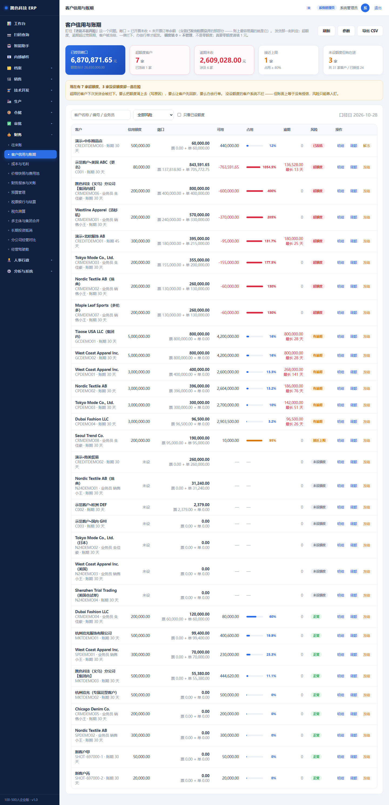

财务 → **客户信用与账期**。这一页只回答一个问题：**这家客户还能不能再赊。**

**怎么看**

- 每行右边是风险标签：**已冻结 / 超额度 / 有逾期 / 接近上限 / 正常 / 未设额度**。
  排在最上面的永远是「已经危险」的，不用一页页翻。
- **敞口**这一列是关键，它等于两块之和：
  - **票**：已开票但还没收到的钱
  - **单**：订单已经投产或发出、但**还没开票**的钱
- 「其中货已发·票未开」单独标橙色 —— 这一类最危险，**货走了、票没开，账面上还看不见**。
  看到就先催开票。

**额度填 0 是什么意思**

> **0 = 不管理，不是零额度。** 系统不限额，只在台账里标「未设额度」。
> 真要「一分钱都不许赊」，请填 1 元。

这是故意的：大多数客户没录额度，如果按「0 就是零额度」处理，他们全部立刻发不出货，
系统会被人当成坏掉的。

**发货被拦下来时怎么办**

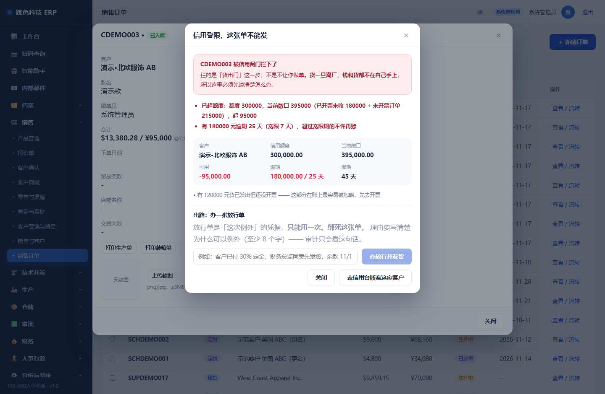

发货那一刻系统会判定三种情况，任一命中就拦：

1. **超额度**：敞口已经超过额度
2. **逾期超过宽限期**（默认 7 天，可在「参数」里改）
3. **客户被冻结**

被拦下的单，**货一件都不会出库，订单状态也不会变** —— 拦在动作之前，不会留半截。

三条出路，按顺序试：

| 出路 | 谁来做 | 说明 |
|---|---|---|
| **让客户回款** | 业务员 | 最干净。收到了，敞口自然降下来 |
| **调额度** | 财务/管理员 | 写原因（≥4 字），系统留历史。调完后页面会先告诉你「调完可用多少」 |
| **办放行单** | 财务/管理员 | 这次例外。**理由至少 8 个字**，一张只能用一次，绑死这张单 |

放行单是唯一能绕过的路，所以门槛最高：写清楚「为什么这次可以例外」
（比如「客户已付 30% 定金，财务总监同意先发，余款 11/15 前结清」）。
这句话就是将来被问起时唯一的凭据 —— 审计只认它。

**冻结**

不用等系统算出超限才冻。听到风声、客户出现退票、老板一个电话，都可以先冻再核：
明细里点「冻结」，写原因即可。**冻结期间额度再宽也发不出货。**
解冻同样要写原因。冻结/解冻/调额都会进「变更记录」，谁在什么时候为什么做的，都查得到。

> 小提示：调额、冻结、放行单只有**财务和管理员**能做。销售能看台账（不然不知道
> 能不能接单），但不能自己给自己批额度。

### 欠供应商的钱：应付与付款计划

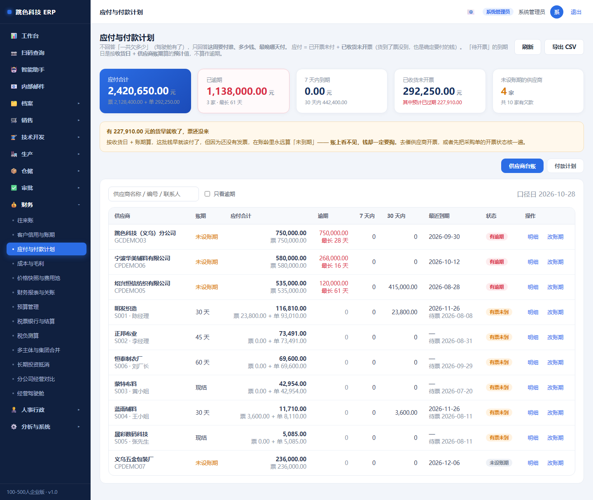

财务 → **应付与付款计划**。这一页不回答「一共欠多少」（驾驶舱有），
只回答一个问题：**这周要付谁、多少钱、最晚哪天付。**

**应付由两块组成**

- **票**：已经收到发票、还没付的钱
- **单**：货已经收了、**供应商还没开票**的钱

第二块最容易漏。它虽然还没发票，但**是确定要付的** —— 做资金计划时不算进去，
就会出现「预算做得挺好，突然冒出一笔钱」。

> 页面顶部如果出现黄条「有 X 元的货早就收了，票还没来」，说明这批钱的
> **预计到期日已经过了**（按收货日 + 账期算）。去催供应商开票，或者核一下
> 这些采购单到底开没开票。它不会出现在账龄的逾期里，因为还没有发票。

**两个页签**

**供应商台账**：每家一行

| 看什么 | 意思 |
|---|---|
| 账期 | 「30 天」= 开票后 30 天到期；「现结」= 当天；**橙色「未设账期」表示系统算不出到期日** |
| 应付合计 | 票 + 单 |
| 逾期 | 已经过了到期日还没付的金额，红色 |
| 7 天 / 30 天内 | 未来这些天内要付多少 —— 判断「这周现金够不够」看这两列 |

排序是**逾期 → 有票未到 → 未设账期 → 正常**，最该处理的永远在最上面。

**付款计划**（按周）

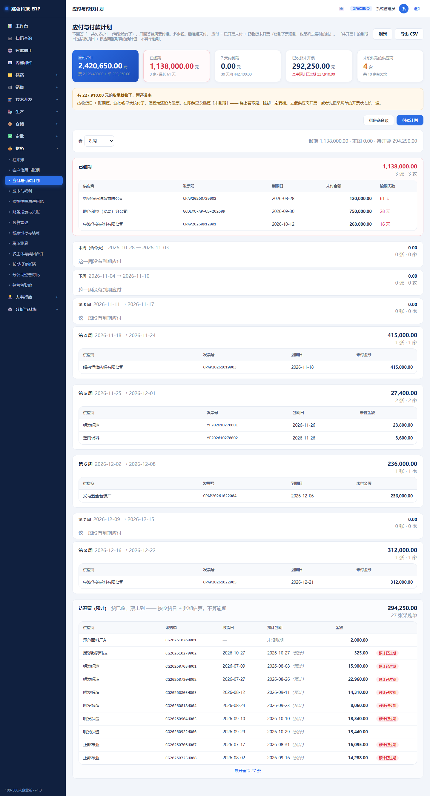

第一组永远是**「已逾期」**（它不是"计划"，是"已经晚了"，混进"本周"会让人以为还有时间）。
后面按周排，空周只占一行。最后单独一块**「待开票（预计）」** ——
按收货日 + 账期估算，**不算逾期**（付款义务还没正式成立），但计划里必须有。

**账期怎么设**

台账行末尾点「改账期」。说明随便写（「月结 30 天」「现结」「货到 15 天」），
系统会自动读成天数；读不出来（比如「按季度结」）就**手工填天数**，填了以天数为准。

> **到期日 = 开票日 + 账期**。以前采购收货时是拿「预计到货日」当到期日的，
> 于是月结 30 天的单子账龄凭空多出 30 天 —— 已修正。

### 付款要走三步：申请 → 审批 → 出纳付款

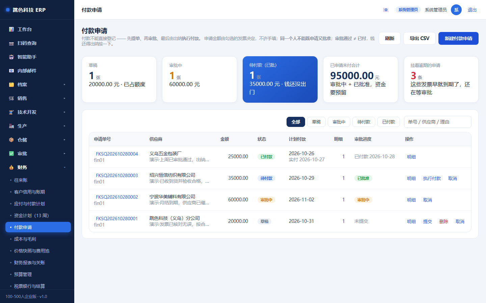

财务 → **付款申请**。这里管的是「钱怎么出去」。

> **为什么不能像以前那样直接登记一笔付款**
> 以前是在「往来账」页填个金额、勾几张发票就出去了，**没有第二个人看过**。
> 审计一问「这笔 35 万谁批的」就答不上来。所以现在拆成三步：
> **提单（财务）→ 审批（财务主管 + 总经理）→ 执行付款（出纳）**。

**第一步：提单**

点右上「新建付款申请」，流程是**先选供应商、再勾发票、最后才看到金额**：

1. 选供应商（只列有未付应付的）
2. 勾要付的发票。每张票会显示四个数：
   - **未付**：这张票还欠多少
   - **已占用**：别的申请单已经占了多少（下面会写出是哪张单）
   - **可申请**：这两者相减，你能申请的上限
   - **本次申请**：默认带全额，可以改小
3. 填申请理由（≥4 字）—— 写「为什么现在付这笔」，比如「月结到期，供应商已催两次」
4. 点「保存并提交审批」

> **金额不能手填。** 想付 5 万就勾出 5 万的发票。允许填一个总数，就会出现
> 「钱付了、账上应付还挂着」—— 这种孤立款对账时最难查。
>
> **同一张票不能重复申请。** 一张票的未付额被某张申请单占住后，
> 别人再申请就只能申请剩下的部分。这是防「两人各提一次、同一张票付两遍」。

**第二步：审批**

提交后单子变成「审批中」，要去 **审批中心 → 待我审批** 里处理。

默认两级：**财务审核 → 总经理审批**（金额区间可以在审批流配置里改）。

> **自己提的单不能自己批。** 哪怕你是管理员也不行 —— 付款是唯一能把钱搬出
> 公司的动作，一个账号既能申请又能批，等于没有审批。
>
> 被驳回的单会退回「草稿」，改完能重新提交，不用重开一张。

**第三步：出纳执行付款**

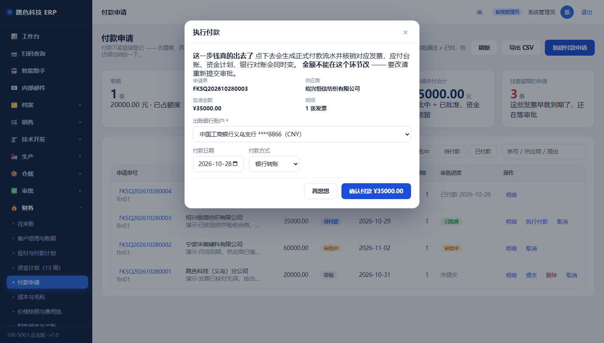

审批全过之后，单子变成**「待付款」**。这时出纳在列表里点「执行付款」：

- **必须选一个出账银行账户**（没账户的流水永远对不上银行账）
- 填付款日期和方式
- 点「确认付款」

点下去之后才会真的生成付款流水、核销发票。**审批通过不等于钱已经付了** ——
这两个动作必须分开，因为中间往往要等资金到位、等票据。

> **执行时不能改金额。** 批准 3.5 万就只能付 3.5 万。要改金额请重新提交审批 ——
> 否则等于绕过审批改数字。

**几个状态的意思**

| 状态 | 意思 | 能做什么 |
|---|---|---|
| 草稿 | 还没提交 | 改、删、提交 |
| 审批中 | 等人批 | 只能取消 |
| 待付款 | 批完了，钱还没出门 | 出纳执行付款、取消 |
| 已付款 | 钱已出账，发票已核销 | 只能看（要退只能走退款/红冲） |
| 已取消 | 撤回了，额度已释放 | 只能看 |

**取消一定要写原因**（≥4 字）—— 谁撤的、为什么撤，事后要能查。

**在应付台账上看「这笔提过申请没有」**

应付台账新增了一列 **「付款流程中」**：这家供应商有多少钱已经在申请单里
（草稿 + 审批中 + 待付款），几张单。看到这个数就不用挨个去翻申请单了。

> 小提示：申请单**只是占用额度，不算已付**。所以应付合计不会因为提了申请就变小，
> 只有真正「执行付款」之后，应付才会减、银行账才会动。

### 钱够不够撑到年底：资金计划

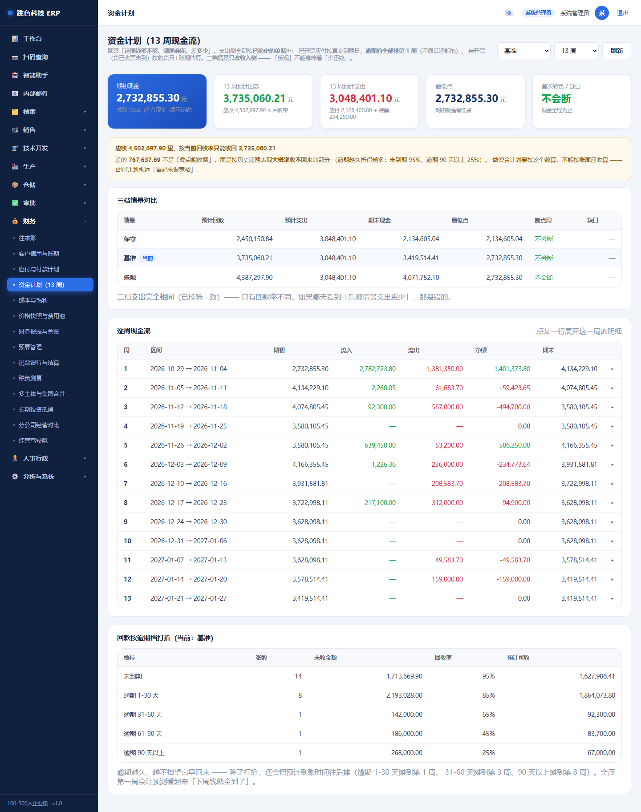

财务 → **资金计划（13 周）**。回答三个问题：**现在手上有多少、这几个月要出去多少、
哪一周会断。**

**期初现金从哪来**：总账「库存现金 + 银行存款」（1002）的余额。不是银行账户页填的期初数 ——
那个只是对账起点。

**支出侧全是确定的单子**

| 出处 | 怎么排 |
|---|---|
| 已开票应付 | 按真实到期日 |
| **逾期应付** | **全部排第 1 周** |
| 已收货未开票 | 按「收货日 + 供应商账期」估算，标「预计」 |
| 工资 | 近 3 期月均，每月 10 日 |
| 固定费用 | 预算期间费用月均，每月 15 日 |

逾期应付排第 1 周这条要说清楚：**已经逾期就随时可能被催**，做计划不能假设
「供应商还会让我们欠着」。宁可计划里早付，也不能计划里假装还能拖。

**收入侧要打折，这是最容易被自欺欺人的地方**

页面顶部黄条会写：应收 450 万，按当前回收率只能收回 373 万，差的 76.8 万
**不是「晚点能收回」，而是大概率收不回来**。

| 档位 | 回收率 |
|---|---|
| 未到期 | 95% |
| 逾期 1-30 天 | 85% |
| 逾期 31-60 天 | 65% |
| 逾期 61-90 天 | 45% |
| 逾期 90 天以上 | 25% |

除了打折，预计到账时间还会往后摊（逾期越久摊得越晚）。**全压第一周会让预测
看起来「下周钱就全到了」**，反而误导排款。

**三档情景：只改收入，不改支出**

右上角可以切「保守 / 基准 / 乐观」。注意：**三档的支出完全相同** ——
「乐观」不能意味着「少还钱」。所以如果你看到「乐观情景支出更少」，那是错的。

老板一般看两个数：**期末现金**（到时手上还有多少）和**断点周**（哪一周转负、缺多少）。

**点某一行可以展开**：这一周要收谁的、收多少、按几成算的；要付谁的、哪张单、为什么这周付。

---

## 五、总账与关账

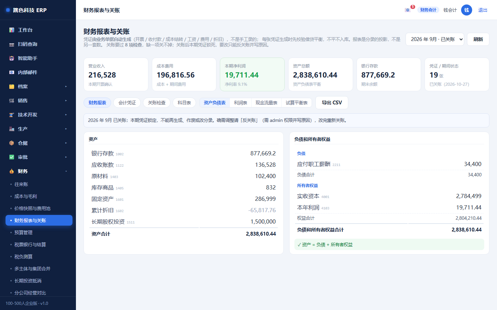

### 凭证不是手工录的

系统按业务单据**反推凭证**（9 类模板），借贷必平才让过：

| 业务 | 生成的凭证 |
|---|---|
| 发货 | 借 应收 / 贷 收入 + 应交税费 |
| 采购收货 | 借 原材料 / 贷 应付 |
| 付款 | 借 应付 / 贷 银行存款 |
| 折旧 | 借 制造费用 / 贷 累计折旧 |

### 关账顺序

```
生成凭证 → 试算平衡 → 资产负债表 / 利润表 / 现金流量表 → 八项关账检查 → 关账
```

八项检查会拦「账不平、有未过账凭证、库存与总账不符」这类问题。**检查不过不许关账。**

### 两条铁律

1. **已关账期间不能补凭证**：补了以后权益（4103）还是老数，资产负债表就不平，合并表直接出不来
2. 要修正已关账期间的成本/收入，用**「可比口径调整」**（只影响分析口径不改账），或先反关账再重结

---

## 六、价格快照与费用池

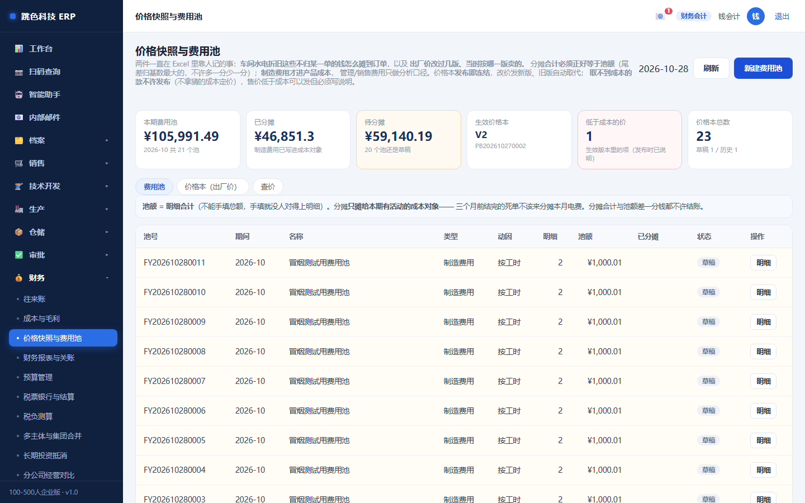

### 费用池

- **池额 = 明细合计**（不能手填）
- 按动因分摊（工时 / 件数 / 材料额 / 收入）到**本期有活动的成本对象**
- **分摊合计必须正好等于池额**（尾差归基数最大的对象），对不上不许结账
- 撤销分摊要写原因，并回滚实际成本

### 价格本

- 按「范围 + 客户」**版本化**，**发布即冻结**
- 同范围同客户只有一版生效，改价基于旧版发新版
- **取不到单件成本不许发布**（不拿猜的成本定价）
- 取价规则：客户专价优先于通用价，命中数量档取该档价

---

## 七、税票银行与预算

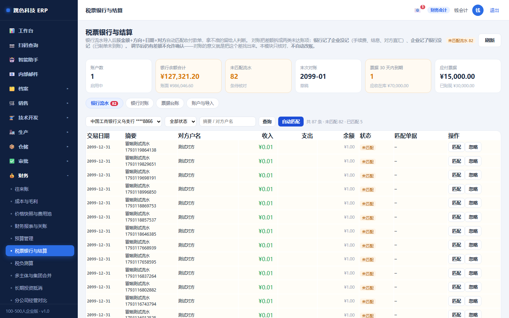

- **银行流水导入 → 匹配 → 对账**：没匹配上的要人工确认
- **票据登记**：进项/销项发票，和应收应付勾稽
- **税负测算**：税率按「主体 × 税区 × 税种 × 期间」配，**没配不许测算**，绝不默认 13%

### 预算的三档超支

| 档 | 处理 |
|---|---|
| 容忍内 | 直接过 |
| 写说明特批 | 填说明，留痕 |
| 硬拦 | 不许提交 |

执行口径：**已用 = 已发生 + 已占用**（占用的钱也不能再花第二遍）。

---

## 八、集团合并（有子公司才用到）

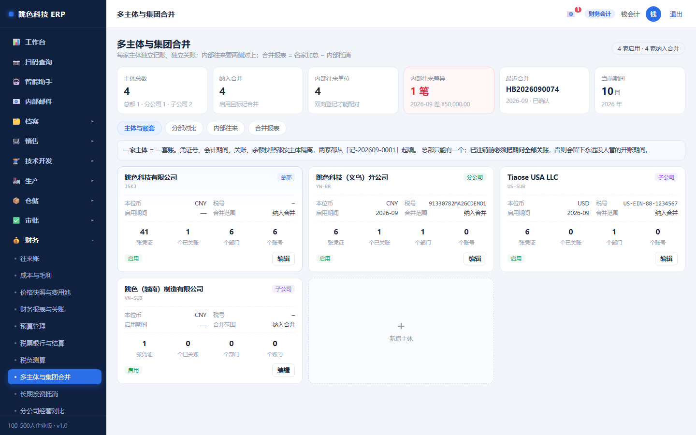

合并最容易错的一块：**长期投资抵消只对子公司做**。

| 概念 | 规则 |
|---|---|
| 长投 ↔ 子公司权益 | 全额对冲 |
| 商誉 | = 长投 − 子公司权益 × 持股比例 |
| 少数股东权益 | = 权益 × (1 − 持股比例) |
| 分公司 | **不抵消**（非独立法人、无股权），直接并入 |

**抵消分录借贷不等，直接不出合并表** —— 宁可不给数，也不给错数。

---

## 九、为什么有些按钮点不了

| 现象 | 原因 | 解决 |
|---|---|---|
| 成本单存不了 | 缺项（材料/工缴没填） | 补齐 |
| 审核通过后分单还是不行 | 不是你的角色点分单 | 分单只有财务（或 admin）能点，你去点 |
| 费用池结不了账 | 分摊合计 ≠ 池额 | 重算分摊 |
| 价格发布不了 | 取不到单件成本 | 先做成本单，不许猜 |
| 凭证过不了 | 借贷不平 | 查分录 |
| 关账被拒 | 八项检查没过 | 看提示，逐项处理 |
| 补凭证被拒 | 期间已关账 | 用可比口径调整，或先反关账 |
| 合并表出不来 | 抵消分录借贷不等 | 查长投与权益数据 |

---

## 十、常见问题

**Q：客户付了钱，订单还是不能结案？**
看应收是否已核销完。收款要**核销到具体发票**，只登记收款不核销，系统仍认为没收到。

**Q：汇率变了，老订单的应收要不要调？**
不调。应收是开票时点确定的债权，汇率变动是汇兑损益，另做账。

**Q：费用池为什么不能按部门平均分？**
可以按件数或收入分，但不能「平均分」—— 没有动因的平均分会让高工时产品少摊成本、低工时产品多摊，毛利全是错的。

**Q：出纳能记账吗？**
默认不能。出纳与会计是分开的岗位，出纳只做银行结算；记账权限按岗位复核结果单独控制。

**Q：月末关账前要检查什么？**
看「八项关账检查」：凭证是否全部过账、试算是否平、库存与总账是否一致、有没有异常余额。逐项过完再关。
