# 06 · 人事行政培训手册

> 适用岗位：人事 / 行政 / 出纳（人事职能）
> 系统权限：`hr`
> 你在系统里的职责：**员工档案、考勤、请假审批、薪酬、绩效、行政合同与用印、组织编制**

---

## 一、你的界面


⚠️ **人事岗位在系统里能看到全公司的工资和身份证号**。这是最高敏感的数据，
系统里除了你、财务、总经理和管理员，其他人（包括销售）都看不到这两列。

---

## 二、一天的节奏

| 时间 | 做什么 | 在哪 |
|---|---|---|
| 上班 | 看昨天谁的考勤异常（迟到/缺卡） | 考勤打卡 |
| 上午 | 处理请假申请 | 请假管理 |
| 随时 | 新人入职建档、离职办手续 | 员工档案 |
| 月末 | 生成薪酬 → 核对 → 确认 → 发放 | 薪酬核算 |
| 每月 | 绩效周期：生成 → 确认 → 申诉处理 | 岗位绩效 |
| 随时 | 合同到期提醒、用印审批 | 行政合同与证照 |
| 每季 | 编制与岗位调整 | 组织编制与岗位 |

---

## 三、员工档案


| 字段 | 注意 |
|---|---|
| 工号 | 建议用「部门缩写+序号」，后面所有单据都会引用 |
| 姓名 / 部门 / 岗位 | 部门决定他在绩效和审批流里的归属 |
| 入职日期 | 影响年假与司龄 |
| 身份证 / 基本工资 | **只有人事、财务、总经理、管理员看得到**，其他人看到的是空 |
| 状态 | 在职 / 离职。**离职不要删，改状态** —— 删了历史单据上的名字就没了 |

### 离职要知道的

离职后：
- 账号要停用（在「用户与角色」里，这一步是管理员做）
- 考勤与薪酬记录保留，不要删
- 编制要释放（回「组织编制」把任职结束）

---

## 四、考勤


- **打卡是本人动作**，所有在岗员工都能打，不归你代打
- 上班打卡晚于 **09:00** 记**迟到**
- 一天只有一条记录（同一天再打卡会更新，不会重复）

你要做的是**看异常**：谁没打卡、谁迟到多。异常的补录要写原因（系统有备注字段，别留空）。

---

## 五、请假


流程：

```
员工本人提交 → 人事审批 或 部门负责人审批 → 通过/驳回
```

**提交和审批是两个不同的权限**：
- 所有在岗员工都能提交自己的请假（`leave.write`）
- 审批需要人事或部门负责人（`leave.review`）

> 这条是特意拆开的。原来提交和审批共用一个权限，等于谁都能给自己批假。

审批时看三件事：日期有没有冲突、天数算得对不对、理由是否合理。驳回要写原因。

---

## 六、薪酬核算


三步走：

```
生成（按在职员工 + 基本工资 + 考勤/绩效扣款）
   ↓
核对（逐个看，有异议先改）
   ↓
确认 → 发放
```

| 规则 | 说明 |
|---|---|
| **读取也限岗** | 工资表只有人事、财务、总经理、管理员能看，销售看不到 |
| 一个月一个期间 | 同期只能有一批 |
| 确认后不能随便改 | 要改先撤回或冲销，留痕 |
| 发放记录 | 发放日期与方式是凭证依据 |

⚠️ **薪酬算错不要直接改库**。改了没人知道改过什么。用「作废 + 重算」或补差调整。

---

## 七、计件工资（按件算工钱）

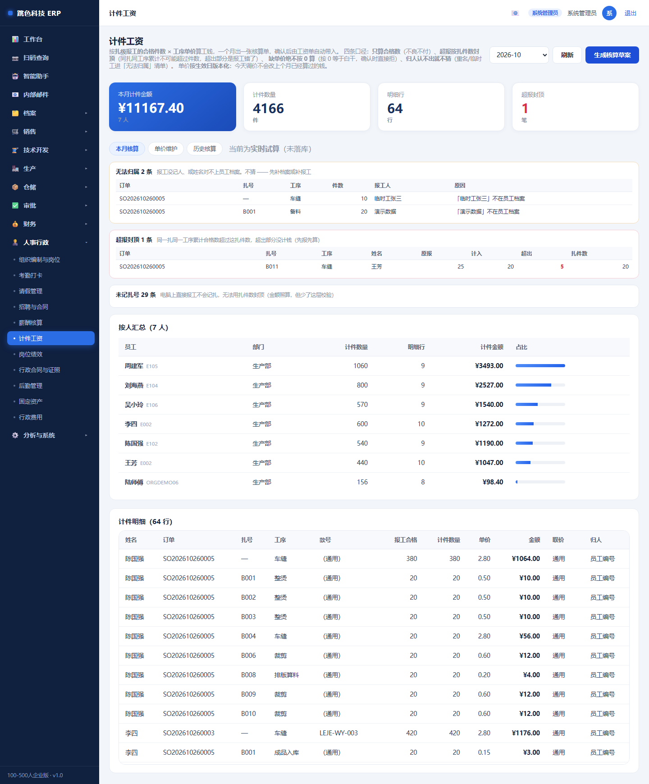

「人事行政 → **计件工资**」，一个月做一次，四步：

1. **先配单价**（页签「单价维护」）：每个工序多少钱一件，可以按款单独定价；
   不填款号就是通用价。**改价要加一条新生效日的，不要改旧的** —— 旧价改了，上个月已经算过的钱就对不上。
2. **月初试算**：选上个月，页面直接给你结果 —— 多少人、多少件、多少钱，还有三块「算不准」的地方要看。
3. **生成草案** → 核对 → **确认**。确认后这份单就冻住了，工资单会带入这个金额。
4. 工资单页点「生成工资单」，计件自动进「计件」列，与基本工资、社保、个税一起算。

### 三块必须看的地方

| 提示 | 意思 | 怎么办 |
|---|---|---|
| **缺单价** | 有些工序没定价，这些没算钱 | 补单价，否则**不能确认**（按 0 算等于白干） |
| **无法归属** | 报工不知道是谁做的（临时工/姓名对不上档案） | 补员工档案，或在备注里写一句怎么处理 |
| **超报封顶** | 同一扎同一工序报的件数超过扎件数，超出部分没算钱 | 核对是否报错扎号，改完重新生成 |

> 页面上还有「未记扎号」的提示：电脑上直接报工不会记扎，这些钱照算，但少了「不超过扎件数」这层校验。
> 想按扎管住，就让车间用手机扫扎标报工。

### 几条规矩

- **只算合格数**，不良不付钱。
- **一个月份只能确认一次**。要改先作废（写理由），再重新生成。
- **计件金额不能手动改**。它只能从核算单来 —— 手填的计件没有报工依据，对不上账。
- 工资单已经确认或已发放时不会再被覆盖，那人这次的计件**不会进单**；
  生成工资单时会弹窗点名提醒，看到就去核对。

> 单价改动不会影响已经确认过的核算单。这是故意的：工钱发出去就不能变。

### 报工那天人在不在（考勤联动）

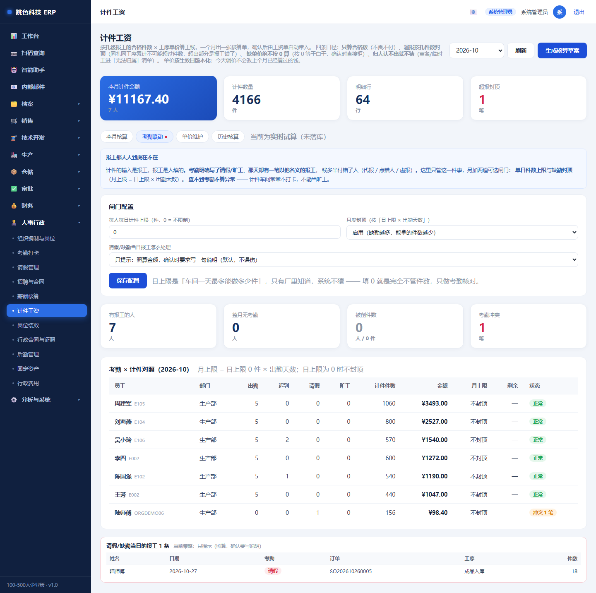

上面那三块看的是「算不算得准」，这一块看的是「**该不该给这个人**」。

报工是班组长填的。人请假了活是别人干的、点错下拉框、甚至凭空报一笔 ——
这些事防不住，但钱会付错人。页签「**考勤联动**」就是干这个的：

| 闸门 | 怎么判 | 默认行为 |
|---|---|---|
| **报工日请假/缺勤** | 那天考勤写着请假或旷工，却有他的报工 | **只提示**，照算，确认时写一句说明 |
| **单日上限** | 同一人同一天计件件数超上限 | 超出部分不计，逐笔列出 |
| **缺勤封顶** | 全月件数超「日上限 × 出勤天数」 | 超出部分不计，逐笔列出 |

三条处理策略（「闸门配置」里选，默认第一条）：

- **只提示**：钱照算，但确认时要写一句「怎么处理的」。**不误伤**，先看清再决定。
- **剔除不计**：这些笔不算钱，逐笔列出金额（合计显示在诊断块标题上）。
- **不许确认**：一笔冲突就拦住，先把报工改到真正干活的人名下。

**两种情况下系统不封顶 —— 不是漏了：**

- 日上限填 **0** = 完全不管件数，只做考勤核对（默认就是这个）。
- 某人**整月没有任何考勤记录**时不做缺勤封顶。考勤没录不能当旷工，否则所有人都变 0 件。

> **现场建议**：先把考勤做齐一个月（打卡或月底补录），再开日上限。
> 日上限取「车间一天正常能做多少件」，宁可往宽了设 —— 它是用来防异常的，不是压产量的。

### 发工资那天要用的两张纸

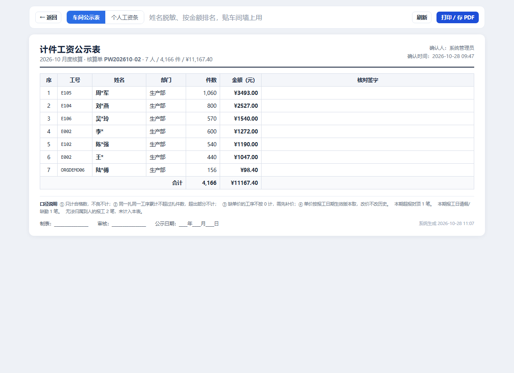

核算单**确认之后**，页面上会多出两个按钮：**「出工资条」**和**「车间公示表」**。这两张纸解决的是同一个问题：
工人说「我这个月应该更多」，你翻系统给他看，他说看不懂。**数字要在当场说清楚，不能等发完钱再解释。**

**车间公示表**（贴墙上）

- 按金额排名，**姓名脱敏**（周*军、李四→李*），金额不遮 —— 要的是能核对，不是能围观。
- 右边留「核对签字」列：有异议当场来划，别等发完钱再说。
- 底部印着本期口径：超报封顶几笔、请假缺勤日报工几笔、无法归属几笔。

**个人工资条**（裁开发到手上）

- 每人一条，虚线裁开；含工序明细（工序 × 订单）、合计、本人签字栏。
- 有条子被上限封顶、或落在请假/缺勤日的，条子上会单独写一行说明 ——
  **这两类最容易被当成「少算了」，提前写出来比事后解释省十倍口舌。**

**三条规矩**

1. **只对「已确认」的核算单出纸**。草案的数字还会变，照草案发出去，第二天改数就是吵架。
2. **打印用浏览器自带打印**（Ctrl+P / 页面右上「打印」），选「另存为 PDF」也行。
3. 两张纸都带核算单号和确认人 —— 工人拿着条子来问，纸面上要能自证出处。

### 三个常见误区

- 「**没打卡就是没来**」—— 错。计件车间常常不打卡，系统只认考勤里写明的请假/旷工。
- 「**设了日上限，所有人都会少拿**」—— 不会。上限只削超出部分，正常产量不受影响。
- 「**剔除不计之后就查不到了**」—— 剔除的笔会留在诊断清单里（含金额），随时能翻回去看。

---

## 八、岗位绩效


| 概念 | 说明 |
|---|---|
| **模板版本化** | 指标规则改了要发新版本，旧版本的历史评分不变 |
| **建议分 ≠ 确认分** | 系统按数据算建议分，确认分由人定，两个数都留着 |
| **周期冻结** | 周期冻结后不能再改分 |
| **申诉独立复核** | 员工申诉由**另一个人**复核，不能让原评分人自己判 |

绩效指标规则要写清：指标、权重、数据来源、封顶分。**没有数据来源的指标等于拍脑袋**。

---

## 九、行政合同与用印


### 合同

- 合同有**版本**：改了要发新版本，旧版本留着
- **到期提醒**：到期前会进日历，别等过期才发现
- 续签 / 终止 / 归档各有状态，归档后只读

### 用印（最需要规矩的一块）

```
申请用印 → 审批 → 用印 → 归还（借出的章）
```

| 规则 | 说明 |
|---|---|
| **印章按公司独立授权** | A 公司的章不能给 B 公司用 |
| **授权有期限** | 到期自动失效，不能长期放开 |
| **借章必须归还** | 借出记录挂在你名下，没归还会一直提醒 |
| **访问留痕** | 谁在什么时候用了哪个章，都有记录 |

⚠️ **不要让别人的账号替你申请用印**。记录里是谁的账号就是谁的责任。

---

## 十、组织编制与岗位


- **岗位**：公司有哪些岗、属于哪个部门
- **编制**：每个岗几个人
- **任职**：谁在哪个岗上，占一个编制
- **占编规则**：任职批准时才占编，草稿不占

调整编制要走审批（`org.approve` 是财务/总经办的口），不是人事自己批。

---

## 十·补 技能矩阵与岗位资格

**入口**：左侧「人事行政」→「技能矩阵与资格」。生产主管也能进（要排产），销售、仓库看不到。

这页回答三件事：**这道工序现在有几个人真能上**、**这个人能不能上**、**下个月谁会掉资格**。

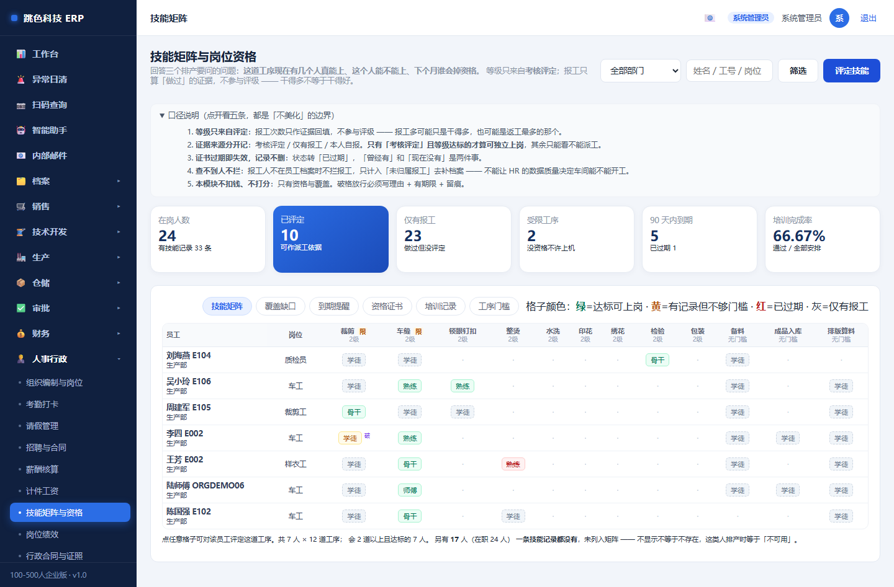

### 第一步：先看清家底（不要急着手工填）

打开「技能矩阵」，你会看到两种颜色：

- **绿色**：考核评定过、等级达标 —— 这才算「能独立上岗」
- **灰色虚框**：只有报工记录，**没人评定过** —— 说明他做过，但不说明做得好

顶部「仅有报工 23 / 已评定 10」就是这个差距。系统已经把历史报工自动回填成「做过」的证据，
**但等级一律按 1 级（学徒）处理**，因为报工多不代表干得好（也可能是返工最多的那个）。

### 第二步：评定（唯一能改等级的地方）

点任意格子 → 弹窗里选等级（学徒/熟练/骨干/师傅）、填有效期、**写评定依据**（至少 4 个字）。

依据必须写清「考了什么、做了几件、返工多少、谁在旁边看」—— 评级要有人负责，否则矩阵就是谁都能填的数字。

- 降级会明确提示（多半是复评没过，别以为点错）
- 评定过的技能到期会进「到期提醒」，过期即失效，但**记录不删**（「曾经有」和「现在没有」是两件事）

### 第三步：只在必要的地方打开「受限」

「工序门槛」页能逐道工序设：最低等级、至少几人、**是否受限**。

**受限 = 没资格就不许报工**。打开前先看「当前合格」那一列：

- 写着 `5 / 3`（绿）→ 可以打开
- 写着 `0 / 1`（红）→ **千万别打开**，打开后这道工序当天就没人能报工（系统会弹警告告诉你）

建议顺序：先补人、再设限。一上来全打开，车间当天停线。

### 第四步：到期与培训

- 「到期提醒」把**技能复评 / 资格证书 / 复训**三类到期合在一起，可切 30/60/90/180 天。
- 「资格证书」登记的是**员工个人证**（叉车、电工、质检资格）。公司证照（营业执照、消防）在「行政合同与证照」里，两回事。
- 「培训记录」里不通过**不会扣钱、不会自动降级**，只提示安排复训。

### 例外怎么办：破格放行

受限工序确实缺人时（旺季、老师傅请假），可以给某个人开**破格放行**：

- 必须写理由（至少 6 个字）
- **必须有到期日**（没期限的破格等于永久后门）
- 会记进「覆盖缺口」的破格列，排产和稽核都看得见

### 三个常见误解

**Q：为什么报工 9 次的人还是「学徒」？**
因为等级只来自评定。报工只证明他做过，不证明他做得好。想让他变成熟练，去点格子评定。

**Q：车间说报不了工，提示「受限工序」怎么办？**
三种解法：① 给他评定到门槛等级；② 开破格放行（要写理由和期限）；③ 把该工序的受限关掉（人事/管理员才能改）。

**Q：报工人不在员工档案里，会不会报不了工？**
不会。**查不到人时不拦报工**，只会计入「未归属报工」提醒你去补档案 —— 不能因为 HR 少录一个人就让整条线开不了工。

---

## 十·补二 员工自助与薪资申诉

**入口**：左侧「我的自助」（所有人都有，排在「工作台」下面）。

这页给两类人用：**员工**看自己的东西、提申请；**人事/财务**受理。

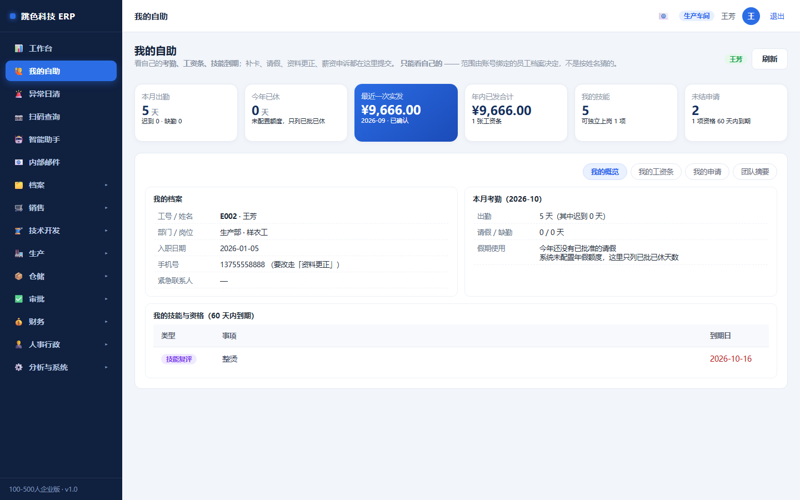

### 第一步（人事）：先把账号绑到员工档案上

这是整个自助的前提。系统**不会**按姓名自动匹配 —— 库里 10 个登录账号
（系统管理员 / 销售小王 / 李工 / 赵主管…）没有一个能对上员工档案，
按名字猜会把「销售小王」绑到「王芳」身上，那就是把别人的工资给人看了。

「我的自助 → 账号绑定」里选账号 + 选员工，绑一次即可。**一个员工只能绑一个在职账号。**

绑之前，员工登录看到的是：

> 当前账号还没绑定员工档案 · 无法查看个人数据。请联系人事在「我的自助 → 账号绑定」里把你的账号绑到员工档案上。

### 员工能看到什么

| 内容 | 说明 |
|---|---|
| 本月出勤、迟到、缺勤 | 按考勤记录算；**没有记录不等于缺勤**，页面会写明「本月还没有考勤记录」 |
| 今年已休假期 | 只列已批已休天数。系统没配年假额度，所以不显示「剩余几天」——不编数字 |
| 我的工资条 | **只有已确认/已发放的才显示**。核算中的不给看：看了又改只会制造申诉 |
| 我的技能与到期 | 60 天内到期的技能复评与证书 |
| 我的申请 | 每条都有单号、状态、回复期限；未处理的可以自己撤回 |

### 工资条怎么申诉

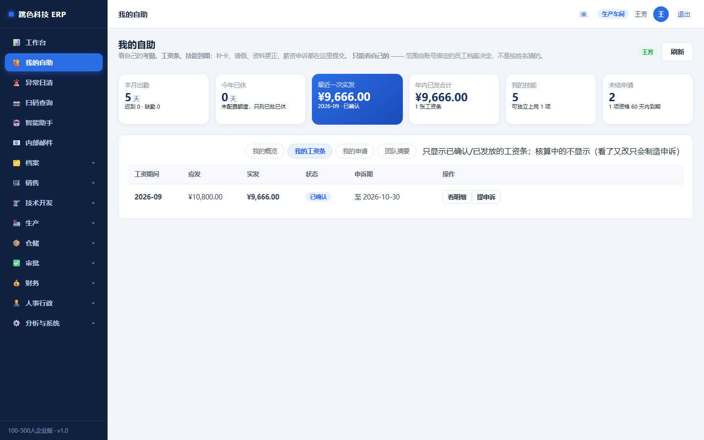

点「看明细」看拆分（基本工资 / 加班 / 奖金 / 扣款 / 社保个税），点「提申诉」填原因与诉求金额。

三条规矩：

1. **只能申诉自己的**，且只能申诉已确认/已发放的那一期
2. **申诉期 30 天**（从发放日算）。过期了按钮就不显示，页面写明「已在某日截止」
3. **同一张工资单只能有一条处理中的申诉** —— 防重复补款

### 人事/财务怎么受理

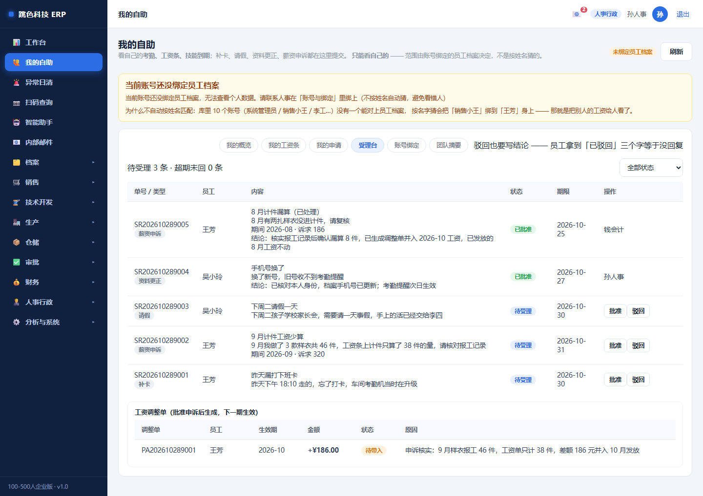

「受理台」里每条都有主责、期限。补卡 3 天、请假 3 天、资料更正 5 天、薪资申诉 5 天，
超期会标红。

- **驳回也必须写结论**（至少 5 个字）。员工拿到「已驳回」三个字等于没回复，下次还会提同样的单。
- **批准补卡**：会真的写进考勤（考勤不是「已付历史」，可以改）。
- **批准资料更正**：会真的改档案里的手机号/紧急联系人。
- **批准请假**：系统**不会**自动生成请假单 —— 请假要占额度、要扣薪，
  自动开会变成两套状态。请到「请假管理」里按结论登记。
- **批准薪资申诉**：必须填调整金额，系统生成一张**下期生效**的调整单。
  **已经发出去的那一期工资不会被改**，否则上月报表、个税、银行流水全部对不上。

### 主管能看到什么（以及看不到什么）

主管进「团队摘要」只看得到：出勤天数、迟到、缺勤、请假天数、在岗状态。

**看不到工资金额，也看不到请假类型** —— 病假属于敏感信息，要本人或人事处理。
这是有意的边界，不是权限没配好。

### 常见问题

**Q：员工说看不到自己的工资条？**
先查两件事：① 账号有没有绑定员工档案；② 那期工资是不是还是「草稿」状态（核算中不对员工可见）。

**Q：申诉批准了，为什么这个月工资没变？**
调整单是**下一期**生效。本月已发放的不动，下个月发工资时会带上。

**Q：员工能自己改手机号吗？**
能，走「资料更正」，人事批准后直接改档案。但**工资、岗位、部门、银行卡不能自助改**，
必须走线下（有审批与留痕）。

---

## 十·补三 办公耗材怎么管（行政日常）

入口：左侧「人事行政」→「办公耗材与服务采购」。三个标签：**耗材与库存 / 申领 / 采购与服务**。

### 一、先建档案，再看库存

「新建物品」填名称、规格、单位、最低库存。有两个勾选项要想清楚：

| 选项 | 什么意思 | 后果 |
|---|---|---|
| **耐用品** | 打印机、椅子、柜子这类 | 验收时**逐件建资产卡**（一物一码），金额**不进费用**；不进办公仓，所以「库存 0」不是缺货 |
| **部门月限额** | 每个部门每月最多领多少（0 = 不限） | 超了要写例外说明才让提交。防的是「某部门一次领走半年的量」 |

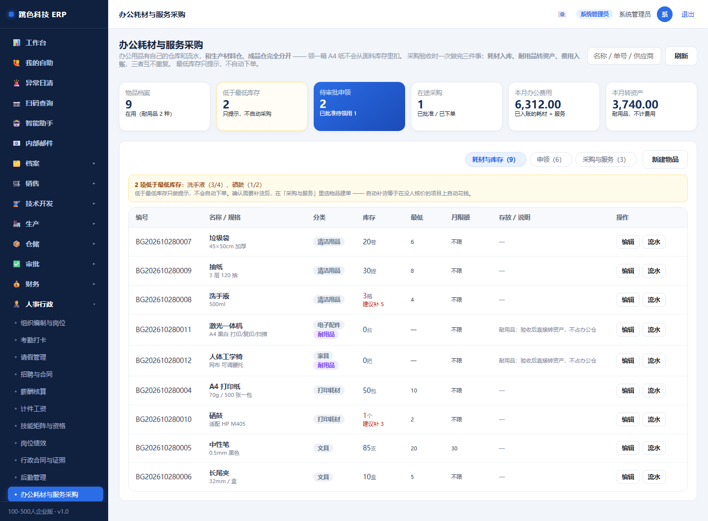

### 二、申领：三道闸会拦住你

提交时会检查三件事，任何一条不过都提交不了：

1. **库存不够** → 「库存只有 3，申领 5 不够」。要么少领，要么先去采购。
2. **重复领用** → 你已经有一条同样的单还没领完。等它领完再提。
3. **超部门月限额** → 填「例外说明」（≥6 字，写清为什么必须超），提交后行政能看到这句说明。

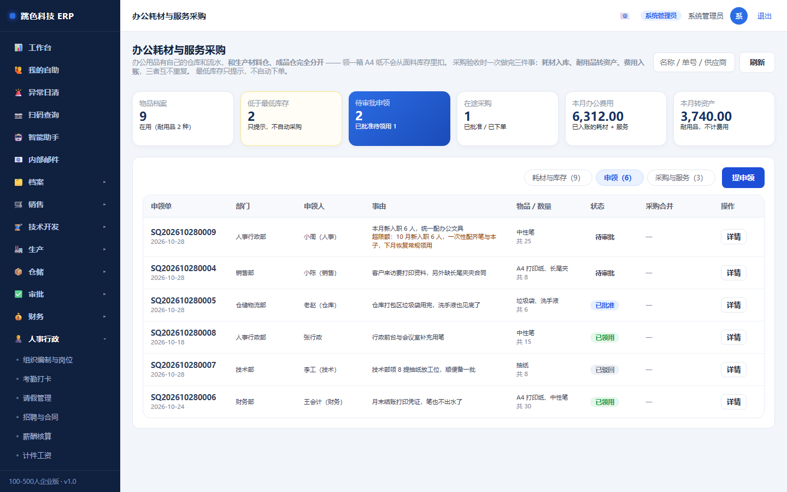

草稿不算「未结」，所以填一半存草稿不会挡住你自己再提一张。

### 三、领用：出库才扣库存

申领被批准后，状态是「已批准」。这时候**库存还没动** —— 要去点「出库发料」才真正扣减并记流水。
这一步是故意的：批了但没发出去的，库存还得算在仓里。

### 四、采购：验收一次做完三件事

采购单点「验收」时会同时做：

```
耗材（普通物品）→ 进办公仓、计入费用
耐用品        → 逐件建资产卡（在「固定资产」里能看到）、不计入费用
服务（保洁等） → 没有库存，直接计入费用
```

验收后系统自动生成一条**行政支出**（在「行政费用」页能看到，备注里带采购单号），
并**占用部门预算**。所以你**不需要再去「行政费用」手工录一遍** —— 手工录必漏，漏了月报永远对不上。

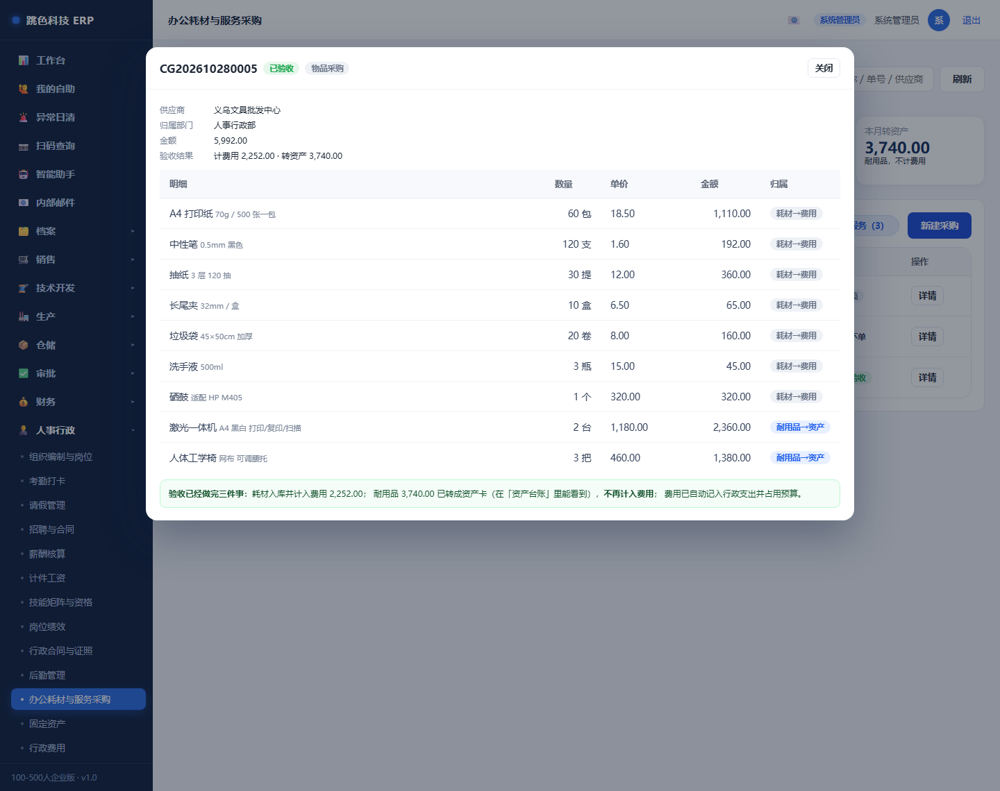

**两个会被拦住的地方**

- **金额 0 不能审批**：从申领合并来的单没有单价，得先把单价填上。0 元验收等于这笔钱在账上消失了。
- **已验收不能撤销**：货已经入库、费用已经入账。要退就走退货（走「库存」页的退货流程）。

### 五、合并采购：不要按单分开买

「新建采购」时会列出所有**已批准待采购**的申领，勾上就合并。
同一个物品会自动汇总成一行（三张申领各要 3、25 支笔 → 一行 28 支），不用买三次。
合并后记得**填单价**，然后审批。

同一张申领不能被两张在途采购单同时占用（防止重复买）；采购单撤销后会自动释放，可以重新合并。

### 常见问题

**Q：为什么「低于最低库存」不自动帮我下单？**
自动补货等于在没人核价的项目上自动花钱。系统只给清单和建议量，建不建单由人决定。

**Q：耐用品为什么不能申领？**
耐用品验收时已经转成资产卡了，不在办公仓里 —— 库存永远是 0。领用一台打印机要在「固定资产」里
做领用登记（记保管人），不是在耗材申领里。

**Q：办公领用会不会影响面料库存？**
不会。办公用品有自己一套仓和流水，和生产材料仓完全分开，没有任何交叉写入口。

---

## 十·补四 工衣、钥匙、工具在谁身上（资产工衣与领归）

入口：左侧「人事行政」→「资产工衣与领归」。四个标签：**领用台账 / 实物档案 / 超期与清退 / 损坏复核**。

固定资产那一页记的是「这东西值多少钱」，这一页记的是「**东西现在在谁手上**」。
两页各管一半，不要互相抄：净值在这里只读，折旧只在固定资产页算。

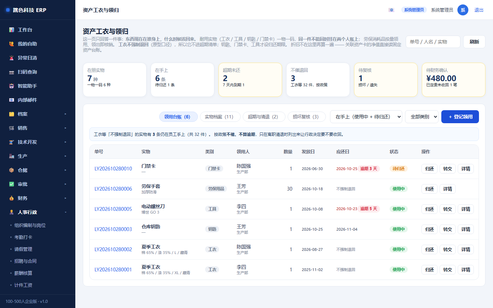

### 先建档案，再发给谁

「实物档案」里先建档，两种建法：

| 类型 | 什么时候用 | 关键字段 |
|---|---|---|
| **一物一码** | 工衣、钥匙、门禁卡、电动工具 —— 一件一号，能追到具体那一件 | 「一物一码」勾上，在册数量必须是 1，多件请分别建档 |
| **按量消耗** | 手套、口罩、耳塞 —— 领出去就没了，不回来 | 不勾「一物一码」，填在册数量；「必须归还」会自动关掉 |

「必须归还」与「一物一码」是**两件事**：

- 工衣：一物一码，但按政策**不强制退回** → 发出去不设期限、不进超期清单（只显示「不强制退回」）
- 钥匙 / 门禁卡 / 工具：一物一码，**必须归还** → 发的时候要定归还日，过期进超期清单

> 把这两件事合成一个开关的后果很具体：所有工衣都变成「逾期」，清单里天天几十条红色，
> 一个星期后就没人看这个清单了，真正逾期的钥匙反而沉在里面。

### 三个动作

| 动作 | 在哪里点 | 系统怎么记账 |
|---|---|---|
| **登记领用** | 台账右上「＋ 登记领用」 | 可先存**草稿**（不占实物），发放时才校验；一物一码的实物同一时间只能一个人在手 |
| **归还** | 台账行内「归还」 | 必须选实物状态：完好 / 磨损 / 损坏 / 遗失 —— **不知道好坏就定不了责** |
| **转交** | 台账行内「转交」（仅一物一码） | 系统先给原领用人记一条归还，再给新领用人开一条新记录，**不改名字**（改了就没有「谁用过这件东西」的历史） |

### 离职清退：一件一件点清

员工离职或调岗时点右上「发起离职/调岗清退」，系统把他名下东西一次列清，并分成两类：

- **必须归还**（钥匙、门禁卡、工具）→ 转「待归还」，以离职日为期限
- **不强制退回**（工衣）→ 只列出来，不改状态、不设期限

清单里必须归还的还有没回来的，**结不了案**；工衣没退回来**不拦结案**（按政策），但会记在备注里。

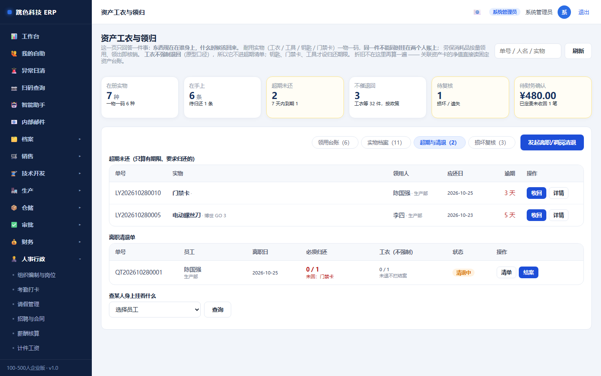

### 坏了、丢了谁负责

归还时选「损坏」或「遗失」，系统会让填情况说明和申报金额，然后生成一张**待复核单**。
复核只做一件事：给出**责任比例**（无责 / 部分责任 / 全责）。

> **这一步不会扣钱。** 定责金额要有财务填的回执号（收款凭证或工资扣款单号）才算落地。
> 行政判责、财务收钱，两个动作不能合并 —— 否则人事自己就能把赔偿「确认」进系统。

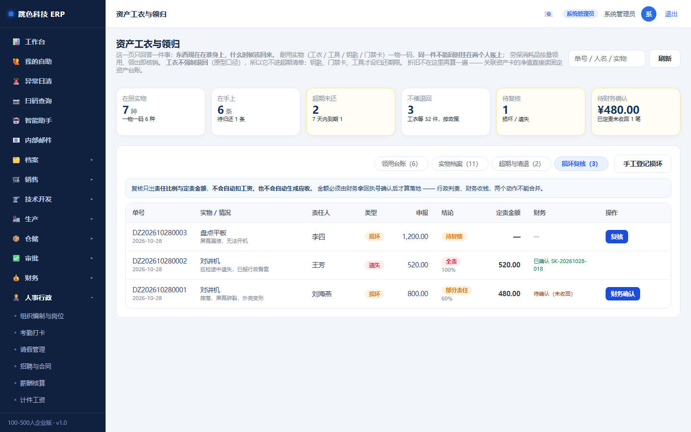

同一件实物，损坏归还后**可发量会变成 0**（状态「待处理」），不能再发给别人：

- 修好了 → 点「恢复」，写上处理结果（换了什么、检查结论），才回到「在册」
- 修不好 → 点「处置」，选报废变卖 / 转出 / 盘亏核销，**必须填处置单号**
- 遗失 → 系统直接按盘亏核销，不用再手工处置

### 四条容易做错的地方

1. **挂了资产卡的实物不要在这里处置**。系统会拒绝，并让你去「固定资产」页报废 ——
   那边才有处置价款和折旧，两边各报一次会出现两个净值。
2. **工衣不要设归还期限**。设了也不会生效（系统会清空），这是故意的。
3. **超期清单只认有期限的**。「领了很久」不是逾期，别拿它去催人。
4. **要点「恢复」**。坏的东西修好了不点恢复，永远发不出去 —— 这也是故意的。

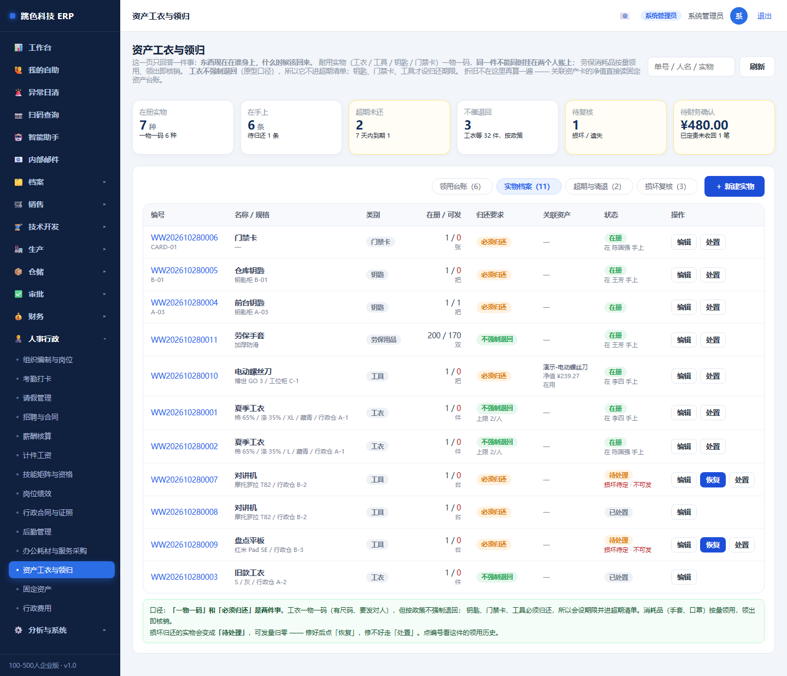

---

## 十·补五 行政运营报表（每月一次，给总经办看的那张表）

入口：左侧「人事行政」→「行政运营报表」。默认是本月，可以切月份与主体。

这张表把以前要开五个页面才凑得齐的东西放在一页：宿舍住得怎么样、行政花了多少、饭卡钱对不对、
耗材还剩多少、预算超没超、维修工单有没有人复验。

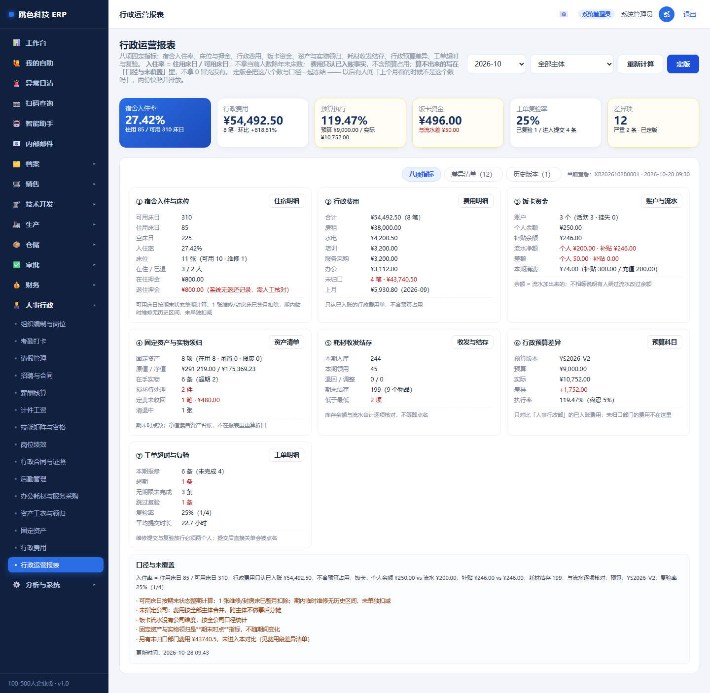

### 八项指标怎么看

| 指标 | 看什么 | 容易读错的地方 |
|---|---|---|
| 宿舍入住率 | **住用床日 / 可用床日** | 不是「现在住了几个人 ÷ 一共几张床」。月中有人退宿、新装床位时，那种算法一定错 |
| 床位与押金 | 可用床、维修床、空床日、在住押金、退住押金 | 退住押金系统没有「已退」字段，只提示「需人工核对」 |
| 行政费用 | 本期合计、按分类、按部门、环比 | 只算已经入账的费用单，**不含预算占用**（占用是承诺，钱还没花） |
| 饭卡资金 | 个人余额 / 补贴余额 / 流水净额 | 余额必须等于流水加出来的；不相等就是有人直接改过余额 |
| 资产与领归 | 固定资产原值净值、在手实物、超期、损坏待处理、定责未收回 | 期末时点数，不随月份变 |
| 耗材收发结存 | 入库 / 领用 / 退回 / 期末结存 / 低于最低库存 | 库存必须等于流水合计 |
| 行政预算差异 | 人事行政部预算 vs 该部门已入账费用 | 未归口部门的费用不进这个对比，但会单独点名 |
| 工单超时与复验 | 超期数、跳过复验数、复验率 | 超时和复验是两件事，一个可以准时交但没人验 |

### 为什么要「定版」

每次打开都是实时算的，数字会随补录变化。点右上「定版」会把这八个数**连同口径**冻成一份快照：

- 以后有人问「上个月看的时候不是这个数吗」，把两版并排放，指着差额说这次补了哪两张单
- 同一期间可以定版多次，旧版都留着
- 定版后如果还要再跑，系统会提醒你会生成新版本（不会悄悄覆盖）

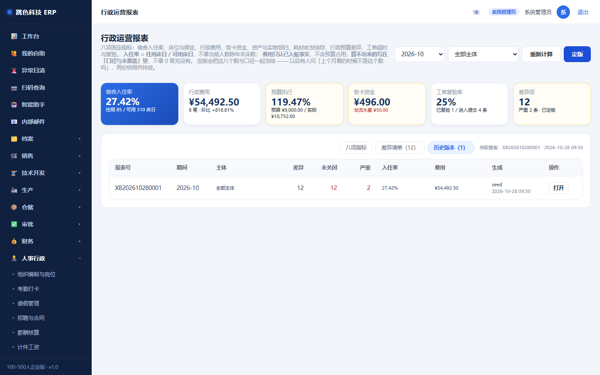

### 差异清单：从「发现问题」到「有人负责」

定版时系统会顺手把对不上的东西列成清单，每条都能分派、跟到关闭：

| 系统会自动点名的情况 | 严重度 |
|---|---|
| 维修床/封房上还有人住 | 严重 |
| 饭卡余额与流水不符 / 补贴余额不符 / 余额为负 | 严重 |
| 办公仓库存与流水合计不符 / 负库存 | 严重 |
| 维修工单提交后直接关单（没有复验人） | 严重 |
| 费用没挂部门（永远进不了部门预算） | 中等 |
| 工单过了期限还没完成 / 行政费用超预算 / 退住押金未退 | 中等 |
| 整月无人入住的房间 / 无保管人的在用资产 / 低于最低库存 / 工单没期限 | 提示 |

处理顺序是 **分派 → 处理 → 复核关闭**：

1. **分派**：填归谁查、什么时候给结果
2. **处理**：写清怎么处理的（改了哪张单）
3. **复核**：**由别人**核对后关闭

> 自己处理自己关的差异等于没复核，系统会拦住：必须先进「已处理待复核」，再由另一个人关闭。
> 确实不算问题的，点「忽略」并写理由（≥6 字），它不会消失，下个月再出现也看得见。

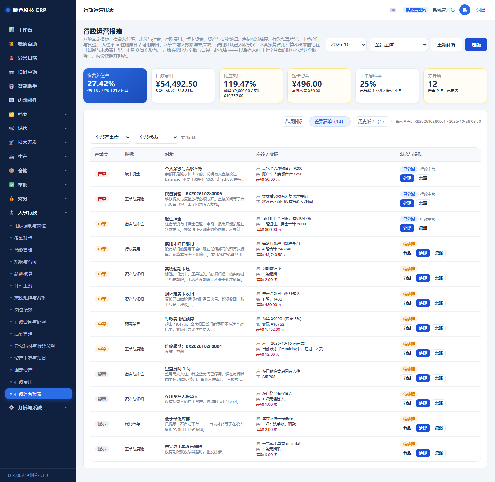

### 四条别做错的事

1. **别拿人数除床数算入住率**。分子是床日、分母也是床日，这是唯一站得住的口径。
2. **别把预算占用当实际支出**。占用只是「准备花」，月底会跟财务账差一大截。
3. **对账差额别「调平」**。饭卡余额对不上要走调整并留痕；办公仓库存不能绕过流水直接改 ——
   调平一次，这个数以后就没人信了。
4. **维修别自己修自己验**。提交和复验是两个人，这是制度，不是流程洁癖。

### 谁能看什么

- **汇总数字**（入住率、费用合计、预算执行）：全员可见，本来也是月度通报的内容
- **明细**（谁住哪张床、谁饭卡还剩多少）：需要人事/财务/管理员岗位；没有权限时姓名显示成「张**」
- **定版与关闭差异**：人事/财务/管理员

---

## 十一、为什么有些按钮点不了

| 现象 | 原因 | 解决 |
|---|---|---|
| 看不到身份证 / 基本工资 | 你的账号不是人事/财务岗 | 找管理员确认岗位 |
| 打不了卡 | 你选的员工不是本人 | 打卡只能打自己的 |
| 批不了假 | 你没有审批权限 | 人事或部门负责人才能批 |
| 薪酬打不开 | 读取限岗 | 找管理员确认岗位 |
| 绩效周期改不了 | 已冻结 | 冻结后不能改，走申诉 |
| 用印申请被拒 | 没有该公司的授权 / 授权过期 | 看授权记录，找管理员 |

---

## 十二、常见问题

**Q：新人第一天要做什么？**
① 员工档案建档 ② 组织编制里登记任职（占编） ③ 让管理员建账号并给岗位 ④ 合同登记。四步都做完，他才能打卡和进系统。

**Q：员工说工资少了，怎么查？**
看薪酬明细：基本工资 + 考勤扣款 + 绩效扣款。扣款都能点到来源（迟到几次、绩效哪项扣分）。

**Q：离职员工还能看到他以前的记录吗？**
能。状态改成离职，记录全留着。**不要删员工**。

**Q：请假审批该谁批？**
人事或部门负责人。跨部门的、超过一定天数的，建议走审批流（在「审批流配置」里设）。

**Q：我能看到销售的工资，销售能看到我的吗？**
看不到。反过来，销售连工资表都打不开。这是按岗位控制的，不是按级别。
