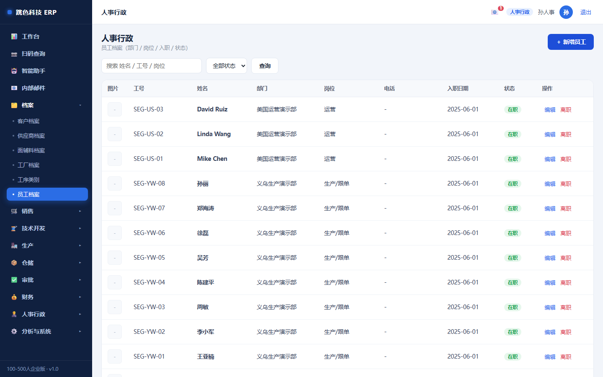
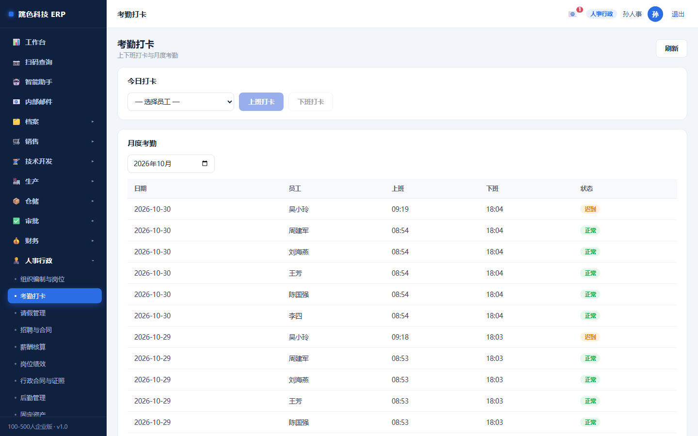
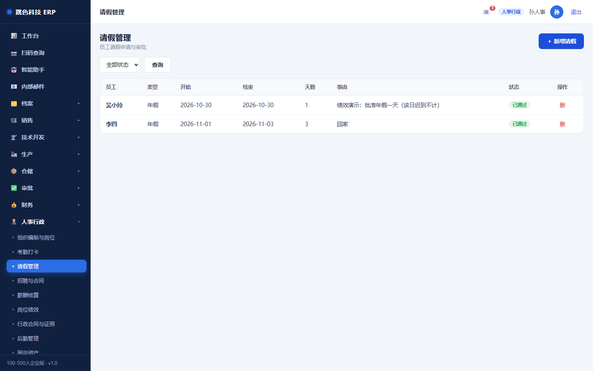
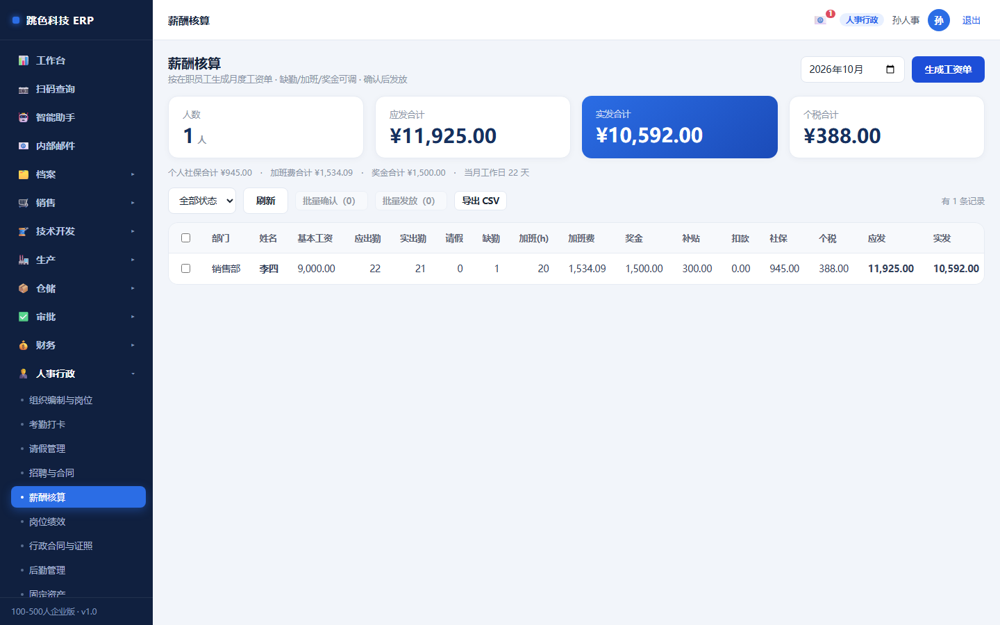
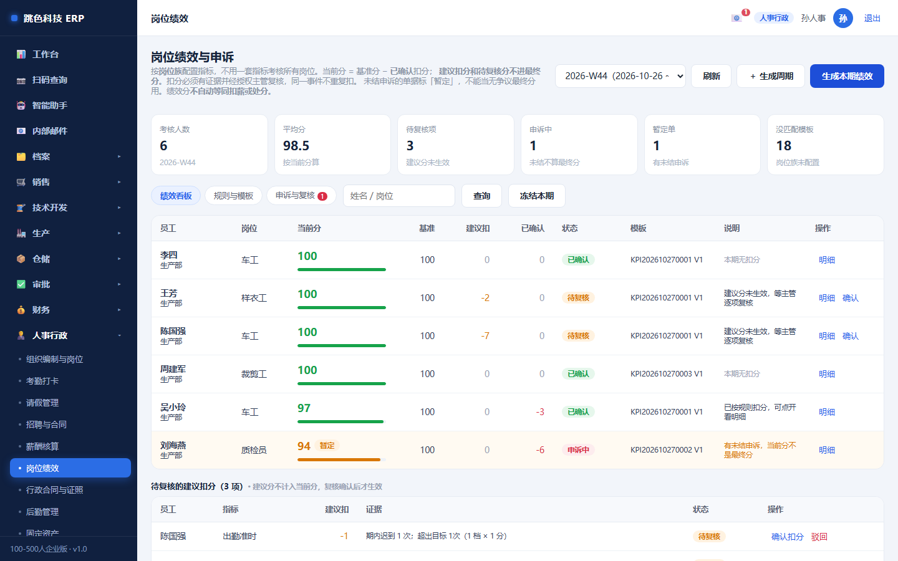
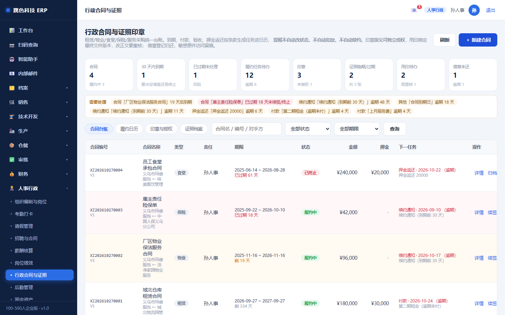
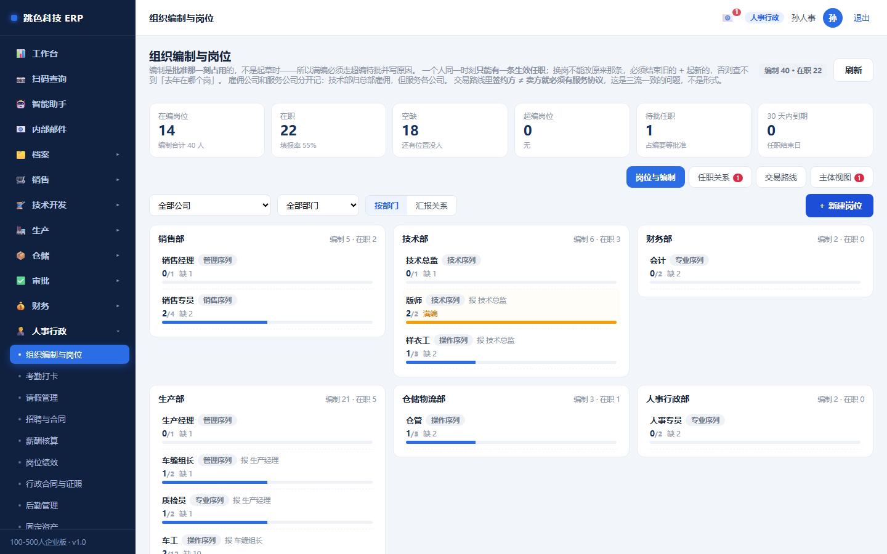

# 06 · 人事行政培训手册

> 适用岗位：人事 / 行政 / 出纳（人事职能）
> 系统权限：`hr`
> 你在系统里的职责：**员工档案、考勤、请假审批、薪酬、绩效、行政合同与用印、组织编制**

---

## 一、你的界面



⚠️ **人事岗位在系统里能看到全公司的工资和身份证号**。这是最高敏感的数据，
系统里除了你、财务、总经理和管理员，其他人（包括销售）都看不到这两列。

---

## 二、一天的节奏

| 时间 | 做什么 | 在哪 |
|---|---|---|
| 上班 | 看昨天谁的考勤异常（迟到/缺卡） | 考勤打卡 |
| 上午 | 处理请假申请 | 请假管理 |
| 随时 | 新人入职建档、离职办手续 | 员工档案 |
| 月末 | 生成薪酬 → 核对 → 确认 → 发放 | 薪酬核算 |
| 每月 | 绩效周期：生成 → 确认 → 申诉处理 | 岗位绩效 |
| 随时 | 合同到期提醒、用印审批 | 行政合同与证照 |
| 每季 | 编制与岗位调整 | 组织编制与岗位 |

---

## 三、员工档案


| 字段 | 注意 |
|---|---|
| 工号 | 建议用「部门缩写+序号」，后面所有单据都会引用 |
| 姓名 / 部门 / 岗位 | 部门决定他在绩效和审批流里的归属 |
| 入职日期 | 影响年假与司龄 |
| 身份证 / 基本工资 | **只有人事、财务、总经理、管理员看得到**，其他人看到的是空 |
| 状态 | 在职 / 离职。**离职不要删，改状态** —— 删了历史单据上的名字就没了 |

### 离职要知道的

离职后：
- 账号要停用（在「用户与角色」里，这一步是管理员做）
- 考勤与薪酬记录保留，不要删
- 编制要释放（回「组织编制」把任职结束）

---

## 四、考勤



- **打卡是本人动作**，所有在岗员工都能打，不归你代打
- 上班打卡晚于 **09:00** 记**迟到**
- 一天只有一条记录（同一天再打卡会更新，不会重复）

你要做的是**看异常**：谁没打卡、谁迟到多。异常的补录要写原因（系统有备注字段，别留空）。

---

## 五、请假



流程：

```
员工本人提交 → 人事审批 或 部门负责人审批 → 通过/驳回
```

**提交和审批是两个不同的权限**：
- 所有在岗员工都能提交自己的请假（`leave.write`）
- 审批需要人事或部门负责人（`leave.review`）

> 这条是特意拆开的。原来提交和审批共用一个权限，等于谁都能给自己批假。

审批时看三件事：日期有没有冲突、天数算得对不对、理由是否合理。驳回要写原因。

---

## 六、薪酬核算



三步走：

```
生成（按在职员工 + 基本工资 + 考勤/绩效扣款）
   ↓
核对（逐个看，有异议先改）
   ↓
确认 → 发放
```

| 规则 | 说明 |
|---|---|
| **读取也限岗** | 工资表只有人事、财务、总经理、管理员能看，销售看不到 |
| 一个月一个期间 | 同期只能有一批 |
| 确认后不能随便改 | 要改先撤回或冲销，留痕 |
| 发放记录 | 发放日期与方式是凭证依据 |

⚠️ **薪酬算错不要直接改库**。改了没人知道改过什么。用「作废 + 重算」或补差调整。

---

## 七、岗位绩效



| 概念 | 说明 |
|---|---|
| **模板版本化** | 指标规则改了要发新版本，旧版本的历史评分不变 |
| **建议分 ≠ 确认分** | 系统按数据算建议分，确认分由人定，两个数都留着 |
| **周期冻结** | 周期冻结后不能再改分 |
| **申诉独立复核** | 员工申诉由**另一个人**复核，不能让原评分人自己判 |

绩效指标规则要写清：指标、权重、数据来源、封顶分。**没有数据来源的指标等于拍脑袋**。

---

## 八、行政合同与用印



### 合同

- 合同有**版本**：改了要发新版本，旧版本留着
- **到期提醒**：到期前会进日历，别等过期才发现
- 续签 / 终止 / 归档各有状态，归档后只读

### 用印（最需要规矩的一块）

```
申请用印 → 审批 → 用印 → 归还（借出的章）
```

| 规则 | 说明 |
|---|---|
| **印章按公司独立授权** | A 公司的章不能给 B 公司用 |
| **授权有期限** | 到期自动失效，不能长期放开 |
| **借章必须归还** | 借出记录挂在你名下，没归还会一直提醒 |
| **访问留痕** | 谁在什么时候用了哪个章，都有记录 |

⚠️ **不要让别人的账号替你申请用印**。记录里是谁的账号就是谁的责任。

---

## 九、组织编制与岗位



- **岗位**：公司有哪些岗、属于哪个部门
- **编制**：每个岗几个人
- **任职**：谁在哪个岗上，占一个编制
- **占编规则**：任职批准时才占编，草稿不占

调整编制要走审批（`org.approve` 是财务/总经办的口），不是人事自己批。

---

## 十、为什么有些按钮点不了

| 现象 | 原因 | 解决 |
|---|---|---|
| 看不到身份证 / 基本工资 | 你的账号不是人事/财务岗 | 找管理员确认岗位 |
| 打不了卡 | 你选的员工不是本人 | 打卡只能打自己的 |
| 批不了假 | 你没有审批权限 | 人事或部门负责人才能批 |
| 薪酬打不开 | 读取限岗 | 找管理员确认岗位 |
| 绩效周期改不了 | 已冻结 | 冻结后不能改，走申诉 |
| 用印申请被拒 | 没有该公司的授权 / 授权过期 | 看授权记录，找管理员 |

---

## 十一、常见问题

**Q：新人第一天要做什么？**
① 员工档案建档 ② 组织编制里登记任职（占编） ③ 让管理员建账号并给岗位 ④ 合同登记。四步都做完，他才能打卡和进系统。

**Q：员工说工资少了，怎么查？**
看薪酬明细：基本工资 + 考勤扣款 + 绩效扣款。扣款都能点到来源（迟到几次、绩效哪项扣分）。

**Q：离职员工还能看到他以前的记录吗？**
能。状态改成离职，记录全留着。**不要删员工**。

**Q：请假审批该谁批？**
人事或部门负责人。跨部门的、超过一定天数的，建议走审批流（在「审批流配置」里设）。

**Q：我能看到销售的工资，销售能看到我的吗？**
看不到。反过来，销售连工资表都打不开。这是按岗位控制的，不是按级别。
