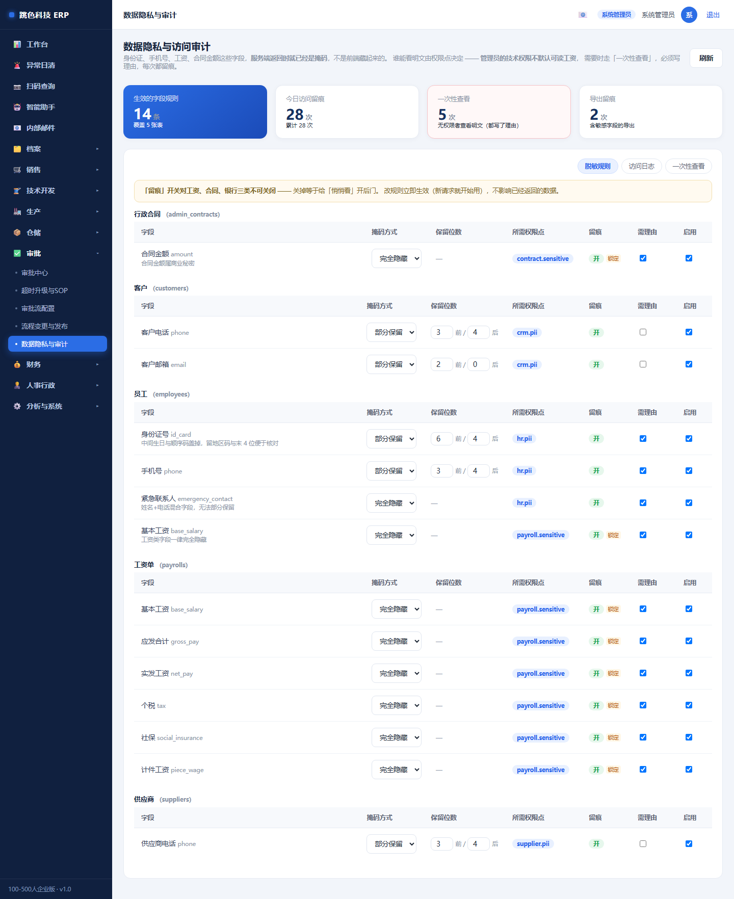
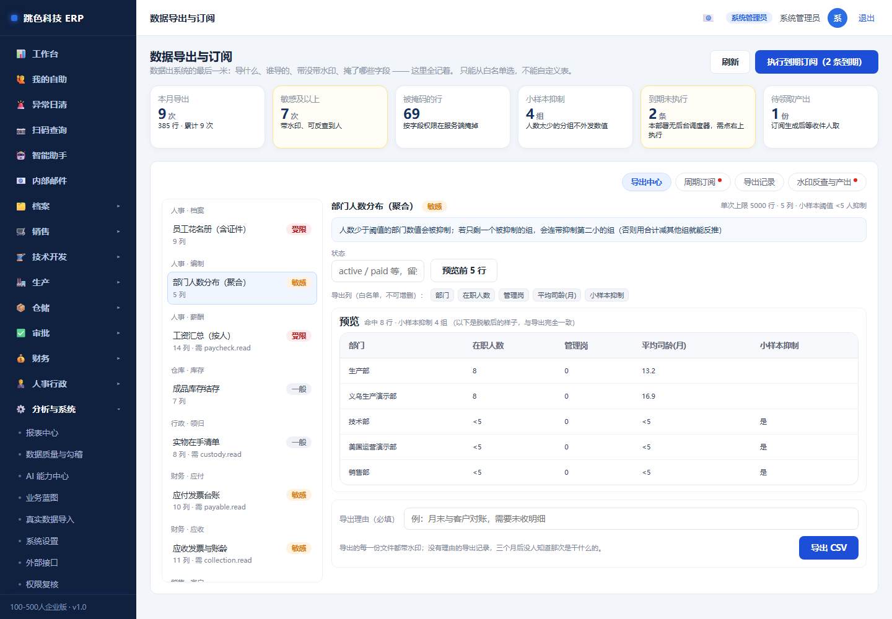
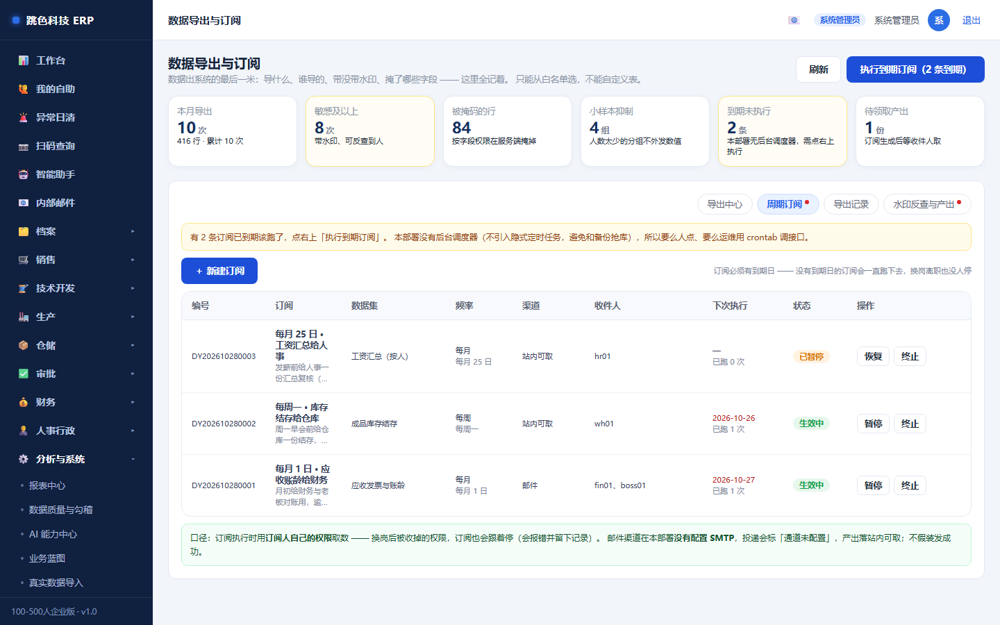
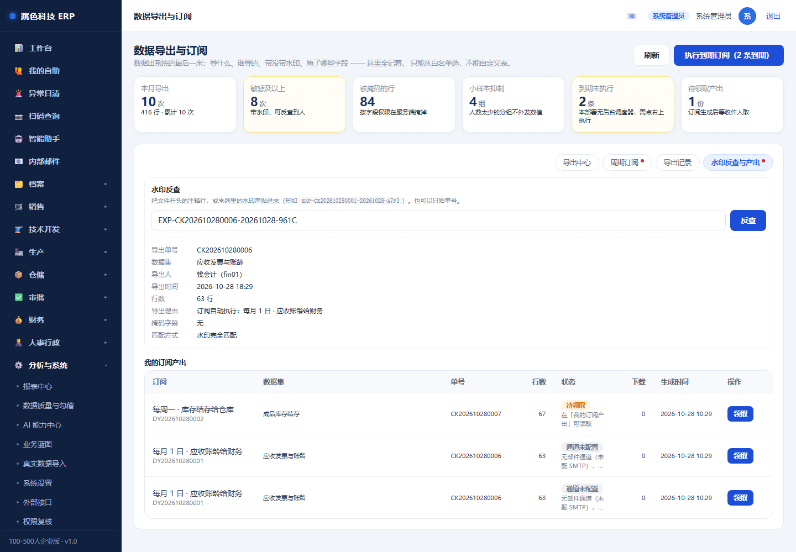

# 07 · 系统管理员培训手册

> 适用岗位：系统管理员 / IT
> 系统权限：`admin`
> 你在系统里的职责：**账号与权限、权限复核、备份与恢复、数据导入、操作日志、系统设置**
> 一句话：**你不做业务，你保证别人能安全地做业务。**

---

## 一、你的界面


你看到的是全部菜单。但要记住：**admin 的每个动作都记在日志里，而且 admin 的日志最没人查** ——
所以能不用 admin 干的活，就不要用 admin 干。

---

## 二、上线期要做的事（按顺序）

| 步骤 | 做什么 | 在哪 |
|---|---|---|
| 1 | 改 admin 密码、改 `JWT_SECRET` | 首次登录 / `.env` |
| 2 | 按真实岗位建账号，一个主岗 | 用户与角色 |
| 3 | 停用所有演示账号（sales01 / tech01 / …） | 用户与角色 |
| 4 | 导入真实主数据（客户、供应商、面辅料、产品、SKU、期初库存） | 真实数据导入 |
| 5 | 按岗位复核一遍权限，收回不该有的 | 权限复核 |
| 6 | 做一次备份 + 跑一次恢复演练 | 备份与恢复 |
| 7 | 挂每日定时备份任务 | 系统计划任务 |
| 8 | 打印各岗位手册发下去 | docs/manual |

---

## 三、账号与角色


### 八个岗位

| 岗位 | 能做什么 | 不能做什么 |
|---|---|---|
| `admin` 系统管理员 | 全部 | —— |
| `boss` 总经理 | **只能看**，没有任何录入权限 | 不能改业务数据（要签字走审批流） |
| `sales` 销售跟单 | 接单、报价、客户、开发单发起 | 不能改工艺、报工、库存、工资 |
| `tech` 技术打版 | 开发单、工艺、面辅料、技术复审 | 不能下单、不能动库存 |
| `production` 生产车间 | 工序、报工、首件、排程、裁片外发 | 不能改库存余额、不能定价 |
| `warehouse` 仓库采购 | 采购、收货、备料、库存、美仓 | 不能改工艺、不能审成本 |
| `finance` 财务 | 成本审核、往来、总账、税票、预算 | 不能改工艺、不能报工 |
| `hr` 人事行政 | 员工、考勤、请假、薪酬、绩效、用印 | 不能下单、不能动库存 |

### 建账号的三条规矩

1. **一个人一个账号，只给一个主岗** —— 兼岗用「附加岗」，不要给 admin
2. **离职先停用，不要删** —— 删了单据上的名字就没了
3. **同名不同人**要加后缀区分（如 `zhangsan01` / `zhangsan02`）

### 一人多岗

主岗 + 附加岗，权限取**并集**。典型场景：生产主管兼管仓库 = `production` + `warehouse`。

---

## 四、权限复核（上线前必做一次）


这一页回答三个问题：每个岗位能点什么、某个人跟同岗位差在哪、有没有人同时握着本该分开的两件事。

### 四个页签

| 页签 | 看什么 |
|---|---|
| **岗位矩阵** | 94 个权限点 × 8 个岗位，带「核」的表示在后端也拦 |
| **账号复核** | 每个账号的生效权限 + 与同岗位的差异 + 附加岗 |
| **职责分离** | 10 条规则，谁同时握着两端 |
| **复核记录** | 签字留痕（账号数 / 例外明细 / 冲突数快照） |

### 收回权限

对某个账号的某个权限点设「收回」，**必须写理由**（不填存不了）。

理由要写到「半年后别人能看懂」的程度：

- ✅ `试用期未满，导出客户数据需主管审批`
- ❌ `不需要`

收回是**双层生效**的：前端按钮消失 + 后端直接拒绝（改钱/库存/人事/权限/对外导出这 32 条高危动作）。

### 职责分离

10 条规则（下单↔审成本、采购↔收货、收货↔质检、发料↔盘点、定价↔成本、银行↔总账、排程生成↔发布、授权↔审计、选供方↔评供方、薪酬↔总账）。

**它是提示不是禁止** —— 小企业一个人干两份是常态。做法是识别 + 留痕 + 补偿性控制（每条规则都给了建议）。
系统管理员不参与计算（admin 恒通过，算进去会让 10 条全红，真正的问题反而被淹没）。

---

## 五、备份与恢复


### 备份

- 点「立即备份」→ 服务端生成，**记录 sha256 / 表数 / 行数 / 校验结果**
- 落盘 `backend/data/backups/`，不依赖有没有人点下载
- 保留策略：手动 30 份、恢复前自动 10 份、定时 15 份
- 页面顶部会告警：超过 24 小时没备份变黄，超过 7 天变红

### 定时备份（必须挂）

```bash
ADMIN_PASS=你的密码 node scripts/backup-cron.js
```

挂到 Windows 任务计划 / Linux crontab，建议每天 02:00。退出码非 0 说明失败，可以让计划任务发告警。

### 恢复（三步，每步都能反悔）

| 步骤 | 做什么 | 能反悔吗 |
|---|---|---|
| **准备** | 校验文件 → **自动备份当前库** → 写待恢复文件 | 能，点「撤销恢复」 |
| **撤销** | 待恢复文件归档，当前库不变 | —— |
| **重启生效** | 启动时再校验 → 旧库改名留档 → 删 `-wal/-shm` → 换文件 | 能，把 `replaced/` 里的文件改回去 |

**三条不能忘的**：

1. **恢复必须重启**，因为 SQLite 已打开的连接不能安全换文件
2. **旧库不删**，在 `data/replaced/`，需要回退时改名回去
3. **校验不过就放弃恢复、继续用旧库** —— 宁可恢复失败，也不能把库弄坏

### 每季度跑一次演练

```bash
node scripts/restore-drill.js --phase prepare
# 重启后端
node scripts/restore-drill.js --phase verify
```

会生成 `docs/DRILL-REPORT.md`，留档。

---

## 六、真实数据导入


支持六类：客户 / 供应商 / 面辅料 / 产品（款）/ SKU 主档 / **期初库存**。

### 流程

```
选类型 → 下模板或粘贴 → 预览（只算不写）→ 看清每一行 → 提交
```

### 五条硬规则

| 规则 | 说明 |
|---|---|
| **默认整批事务** | 有一行错就整批不写（导一半最难收拾）。要跳过错行必须手动勾，界面标「不推荐」 |
| **期初库存只能导一次** | 已有期初流水就拒（重复导入会把库存翻倍） |
| **不覆盖真实库存** | 已有库存不为 0 时拒绝，那种情况走盘点 |
| **给了编码只认编码** | 编码查不到就是新增，**不会按同名覆盖老客户** |
| **只覆盖文件里给出的字段** | 没给的列不动，避免导一半把别的字段清空 |

---

## 七、操作日志与审计


**先记住一句**：日志只记「谁在什么时候动了什么」，**不记单据里写了什么**。
所以别指望从日志里看到「他把单价从 5 元改成 6 元」—— 那要看单据自己的修改记录。
这不是偷懒：body 里有密码、有金额，日志一旦记内容，日志本身就变成了泄密源。

### 每天扫一眼两个数

- **失败请求**（第三张卡）：401/403 突然变多，多半是有人在试不该他用的功能。
- **今日写操作**：跟平时比翻倍，就问一句「今天在批量做什么」。

### 查一条线索的顺序

1. 时间范围 + 账号 + 大类（销售/仓储/财务…）先缩小范围
2. 看「摘要」列 —— 写的是人话（「销售订单 orders#123 · 流转」），不用认 URL
3. 状态：**403 = 被权限拦了（是设计，不是 bug）**；400 = 参数不对；500 才需要技术介入
4. 「链」列的小字是该条日志的哈希，鼠标悬停看完整的

### 「校验链」是干嘛的

每条日志都带一个哈希，和上一条串成链。**改任何一条，它后面的全部对不上**。
点一次「校验链」，只有两种结果：

- 绿色「**通过**」：日志没被动过
- 红色「**断裂**」：会直接告诉你**断在第几条**，以及是「内容被改」（`HASH`）还是「记录被删」（`TAIL_SEQ` / `HEAD_GAP`）

看到红色别自己处理 —— **先截图、再找技术**。那是重大事项，改动现场会让线索消失。

> 为什么删了也能发现：系统另存了一份「水位」（最后一条的序号和哈希）。
> 删掉最后几条，链自己还是通的，但跟水位对不上 → 报「尾部缺失」。

### 要给外人（验厂 / 审计 / 投资方）看时

1. 先用筛选框卡范围（时间、大类、动作），别一导全库
2. 点「导出 CSV」
3. 这份文件开头**四行**已经写明：谁导的、什么范围、多少条、链校验是否通过、起止哈希
4. 对方较真时可以算文件的 SHA256 —— 系统在下载响应头里也给了一份（`X-Audit-File-SHA256`），对得上说明文件没被改过

### 归档（日志太多了才用）

日志量大了会拖慢查询。**归档是唯一能减少日志的办法** —— 系统没有「删除」功能，这是故意的。

- 点「归档」→ 填保留天数（**最少 30 天，低于直接拒**）→ 系统把更早的日志打成文件、算出文件哈希、登记一条归档记录，才从主表移走
- 归档文件在 `backend/data/audit-archives/`，**必须跟备份一起存**：只留库、丢了文件，归档记录就成了空头支票
- 归档之后「校验链」照样能用 —— 系统会把水位往前挪，不会把「合法归档」当成「偷偷删」

### 三条禁令

1. **不要直接改数据库里的 `audit_logs`**：改了就断链，断链之后所有日志的可信度一起没了。
2. **不要随手把导出文件发出去**：里面是全公司每个人的操作轨迹（谁在看工资、谁在改成本）。
3. **不要为了「好看」删掉失败记录**：401/403 恰恰是最该留下的一类。

---

## 八、系统设置


| 设置项 | 注意 |
|---|---|
| 汇率 | 下单时**快照**进订单，改了不影响老单 |
| 面料库 / 辅料库 | 主数据，改了影响所有引用它的开发单 |
| 尺码模板 | 下单时可一键套用 |
| 业务蓝图 | 系统内的流程说明页，给新人看 |

---

## 八·补 改审批流（流程变更与发布）

入口：左侧「审批」→「流程变更与发布」（只有管理员看得到）。

**审批流是制度，不是代码。** 所以改它不能直接改，要走变更单 —— 因为改完出问题时，你得能回答三个问题：
谁改的、改成什么样、怎么改回去。


### 四步，少一步都不许发布

| 步 | 做什么 | 不做会怎样 |
|---|---|---|
| 1. **发起变更** | 选流程 → 写标题与原因 → 改步骤（加一级 / 删一级 / 换角色） | — |
| 2. **试运行** | 系统拿**近 90 天的历史审批单**逐单对比，告诉你「多少单的审批路径会变」 | 不试运行就发布 → 系统直接拒绝 |
| 3. **发布** | 定生效日（**不能早于今天**），选在途单怎么办 | — |
| 4. **可回滚** | 发布后发现不对，一键回上一版，写原因 | 没有回滚就只能凭记忆改回去 |

### 三条门槛（系统会拦）

**1. 没试运行不许发布**
原型里写得很清楚：「所有规则改变有版本和测试证据」。系统不认「我觉得没问题」。

试运行会给你这样一份证据：

```
样本 9 单 · 路径不变 0 · 路径变化 9
财务审核 → 总经理审批   ==>   财务初审 → 成本复核 → 总经理终审
结论：超过一半的历史单审批路径会变（9/9），影响面大
```

**2. 生效日不能倒签**
不能今天发布、生效日写上周。那等于偷偷改历史 —— 上个月的审批记录会突然「不符合当时生效的流程」，出了纠纷说不清。

**3. 删关键角色必须写理由**
财务（finance）和总经理（admin）从流程里消失时，试运行会单独列出来，发布必须写清为什么可以删。
**想删可以，但删了会被记下来** —— 这就是「关键门槛不允许因加急被绕过」的落地。

### 在途单会不会跟着变？

**默认不会。**

发布时有两个选项：

| 选项 | 含义 | 什么时候用 |
|---|---|---|
| **在途单保持原版本**（默认） | 已经在走流程的单继续按老规矩走完 | 绝大多数情况 |
| 把未开始的在途单迁到新版本 | 只迁「一步都还没人批」的单 | 新流程是修 bug 而不是改规矩时 |

**已经有人批过一半的单不会被迁移** —— 迁移会把它打回起点，那是破坏不是升级。
这些单继续走旧版，系统会在影响分析里单独告诉你还有几单。

### 怎么看「这单是按哪版审的」

每张审批单在发起时就记下了当时的版本与步骤快照。流程后来改过多少次，这张单的路径都不会变。
所以「为什么这单只要两级」有据可查，不用去翻代码。

### 出问题了

| 现象 | 处理 |
|---|---|
| 发布后发现流程不对 | 在变更单上点「回滚」，写原因；只能回滚**最近一次**发布 |
| 只是草稿不想改了 | 点「作废」，写原因（不会影响生效版本） |
| 想删掉财务/总经理那一级 | 可以，但发布时要写理由，理由会进审计流水 |

---

## 八·补二 数据隐私（谁能看工资、身份证）

入口：左侧「审批」→「数据隐私与审计」（只有管理员看得到）。



**核心一句话：掩码是服务端给的，不是前端藏起来的。**
打开开发者工具、导出 CSV、调接口，看到的都是 `138****5678` 和 `***`。

### 默认谁能看到什么

| 字段 | 谁能看明文 | 其他人看到 |
|---|---|---|
| 员工身份证 / 手机 / 紧急联系人 | 人事（`hr.pii`） | `110101********1234` / `138****5678` |
| 员工基本工资、工资单所有金额 | 财务、人事（`payroll.sensitive`） | `***` |
| 客户手机 / 邮箱 | 销售、财务（`crm.pii`） | `138****0000` / `ab***@qq.com` |
| 供应商电话 | 仓库、财务（`supplier.pii`） | `139****4321` |
| 合同金额 | 财务、老板（`contract.sensitive`） | `***` |

### 注意：系统管理员也看不到工资

这不是 bug。原型明确要求「**管理员技术权限不默认可读工资**」——
技术权限和业务权限是两件事，运维能重启服务不等于能看全公司工资。

管理员要看怎么办？走「一次性查看」：

1. 在「数据隐私与审计」页点「一次性查看」
2. 选表 → 选字段 → 填记录 ID → **写理由**
3. 看到明文，同时**这次查看会进审计日志**

理由写不清（少于 6 个字）会被拒绝。这不是刁难 —— 数据安全事件里第一个被问的就是
「谁在什么时候看了谁的身份证」。

### 改了会怎样

规则页可以直接改掩码方式与所需权限点，**立即生效**（下一个请求就用新规则）。

但有一条改不动：**工资、合同、银行三类的「留痕」开关**。
页面上那个开关会一直显示「开 · 锁定」，谁都关不掉 —— 关掉等于给「悄悄看」开后门。

### 怎么查「谁看过什么」

「访问日志」页按时间倒序，每条记录：

| 列 | 含义 |
|---|---|
| 账号 / 角色 | 谁看的 |
| 表.字段 | 看了什么 |
| 动作 | 列表查看 / 一次性查看 / 导出 |
| 授权 | **有权限**（本来就该看到） / **申请查看**（写理由才看到的） |
| 条数 | 一次看了几条（列表级只记一条，不逐行记） |
| 理由 | 申请查看时写的理由 |

「有权限」和「申请查看」一定要分开看：前者是正常工作，后者才是需要关注的。

---

## 八·补三 数据导出与订阅（每一次导出都留痕）

入口：左侧「系统设置」→「数据导出与订阅」。

这一页管的是**数据离开系统的最后一米**。页面上的字段权限只保护「看得见的部分」——
导出的文件一旦落到别人电脑里，系统就管不到了。所以导出必须留痕、必须带水印。



### 只能从白名单里选，不能自定义

能导的就那 9 个数据集：应收账龄、应付台账、客户档案、工资汇总、员工花名册、成品库存、
订单清单、实物在手、部门人数分布。

**没有「选表 / 写 SQL / 自定义列」这样的入口**，这是故意的。开放自由导出的最后结果，
是有人把整张 `users` 表导走，而这件事在日志里看起来完全正常。

每个数据集还有自己的权限要求（工资要薪酬权限、应收要应收权限），
所以「能进这个页面」不等于「什么都能导」。

### 导之前先看一眼：预览与你的权限

选好数据集点「预览前 5 行」，看到的就是**导出后的样子**——脱敏、抑制都和导出完全一致。

如果预览标题旁边出现黄色提示「其中 phone、email 会按字段权限掩码」，
说明这些列在文件里是空的。**不是系统坏了**，是你没有看明文的权限。

### 水印：文件被转手了能查到是谁导的

每一次导出都会生成一个水印串，形如：

```
EXP-CK202610280001-20261028-A7F3
```

它出现在两个地方：

1. 文件开头的说明行（导出人、时间、理由、水印）
2. **敏感数据集的每一行最后那一列**

第二个位置很关键：首行只有在完整文件里才有效；截图、复制几行、拍成照片都会丢掉首行，
末列水印是「被截断之后仍然能追」的那一手。

拿到一份来路不明的文件，回到这一页最下面「水印反查」，把水印串贴进去，就能看到
**谁、什么时候、导了什么、为什么导**。

> 没有审计权限的人反查水印，只能确认「有这么一次导出」，看不到是谁 ——
> 「谁在查什么数据」本身也是情报。

### 小样本抑制：人太少的部门不报数

「部门人数分布」是聚合数据。人数少于 5 的分组，数值会显示成 `<5`。

而且如果只有一个组被抑制，系统会**连带把第二小的组也抑制掉** ——
因为「总数减掉其他组」就等于那一个组，只抑制一个等于公开。

这就是为什么页面上会出现两三个 `<5`：不是算错了，是防反推。

### 订阅：把「每月手动导一次」变成自动



建订阅要填清五件事：**数据集、频率、收件人、生效期、用途**。三条硬规则：

1. **必须有到期日**，最长两年。没有到期日的订阅会一直跑下去，换岗离职也没人停 ——
   这是数据外流最常见的形态。
2. **收件人必须是真实账号**。写错一个人的用户名，产出没人领，而系统以为发到了。
3. **执行时按订阅人当前的权限取数**。这个人被调岗、权限收掉了，订阅当场报错并留记录 ——
   不能靠「以前建过」绕过权限。

到期执行：本部署**没有后台调度器**（不引入隐式定时任务，避免和备份抢库），
所以要么每天有人点一下右上「执行到期订阅」，要么请运维用 crontab 每天调一次接口。
同一天重复点不会重复产出。

### 「发出去了」和「邮件发出去了」是两件事

订阅的渠道有两种：**站内可取**（真的可用）和**邮件**（本部署没有配 SMTP）。

选了邮件的话，投递状态会显示「通道未配置」，产出照样放进收件人的「我的订阅产出」，
让他自己领了转发。**系统不会假装发成功** —— 假装成功比不发更糟：
收件人以为没收到，数据其实在库里等着被谁点走。



### 谁能看到「谁导了什么」

- **普通岗位**：只看得到自己的导出记录。别人的导出记录是「谁在找什么数据」的信息，不外露。
- **人事 / 财务 / 管理员**：能看全部记录、能反查任意水印、能替人领取产出。

### 三条别做错的事

1. **不要把导出的文件随手丢在共享盘**。文件里有水印，追得到你；但泄漏已经发生了。
2. **不要为了「方便」要求开发加个「导出全量客户」的按钮**。真需要，就走数据集参数缩小范围。
3. **不要用别人的账号导出**。记录里是那个人的名字，出事他担。

---

## 八·补四 演示数据体检与清库（上线前必做一次）

系统里有一类数据看起来像真数据、其实是测试留下的：单号正常、金额正常、就是内容不对。
最典型的是**研发立项里一排 `SMOKE-744441`**、**SKU 档案里一半是 `SMK-744441-A-3T`**。

体检工具在做三件事：找出来、说清能不能删、删完证明干净了。

```bash
cd backend
npm run audit:data      # 只体检，不改数据
npm run clean:data      # 清「烟测夹具」（自动先备份）
npm run verify:data     # 清完校验：残留归零 + 孤儿检查
```

### 三档分类：为什么不是「一键全删」

| 档 | 是什么 | 怎么处理 |
|---|---|---|
| **烟测夹具** | 单号/款号/名字**以** `SMOKE`、`SMK-`、`烟测`、`冒烟` **开头** | 默认清理 |
| **演示数据** | 有 `demo_tag` 标记 | 演示库保留（交付前用 `--with-demo` 清） |
| **疑似** | 只是**备注里提到**烟测 | **只报告，不动** |

第三档是关键：一张真实领料单的备注可能写着「参考烟测数据补录」，按备注删就会把真单据删了。
所以判定只看**单号/编码/名称**这些能代表整行身份的列。

### 财务类为什么不自动删

应收、应付、凭证、工资这几张表，删一行就改动账面数字。正确做法是**冲销或作废**，不是删除 ——
直接删会让「总账和业务账对不上」这件事失去线索。

所以它们默认跳过，报告里会把金额标出来（本次 ¥210,700），要你看过之后加 `--include-finance` 才执行。

### 删之前会做什么

1. **先整库备份**到 `packages/clean-backup-*.db` —— 删错了能退回去
2. **按引用关系排顺序**：先删子表再删父表（这个库没有外键，顺序错了会留孤儿）
3. **删后对账**：订单数、订单金额、库存总量、凭证数、借贷合计必须**保持不变**；
   变了说明误删了真实业务，立刻回滚
4. **孤儿检查**：有没有子表行指着已经删掉的父行

### 什么时候跑

- **上线交付前**必跑一次（`--with-demo` 把演示数据也清掉，给客户一个干净库）
- **每次升级/导入数据后**跑一次 `npm run audit:data`，看有没有新残留
- 冒烟测试**每次跑完会自己清并自检**，跑完最后一行若是
  `★ 冒烟跑完库里没有烟测残留（L1 = 0）` 就是干净的

### 一条别做错的事

**不要手工 `DELETE` 干净这些数据**。你以为只删一行，实际上那张单下面还挂着明细、流水、凭证；
这个库没有外键约束，删错了不会报错，只会在三个月后对账时冒出来。

---

## 九、出问题了怎么查（管理员专用）

| 现象 | 先查 | 再看 |
|---|---|---|
| 某人点了没反应 | 按钮有没有出现（权限） | 后端 403 日志（权限被拒） |
| 单据状态推不动 | 状态机是否允许 | 硬门槛（评审 / 技术 / 财务） |
| 数字对不上 | 数据健康检查（备份页） | 库存流水 / 凭证分录 |
| 页面报错 | 浏览器控制台 | 后端日志（`node src/server.js` 的终端输出） |
| 系统慢 | 表数量与行数（备份页的统计） | 是否有超长列表没分页 |

### 常用检查命令

```bash
cd backend
npm run smoke                    # 冒烟 1291 项
node scripts/rbac-audit.js       # 权限矩阵一致性（819 接口 / 0 问题）
node scripts/fix-orphan-gl.js    # 总账孤儿分录（只读，加 --apply 才删）
node scripts/fix-stock-baseline.js  # 库存与流水对齐（只读，加 --apply 才补）
```

---

## 十、常见问题

**Q：给某人加了个权限，他没变化？**
权限有 20 秒缓存，让他刷新页面或重新登录。

**Q：改了岗位，用户还是老权限？**
主岗改了要**重新登录**（JWT 里带的是登录时的主岗）。附加岗与例外是实时读的。

**Q：能不能给老板开个 admin 账号？**
不建议。老板要的是「能看」，用 `boss` 岗位（0 个写权限）。admin 账号每个动作都记在他名下，等于没有审计。

**Q：备份文件能拷到 U 盘吗？**
能，但注意里面是全公司数据（含工资、成本、客户）。拷出去要有登记，别随手放。

**Q：恢复会不会丢数据？**
会。恢复到备份那一刻，之后的数据都会消失。所以**恢复前系统会自动备份当前库**，还有 `replaced/` 里的旧库 —— 但那都是补救，恢复前先想清楚。

**Q：怎么知道系统有没有被人乱改？**
看操作日志 + 权限复核的「例外」列表。异常的时间点（半夜）、异常的路径（不该他用的模块）要留意。
