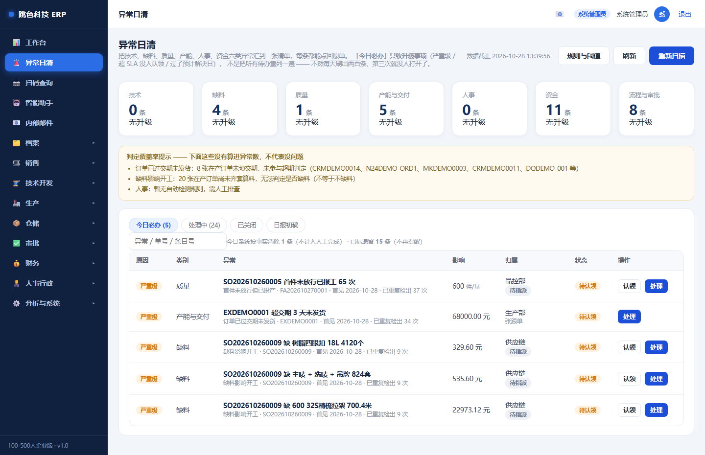
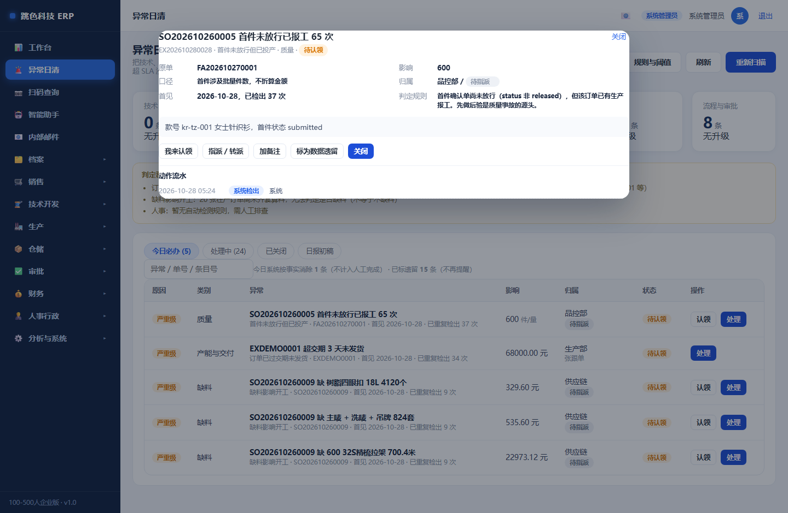
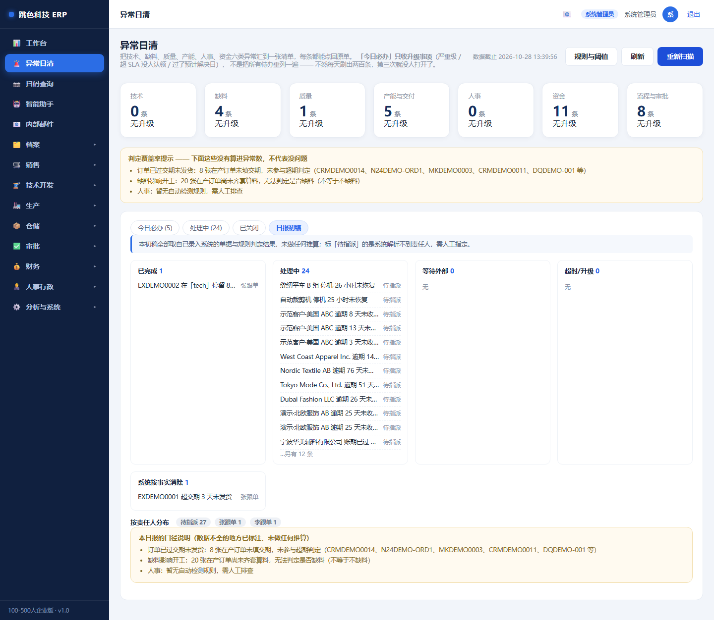

# 08 · 异常协同与日清培训手册

> 适用岗位：**全体员工**（技术 / 供应链 / 品控 / 生产 / 财务 / 人事 / 销售 / 总经办）
> 入口：左侧菜单「🚨 异常日清」，就在「工作台」下面
> 你在系统里的职责：**每天把自己归口的那几件事清掉，并写清「为什么」和「怎么解决的」**

---

## 一、这个页面是干什么的

一句话：**系统里所有「该有人管但还没人管」的事，都汇总到这一页。**

在这之前，异常是散的：

| 异常 | 原本在哪 |
|---|---|
| 订单过交期没发货 | 订单详情里的红色标签 |
| 缺料 | 齐套与缺料 |
| 首件没放行就报工了 | 首件确认 |
| 验货不合格 | 质量与合规 |
| 设备停机 | 设备与产能 |
| 应收逾期 | 应收催收 |
| 审批超时 | 审批中心 |

每个模块都有提醒，**但没有一张清单告诉你「今天该管哪几件」**。结果是每天看到一堆红点，一个都不点。

---

## 二、一天的节奏

| 时间 | 做什么 |
|---|---|
| 上班第一件事 | 打开「异常日清」，看顶部七个归口卡片有没有自己部门的数字 |
| 先看「今日必办」 | 只有**严重级**、**超时没人认领**、**过了预计解决日**的才在这里 —— 这是今天必须清的 |
| 认领自己能办的 | 点「认领」，这条就归你了（别人再点会提示「已由 XXX 认领」） |
| 自己办不了的 | 点「指派 / 转派」，**必须写原因**（至少 4 个字）。系统会记下什么时候从谁手上转给了谁 |
| 下班前 | 办完的点「关闭」，**原因和处理结果都要写**；没办完的填「预计解决日」 |
| 周一 | 看「日报初稿」，直接拿去做周会材料 |

---

## 三、七个归口，各管一段

| 归口 | 谁负责 | 典型异常 |
|---|---|---|
| 技术 | 技术部 | 定制单没有已确认技术包就往下走了 |
| 缺料 | 供应链 | 齐套算料净缺口 > 0、采购超到货日 |
| 质量 | 品控部 | 首件未放行已报工、验货不合格未处置 |
| 产能与交付 | 生产部 | 订单过交期未发货、卡在同一状态、设备停机超 24 小时 |
| 人事 | 人事行政 | 暂无自动检测规则，需人工排查 |
| 资金 | 财务部 | 应收逾期、应付过账期 |
| 流程与审批 | 总经办 | 审批超时（**只提醒，不自动通过**） |

**注意看「判定覆盖率提示」那一条黄色框**：它告诉你哪些异常**没算进去**。

比如「8 张在产订单未填交期，未参与超期判定」—— 意思是这 8 张单**不一定是准时的**，
只是系统没法判断。看到这句，正确动作是去把那 8 张单的交期补上，而不是当它没问题。

---

## 四、为什么有些单不在「今日必办」里

这是设计如此，不是漏了。

**日清只处理升级事项**：

- 严重级（过交期、缺料、首件未放行、验货不合格、无技术包）
- 超 SLA 还没人认领
- 过了「预计解决日」还没关

普通级、且今天刚出现、还在时限内的，都在**「处理中」**那一页。
如果全部塞进「必办」，第一天 25 条、第三天 200 条，之后没人再打开它。

---

## 五、关键操作

### 5.1 认领

点「认领」。认领之后这条就在你名下，别人不能再抢。

> 已经被别人认领的，点认领会提示「已由 XXX 认领」。要接手请让对方**转派**给你，
> 或者找管理员改派 —— 系统不允许两个人同时负责同一件事。

### 5.2 关闭（原因 + 结果都要写）

两个输入框**都要填，各至少 4 个字**：

| 字段 | 填什么 | 例子 |
|---|---|---|
| **原因**（为什么会发生） | 根因，不是现象 | 「技术确认卡在面料成分复核」 |
| **处理结果**（怎么解决的） | 具体动作 | 「已补成分检测报告，技术今日确认放行」 |

为什么要两个都填：**月度复盘看「原因」，追责看「结果」**。
只填一个的话，下个月同类问题照样发生，没人知道根因。

关闭之后状态变成「已关闭 · 待复核」，等主管复核。**复核人不能是处理人本人**。

### 5.3 标为数据遗留（不再提醒）

有些异常是**历史遗留**，永远不会清掉：

- 系统迁移带进来的老单据
- 演示/测试期间产生的夹具单
- 已经确认「这条不适用」的事实

对这类，点「标为数据遗留」，**必须写理由**，可以选择：
- **不填到期日** = 永久不再提醒
- **填到期日** = 到期后自动重新检出（临时豁免要能自动失效）

标为遗留**不是「当它没发生」**：

- 状态单独记成「已忽略」，不算你处理完成
- 页面顶部会显示「已标遗留 N 条（不再提醒）」，随时能看见被压住了多少
- 重新扫描时，「被压住 N 条」会出现在扫描结果里 —— 不静默

### 5.4 系统自动消除（不用你操作）

如果事实自己消失了（比如订单发货了，超期异常自然不该存在），系统会自动标成
**「已自动消除」**，并且写明「本次扫描未再检出该事实，由系统按事实自动消除」。

**它不算人工完成** —— 日报里的「已完成」只统计人关掉的。所以月底的「异常处理率」不会被虚高。

---

## 六、日报初稿

点「日报初稿」这一页，直接给你一份能用的日报：

| 分区 | 内容 |
|---|---|
| 已完成 | 今天人关掉的（带处理人和结果） |
| 处理中 | 有人认领、还在办 |
| 等待外部 | 状态是「等外部」的（等供应商、等客户） |
| 超时/升级 | 已升级的（这部分是重点） |
| 系统按事实消除 | 事实消失自动消掉的（不算人工完成） |
| 按责任人分布 | 谁手上堆了多少件 |

页面上那句「本初稿全部取自已录入系统的单据与规则判定结果，未做任何推算」
是认真的：**没有一个数字是生成的**。系统里没填的就是没填，不会补 0。

---

## 七、常见问题

**Q：我看到一条异常，但我觉得判断错了。**
A：点开详情看「判定规则」那一栏，写清了这条是怎么判出来的。如果确实是规则不合适，
找管理员在「规则与阈值」里改阈值或停用那条规则（改完下次扫描生效，不影响已有条目）。

**Q：这条我已经处理了，为什么还在？**
A：两个可能：① 业务单据没改（系统只看事实，不看你的说法）；② 你只加了备注没点「关闭」。
备注不改状态。

**Q：能不能批量关闭？**
A：不能。每条都要写原因和结果。批量关闭等于没人看过。「标为数据遗留」可以批量用在
确实同类的历史数据上，但也要写理由。

**Q：我会不会被扣钱？**
A：不会。**预警升级不等于自动处罚。** 采购超额、系统风险、待核费用都不会自动认定失职，
不直接扣绩效或工资。清单只是让事情有人管，不是用来罚人的。

**Q：人事那一类为什么一条都没有？**
A：人事类暂时还没有自动检测规则（考勤、请假这类异常还在各自模块里）。页面上的
覆盖率提示会明说「人事：暂无自动检测规则，需人工排查」—— 显示 0 条不代表没问题。

---

## 八、给管理员：规则与阈值

点右上角「规则与阈值」，能改每一条的：

| 字段 | 说明 |
|---|---|
| 阈值 | 订单卡几天算超时、停机几小时算超时、应收逾期几天算逾期 |
| SLA(小时) | 多久没人认领就升级 |
| 启用 | 停用后该规则不再扫描（已有条目不会被自动消除） |

**改阈值不追溯**：已经生成的条目按原来的判定留着，新阈值只影响下一次扫描。
